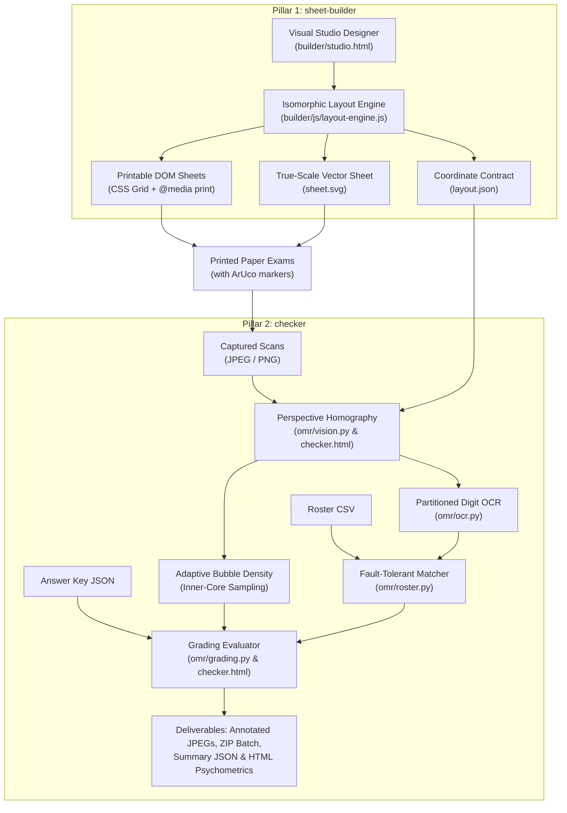
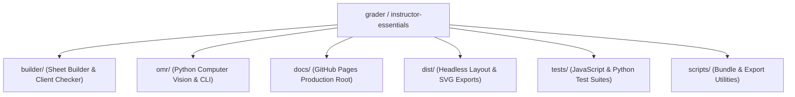
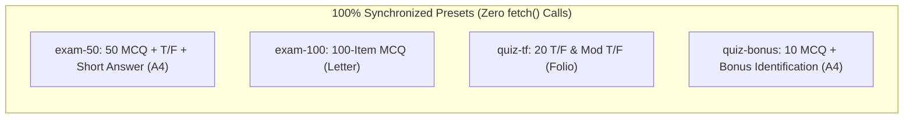
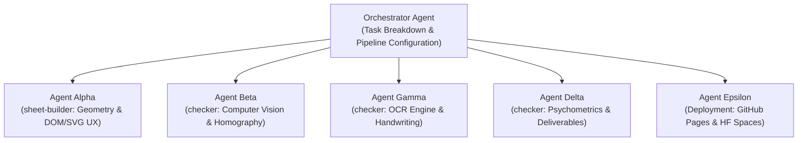

# Engineering Decisions & Architecture Specification (`grader`)

> **Project Name**: `grader` (Instructor Essentials)  
> **Last Updated**: October 2026  
> **Intended Audience**: Software Engineers, Computer Vision Researchers, and Autonomous AI Pair Programmers.  
> **Canonical Status**: This is the **single, authoritative decisions document** for the repository.

> **Project perspective:** This is an instructor-led project. The maintainer brings classroom experience and knows the practical needs the tool should address, but does not claim specialist expertise in software engineering, computer vision, OCR, or psychometrics. The architecture and decisions below describe the current implementation and its rationale; they are not a claim that every method is the only or academically validated approach. Explain assumptions in plain language and validate engine or assessment-related claims against evidence where possible. See [`AGENTS.md`](AGENTS.md) for guidance to AI coding agents and [`ROADMAP.md`](ROADMAP.md) for proposed improvements.

---

## 1. Executive Summary & Two-Pillar Philosophy

`grader` is an end-to-end, zero-cost, millimeter-accurate Optical Mark Recognition (OMR) and document assessment system operating on standard camera photos and flatbed scanner images (JPEG, PNG).

The system eliminates traditional OMR friction (expensive proprietary hardware, pre-printed lithographic forms, and brittle pixel-coordinate models) by partitioning responsibilities into two robust pillars:



1. **`sheet-builder` (Frontend Designer & Layout Engine)**:
   - Zero-dependency client-side web application.
   - Fluid drag-and-drop exam designer with live millimeter page preview, property inspector controls, and automated answer-key generator.
   - Runs in any browser or standalone as a single local file ([`builder/studio.html`](file:///Users/philsumabat/coding-projects/grader/builder/studio.html)) with zero internet connection or server required (zero-CORS).
   - Hosted with zero backend server on GitHub Pages ([`docs/index.html`](file:///Users/philsumabat/coding-projects/grader/docs/index.html)).

2. **`checker` (Computer Vision OMR Pipeline & Assessment Engine)**:
   - **Client-Side Checker Studio** ([`builder/checker.html`](file:///Users/philsumabat/coding-projects/grader/builder/checker.html) / [`docs/checker.html`](file:///Users/philsumabat/coding-projects/grader/docs/checker.html)): Standalone in-browser OpenCV-style grading app with 100% inlined homography rectification, bubble density scoring, psychometrics, annotated JPEG downloads, and zero-dependency inlined ZIP export.
   - **High-Throughput Python Pipeline** (`omr/`): Batch grading CLI runner (`./grader`, `python -m omr`) with PyTesseract OCR, wildcard roster matching, and Jinja2 psychometric reports.
   - **Cloud Web Application**: Hugging Face Spaces Gradio 4.44.0 app in `spaces/exam-checker/`.

---

## 2. Architecture & File Structure



### `sheet-builder` (Frontend Designer & Renderers)
- [`builder/css/app.css`](file:///Users/philsumabat/coding-projects/grader/builder/css/app.css) — Builder UI styles, control palette, and floating toolbar styling.
- [`builder/css/sheet.css`](file:///Users/philsumabat/coding-projects/grader/builder/css/sheet.css) — Millimetric CSS Grid rules and `@media print` directives.
- [`builder/index.html`](file:///Users/philsumabat/coding-projects/grader/builder/index.html) — Modular developer editor with live preview.
- [`builder/studio.html`](file:///Users/philsumabat/coding-projects/grader/builder/studio.html) — Zero-dependency, standalone single-file production studio (zero-CORS).
- [`builder/checker.html`](file:///Users/philsumabat/coding-projects/grader/builder/checker.html) — Standalone in-browser OMR grading studio with JPEG/ZIP export.
- [`builder/js/app.js`](file:///Users/philsumabat/coding-projects/grader/builder/js/app.js) — UI controller, drag-and-drop state, and library actions.
- [`builder/js/aruco.js`](file:///Users/philsumabat/coding-projects/grader/builder/js/aruco.js) — Native OpenCV `DICT_4X4_50` marker bit patterns (IDs 0–3).
- [`builder/js/layout-engine.js`](file:///Users/philsumabat/coding-projects/grader/builder/js/layout-engine.js) — Isomorphic geometry engine (computes resolved mm coordinates).
- [`builder/js/render-dom.js`](file:///Users/philsumabat/coding-projects/grader/builder/js/render-dom.js) — DOM / CSS Grid renderer for physical printing.
- [`builder/js/render-svg.js`](file:///Users/philsumabat/coding-projects/grader/builder/js/render-svg.js) — True-scale Scalable Vector Graphic (SVG) generator.
- [`builder/js/templates.js`](file:///Users/philsumabat/coding-projects/grader/builder/js/templates.js) — Inlined sample templates for offline execution.
- [`builder/templates/`](file:///Users/philsumabat/coding-projects/grader/builder/templates/) — Canonical exam template definitions:
  - `blank.json` (Blank Sheet with Corner Markers, Folio)
  - `exam-50.json` (50 MCQ + T/F + Short Answer, A4)
  - `exam-100.json` (100 MCQ + 8-digit Student ID, Letter)
  - `quiz-tf.json` (20 Simple T/F + 10 Modified T/F + Essay, Folio)
  - `quiz-bonus.json` (10 MCQ + 5 pt Bonus Identification, A4)

### `checker` (Python CV, OCR & Grading Pipeline)
- `omr/__main__.py` — Entrypoint for `python -m omr` execution.
- `omr/annotator.py` — Superimposes visual grading feedback (OpenCV derivative JPEGs).
- `omr/cli.py` — CLI command processor registered as `grader`.
- `omr/grading.py` — Evaluates responses against JSON key (MCQ, TF, fuzzy text).
- `omr/layout.py` — Typed loader and coordinate queries for `layout.json`.
- `omr/ocr.py` — Image preprocessing and PyTesseract partitioned OCR extraction.
- `omr/pipeline.py` — End-to-end batch processing pipeline orchestrator.
- `omr/report.py` — Psychometrics calculator and Jinja2 HTML report generator.
- `omr/roster.py` — CSV roster ingestion and fault-tolerant student ID matcher.
- `omr/simulator.py` — Test scanner generator synthesizing realistic scan JPEGs.
- `omr/vision.py` — ArUco detection, perspective warping, and bubble density scanner.
- `spaces/exam-checker/` — Turnkey Gradio 4.44.0 cloud web application for Hugging Face Spaces.

### Synchronized Deployment & Test Artifacts
- [`docs/index.html`](file:///Users/philsumabat/coding-projects/grader/docs/index.html) — Production Sheet Builder served on GitHub Pages.
- [`docs/checker.html`](file:///Users/philsumabat/coding-projects/grader/docs/checker.html) — Production Checker Studio served on GitHub Pages.
- `dist/` — Headless template exports (`exam-50/`, `exam-100/`, `quiz-tf/`, `quiz-bonus/`).
- `tests/js/` — Node.js test suite ([`checker-presets.test.mjs`](file:///Users/philsumabat/coding-projects/grader/tests/js/checker-presets.test.mjs), [`standalone-bundle.test.mjs`](file:///Users/philsumabat/coding-projects/grader/tests/js/standalone-bundle.test.mjs), [`layout.test.mjs`](file:///Users/philsumabat/coding-projects/grader/tests/js/layout.test.mjs)).
- `tests/test_*.py` — Python test suite covering vision, OCR, grading, psychometrics, and roster matching.

---

## 3. Core Architectural Contracts

### 3.1 The Millimeter Coordinate Contract
The single biggest pitfall in computer vision document processing is coordinate drift between the document generator and the CV analyzer.

**The Solution:**
- All geometry is defined and resolved strictly in **physical millimeters ($mm$)** inside [`builder/js/layout-engine.js`](file:///Users/philsumabat/coding-projects/grader/builder/js/layout-engine.js).
- The engine outputs `layout.json` describing bounding boxes, bubble centers, and ROI boxes with millimeter measurements.
- The Python pipeline (`omr/layout.py`) ingests `layout.json` and scales all millimeter coordinates by `px_per_mm`:
  $$\text{Target Resolution} = 10.0\,\text{px/mm} \quad (\approx 254\,\text{DPI})$$
  $$\text{Page Width (A4)} = 210.0\,\text{mm} \times 10.0 = 2100\,\text{px}$$
  $$\text{Page Height (A4)} = 297.0\,\text{mm} \times 10.0 = 2970\,\text{px}$$
- Because SVG export, print CSS Grid, and Python CV warping share the exact same `layout.json` source of truth, sampling centers never drift.

### 3.2 Fiducial Marker Standard (ArUco DICT_4X4_50)
Instead of relying on fragile circular black dots that can be confused with punch holes or dark markings, `grader` embeds native OpenCV **ArUco markers** from `DICT_4X4_50` at the four corners of the sheet:
- **Top-Left (ID 0)**: Inset anchor $(12\,\text{mm}, 12\,\text{mm})$ center
- **Top-Right (ID 1)**: Inset anchor $(W - 12\,\text{mm}, 12\,\text{mm})$ center
- **Bottom-Right (ID 2)**: Inset anchor $(W - 12\,\text{mm}, H - 12\,\text{mm})$ center
- **Bottom-Left (ID 3)**: Inset anchor $(12\,\text{mm}, H - 12\,\text{mm})$ center

**Why this matters:**
ArUco markers encode 16 bits of error-corrected identity. The detector immediately knows *which* marker is in which corner, resolving arbitrary $90^\circ, 180^\circ, 270^\circ$ scan rotations and flips automatically without needing a separate orientation guide.

---

## 4. Supported Layout Zones & Paper Formats

### 4.1 Zone Types Supported by `layout-engine.js`

| Zone Type | Description | Key Properties |
| :--- | :--- | :--- |
| `fields` | Student Information & ID block | `fields: [...]`, integrated `sid` with `digits` (4–14), multi-row grid layout. |
| `mcq` | Multiple Choice questions | `count`, `start`, `choices` ('ABCD', 'ABCDE', etc.), `columns` (1–5), `pointsPerItem`. |
| `truefalse` | Simple True / False | `count`, `start`, `choices: ['T', 'F']`, `columns` (1–5), `pointsPerItem`. |
| `modified_tf` | Modified True / False | `count`, `start`, `choices: ['T', 'F']`, adjacent write-in correction box (`corrWidth` 20–90 mm), `pointsPerItem`. |
| `student_id` | Dedicated Student ID Grid | Shaded bubble matrix (`shading: true`) or partitioned write-in boxes (`shading: false`). |
| `text` / `text_short` | Short Answer / Bonus Identification | Compact write-in box (8–25 mm), `points`, `charset` ('any', 'digits', 'alpha'). |
| `text_essay` | Essay / Long Answer | Multi-line write-in box (25–120 mm), `points`, `charset` ('any'). |
| `instructions` | Instructions & Guidelines | `text`, `fontSize` (2.4, 2.8, 3.2 mm). |

### 4.2 Standard Paper Sizes

| Paper Name | Dimensions (mm) | Dimensions (inches) |
| :--- | :--- | :--- |
| **A4** | $210.0 \times 297.0$ | $8.27 \times 11.69$ |
| **US Letter** | $215.9 \times 279.4$ | $8.50 \times 11.00$ |
| **Folio / F4** | $215.9 \times 330.2$ | $8.50 \times 13.00$ |
| **Half-A4 / A5** | $148.5 \times 210.0$ | $5.85 \times 8.27$ |
| **Half-Letter** | $139.7 \times 215.9$ | $5.50 \times 8.50$ |
| **Half-Folio** | $165.1 \times 215.9$ | $6.50 \times 8.50$ |

---

## 5. UI Controls, Steppers & Saved Exam Builds

- **Strict Constraint**: **Zero range sliders (`<input type="range">`) in the inspector forms**.
- All numeric controls use explicit stepper inputs:
  - Decrement button: `[−]` (`.stepper-btn`)
  - Numeric input: `<input type="number" class="stepper-input">`
  - Increment button: `[+]` (`.stepper-btn`)
- Applied to: question counts, student ID digits, box heights, points per item, and correction box widths.
- **Saved Exam Builds Storage**: Browser `localStorage` key `'sheet-builder:saved_builds'` (with backwards-compatible migration from `'grader:saved_builds'`).

---

## 6. Synchronized Presets & Client-Side Checker Studio

### 6.1 Unified Preset Catalog
Both **Sheet Builder Studio** ([`builder/index.html`](file:///Users/philsumabat/coding-projects/grader/builder/index.html)) and **Checker Studio** ([`builder/checker.html`](file:///Users/philsumabat/coding-projects/grader/builder/checker.html)) share identical, synchronized preset identifiers and display names:



### 6.2 Zero-Dependency Client-Side Checker Studio
- **Self-Contained Engine**: Runs directly in the browser with zero web server, zero backend, and zero CORS errors.
- **Inlined Preset Data**: Complete layout geometry, ArUco fiducials, bubble centroids, and answer keys are inlined into `const PRESETS = { ... }`.
- **Text Item Handling**: Handwritten identification questions (`keyItem.kind === 'text'`) are gracefully bypassed during automated bubble OMR scanning to prevent coordinate crashes, while retaining points in keys and reports.
- **Annotated Graded Sheet Export**:
  - `btn-download-sheet-jpeg`: Renders grading overlays (green checks, red crosses, student ID, and score badge) on an HTML5 canvas and exports true-resolution JPEG.
  - `btn-export-zip`: Uses an inlined, zero-dependency ZIP archive generator (`createZip`) to bundle all graded sheets into a single `.zip` file.

---

## 7. Key Engineering Decisions Log

### Decision 1: Partitioned Handwritten Student ID vs. Bubble Matrix
- **Problem**: 10-row bubble matrices consume massive vertical space and confuse younger students.
- **Decision**: Added `shading: false` mode creating partitioned write-in boxes (`colW = 6.0mm`, `boxHeight = 7.5mm`). In `omr/ocr.py`, cell-by-cell segmentation removes dividers and uses PyTesseract PSM 8/10.

### Decision 2: Student Information Field Compression
- **Problem**: Stacked vertical boxes wasted 40–50mm of vertical sheet space.
- **Decision**: Consolidated metadata into a tight 2-line layout (Line 1: Name & Student ID; Line 2: Offer No. & Class Sched, Date, Score box) reducing footprint to ~27mm.

### Decision 3: Dedicated Score Box vs. Obtrusive Top Banner
- **Problem**: Large semi-transparent top banners obscured exam headers.
- **Decision**: Added a dedicated `Score` box with `role: "score"`. The annotator renders the score, percentage, and status stamp directly inside the printed Score box.

### Decision 4: Written Answer Box Height Reduction
- **Problem**: Tall response boxes left insufficient room on A4 paper for 60 questions.
- **Decision**: Standardized `boxHeight` for short-answer terms to $7.5 - 8.0\,\text{mm}$, saving ~25mm of vertical space.

### Decision 5: Elimination of Question Sentences on Answer Sheets
- **Problem**: Long question sentences caused unpredictable wrapping and layout overflow.
- **Decision**: Answer sheets contain only item numbers and bubble/write-in response regions; question text is maintained separately in exam booklets.

### Decision 6: Side-by-Side Module Layout
- **Decision**: Added `layout: 'half-left'` / `layout: 'half-right'` allowing distinct modules (e.g. Simple T/F and Modified T/F) to sit side-by-side with exact 50% millimeter bounds.

### Decision 7: Stepper Controls for Points Per Item
- **Decision**: Explicit stepper inputs control `pointsPerItem` across MCQ, True/False, and Modified True/False modules, dynamically propagating to exported answer keys.

### Decision 8: Consolidated 2-Line Header Block
- **Decision**: Upper line contains `Student Name` and `Student ID`; lower line contains consolidated `Offer No. & Class Sched`, `Date`, and dedicated `Score` box.

### Decision 9: Dual Cloud Deployment (GitHub Pages & Hugging Face Spaces)
- **Decision**: Zero-server hosting on GitHub Pages for `sheet-builder` (and client-side `checker`), plus a turnkey Gradio 4.44.0 app on Hugging Face Spaces for the Python pipeline.

### Decision 10: Two-Pillar Architecture Branding (`sheet-builder` & `checker`)
- **Decision**: Explicit separation of responsibilities into `sheet-builder` (document designer & layout engine) and `checker` (computer vision OMR grading & psychometrics).

### Decision 11: Strict Mermaid-Only Diagrams Standard
- **Decision**: All architectural, sequence, and workflow diagrams must use clean Mermaid syntax. Text-art, pseudo-graphic lines, and Unicode box-drawing characters are strictly forbidden to ensure cross-platform rendering consistency.

### Decision 12: Standing Multi-Agent Mandate
- **Decision**: Reaffirmed the policy to decompose complex engineering initiatives across specialized autonomous subagents.

### Decision 13: Browser-Based Standalone Checker Studio
- **Decision**: Built [`builder/checker.html`](file:///Users/philsumabat/coding-projects/grader/builder/checker.html) to enable client-side grading with zero server dependencies, using inlined homography and bubble density sampling.

### Decision 14: Synchronized Preset Catalog Across Studios
- **Decision**: Synchronized the preset dropdown options between Sheet Builder and Checker Studio to share identical keys, labels, and inlined data.

### Decision 15: Introduction of the 10-Item Quiz with Bonus Identification (`quiz-bonus`)
- **Decision**: Added `quiz-bonus` preset (A4, 2-line header, 10 MCQ items at 1 pt each, and 1 handwritten Bonus Identification question at 5 pts). Automated bubble grading bypasses the text zone without errors.

### Decision 16: Zero-Dependency JPEG & ZIP Graded Sheet Export
- **Decision**: Implemented client-side JPEG rendering of annotated sheets and an inlined, zero-dependency ZIP archive generator (`createZip`) in Checker Studio for 1-click batch downloads.

### Decision 17: Header Sub-Badge Cleanup
- **Decision**: Removed obsolete subtitle badges (`"OMR Exam Designer & Layout Engine"` and `"Client-Side OMR Grading & Psychometrics"`) to keep headers clean, focused, and uncluttered.

### Decision 19: Exam Generator Tool in Sheet Builder
- **Decision**: Added a 1-click interactive Exam Generator modal (`#modal-generator`) to Sheet Builder. Instructors can customize paper size, Student ID format (partitioned OCR box vs. 10-row OMR bubble grid), instructions banner, and toggle individual exam sections (MCQ, True/False, Modified T/F, Short Answer / Identification, and Essay) with custom item counts and point weights. Generates complete, millimeter-precise OMR templates directly into the visual canvas.

### Decision 20: Checker Studio Streamlined Layout & Dedicated Answer Key Management
- **Decision**: Redesigned Checker Studio sidebar into unnumbered, focused cards (`Exam Scans`, `Layout`, `Answer Key`, `Grading Settings`, `Export Reports`).
- **Decision**: Created a prominent, dedicated Answer Key section displaying active key statistics, custom JSON upload, an in-browser Answer Key Editor modal (`#modal-key-editor`) for quick corrections, and a 1-click JSON template generator. Added Layout export buttons (`Export Layout` and `Export Sheet`).
- **Decision**: Streamlined the results navigation into strictly three analytical tabs: `Summary`, `Student Roster`, and `Item Analysis`.
- **Decision**: Standardized student sheet inspection under the exclusive button name `"Sheet Inspector"`, opening an interactive visual modal (`#modal-viewer`) with student selection, single sheet JPEG download, and 1-click batch ZIP export (`Download All (ZIP)`).

### Decision 21: Subject-Agnostic Synchronized Preset Catalog
- **Decision**: Standardized all preset identifiers and display labels across Sheet Builder and Checker Studio to clean, subject-agnostic format names: `50 MCQ + T/F + Short Answer (A4)`, `100-Item MCQ (Letter)`, `20 T/F & Mod T/F (Folio)`, and `10 MCQ + Bonus Identification (A4)`.

### Decision 22: Standardized 8-Digit Student ID & Full-Width Header Blocks
- **Decision**: Standardized Student ID digits across the entire application to strictly 8 digits (removed all UI steppers/inputs allowing arbitrary digit counts).
- **Decision**: Separated the combined `"Offer No. & Class Sched"` header field into two distinct, dedicated fields: `"Offer No."` and strictly `"Sched"`.
- **Decision**: Standardized `fields` (student details) and `student_id` blocks to always expand 100% full width across the printable sheet canvas, dynamically scaling row column widths and centering grids to eliminate margin gaps.

### Decision 23: Interactive Part-Ordered Exam Generator & Blank Preset Canvas
- **Decision**: Re-architected the Sheet Builder Exam Generator to empower instructors to dynamically add, configure, and reorder (Move Up / Move Down) exam parts with custom section types (Multiple Choice, True/False, Modified T/F, Short Answer / Identification, Essay) and automatic sequential question numbering.
- **Decision**: Updated the "Blank Sheet" preset to initialize as a completely empty canvas (`zones: []`) with corner fiducials, allowing users to delete all zones down to zero or build custom assessments from scratch visually without ever creating or editing JSON files.

### Decision 24: Anti-Slop Design Architecture & Human-Grade UI/UX Engineering
- **Decision**: Purged all raw emojis across both Sheet Builder and Checker Studio, replacing them with crisp, single-weight vector SVG icons (1.75px–2px strokes) and accessible semantic markup.
- **Decision**: Implemented the Quiet Luxury / Technical Pro design system token architecture across both studios (Electric Cobalt primary accent, precision hairline borders, layered diffused shadows, and unified `cubic-bezier(0.16, 1, 0.3, 1)` easing curves).
- **Decision**: Engineered the 8-state interactive feedback system across all buttons and cards (tactile `:active` micro-scaling `transform: scale(0.97)`, visible `:focus-visible` keyboard focus rings, and smooth hover lifts).
- **Decision**: Enforced `font-variant-numeric: tabular-nums` across all statistical metrics, data tables, score summaries, and item difficulty calculations to eliminate layout shift and visual jitter.
- **Decision**: Elevated studio navigation into capsule segmented controls and upgraded dialog windows with glassmorphic depth (`backdrop-filter: blur(12px)`).

### Decision 25: Streamlined Topbar Metrics, Visual Answer Key Editor & Clean Question Numbering
- **Decision**: Streamlined visible topbar stat pills to strictly "Questions" and "Points". Relocated "Show CV Targets", "ID Digits: 8", and "Page Fill %" into a dedicated, clean "View" dropdown menu to prevent toolbar clutter.
- **Decision**: Integrated a fully visual, interactive Answer Key Editor (`#modal-answer-key`) into Sheet Builder. Instructors can configure correct keys by clicking bubble buttons directly, set passing scores, adjust point weights, use quick-fill shortcuts (`All A`, `All T`, `Sample Key`, `Clear`), and export JSON keys with zero manual code or JSON editing.
- **Decision**: Enhanced the Exam Sheet Generator modal (`#modal-generator`) with a real-time live preview panel featuring dynamic metrics calculation (Questions, Points, Page Fill %) and a live miniature wireframe representing header blocks, section modules, and bubble rows as instructors adjust parts.
- **Decision**: Standardized all question rendering across DOM, SVG, and generator modules to output strictly the clean question number (e.g., `1.`, `2.`), completely removing test-type labels or question prompts from printed exam sheets.
- **Decision**: Standardized initial application boot and preset default to "Blank Sheet" (`zones: []`), giving instructors an immediate, clean canvas to design custom exams or generate structures from scratch.

---

## 8. Multi-Agent Development Mandate



> [!IMPORTANT]
> **Standing Mandate**: **Always use multiple agents whenever needed and possible for this project.**
> Subagents must be invoked to parallelize tasks across specialized boundaries:
> - **Frontend/Studio Geometry (`sheet-builder`)**: `layout-engine.js`, `render-dom.js`, `render-svg.js`, CSS.
> - **Computer Vision & Grading (`checker`)**: `omr/vision.py`, `omr/ocr.py`, `omr/grading.py`.
> - **Deployment & Cloud Systems**: GitHub Pages workflows, Hugging Face Spaces Gradio apps.
> - **Quality Assurance**: Automated regression verification (`npm test`, `pytest`).

---

## 9. Verification & Test Commands

Every change to the codebase must pass both JavaScript layout tests and Python unit/integration tests:

```bash
# 1. Run JavaScript layout engine & bundle tests
npm test

# 2. Re-bundle standalone studio and synchronize docs/ for GitHub Pages
npm run build:studio

# 3. Export all template layouts and SVGs to dist/
npm run export:all

# 4. Run Python OpenCV/OMR test suite
PYTHONPATH=. .venv/bin/pytest -v

# 5. Synthesize 10 sample scans
PYTHONPATH=. .venv/bin/python scripts/generate_sample_scans.py

# 6. Execute full batch grading pipeline
PYTHONPATH=. .venv/bin/python -m omr \
  --layout dist/exam-50/layout.json \
  --key data/bio101_key.json \
  --roster data/bio101_roster.csv \
  --scans "data/scans/*.jpg" \
  --out output/
```
