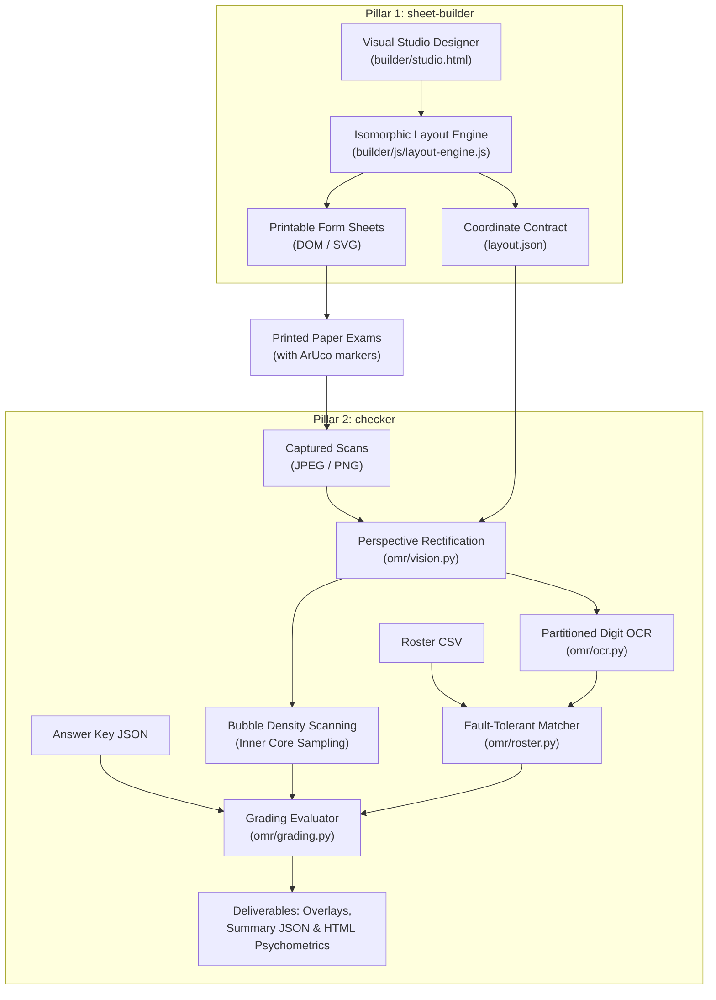
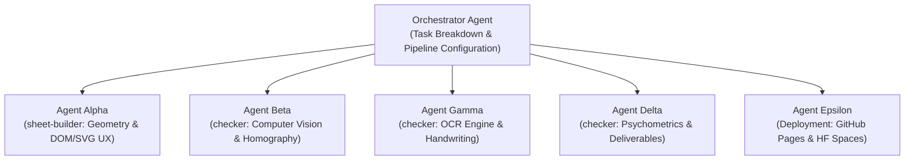

# Engineering Decisions & AI Handoff Specification (`grader`)

> **Project Name**: `grader`  
> **Last Updated**: October 2026  
> **Intended Audience**: Software Engineers, Computer Vision Researchers, and Future AI Pair Programmers (Gemini, Claude, GPT, or custom autonomous agent teams).

---

## 1. Executive Summary & Purpose

`grader` is an end-to-end, millimeter-accurate Optical Mark Recognition (OMR) and document processing pipeline operating on standard camera photos and flatbed scanner images (JPEG, PNG). 

The system solves traditional OMR friction (proprietary scanner hardware, pre-printed lithographic sheets, and fragile pixel-coordinate assumptions) by dividing functionality into two robust pillars:
1. **`sheet-builder`**: A browser-based visual exam sheet designer, layout engine, and zero-CORS standalone HTML editor generating mathematically exact vector (SVG) and printable (HTML/CSS Grid `@media print`) forms anchored by ArUco fiducials.
2. **`checker`**: A computer vision OMR grading pipeline, OCR engine, psychometrics analyzer, CLI runner, and cloud web app (Hugging Face Spaces) that rectifies scans regardless of phone angle, rotation skew, or flatbed feeder distortion using homography.



---

## 2. Architecture & File Structure

### `sheet-builder` (Module 1: Browser-Based Sheet Designer)
- `builder/css/app.css` — Builder UI styles, control panel, and floating toolbar styling.
- `builder/css/sheet.css` — Millimetric CSS Grid rules and `@media print` directives.
- `builder/index.html` — Interactive modular developer editor with live preview.
- `builder/studio.html` — Zero-dependency, standalone single-file production studio (zero-CORS).
- `builder/js/app.js` — UI controller, library state management, and file download actions.
- `builder/js/aruco.js` — Native OpenCV `DICT_4X4_50` marker bit patterns (IDs 0–3).
- `builder/js/layout-engine.js` — Isomorphic geometry engine (computes resolved mm coordinates).
- `builder/js/render-dom.js` — DOM / CSS Grid renderer for physical printing.
- `builder/js/render-svg.js` — True-scale Scalable Vector Graphic (SVG) generator.
- `builder/templates/` — Canonical exam templates (`exam-50.json`, `exam-100.json`, `quiz-tf.json`).

### `checker` (Modules 2–5: Computer Vision, OCR & Grading Pipeline)
- `omr/__main__.py` — Entrypoint for `python -m omr` execution.
- `omr/annotator.py` — Superimposes visual grading feedback (OpenCV derivative JPEGs).
- `omr/cli.py` — CLI command processor registered as `grader`.
- `omr/grading.py` — Evaluates responses against JSON key (MCQ, TF, fuzzy text).
- `omr/layout.py` — Typed loader and coordinate queries for `layout.json`.
- `omr/ocr.py` — Image preprocessing and PyTesseract partitioned OCR extraction.
- `omr/pipeline.py` — End-to-end batch processing pipeline orchestrator.
- `omr/report.py` — Psychometrics calculator and Jinja2 HTML report generator.
- `omr/roster.py` — CSV roster ingestion and fault-tolerant student ID matcher.
- `omr/simulator.py` — Test scanner generator synthesizing realistic scan JPEGs.
- `omr/vision.py` — ArUco detection, perspective warping, and bubble density scanner.
- `spaces/exam-checker/` — Turnkey Gradio 4.44.0 cloud web application for Hugging Face Spaces.

### Data & Deliverables
- `data/` — Reference answer key (`bio101_key.json`), roster (`bio101_roster.csv`), and scans (`scans/`).
- `dist/` — Headless template exports (`exam-50/`, `exam-100/`, `quiz-tf/`).
- `output/` — Grading deliverables (`annotated/`, `grades_summary.json`, `item_analysis_report.html`).
- `scripts/` — Build and export utilities (`build-standalone-studio.mjs`, `export-layout.mjs`, `generate_sample_scans.py`).
- `tests/` — Automated test suite (`tests/js/` for Node, `tests/test_*.py` for Python).

---

## 3. Core Architectural Contracts

### 3.1 The Millimeter Coordinate Contract
The single biggest pitfall in computer vision document processing is coordinate drift between the document generator and the CV analyzer.

**The Solution:**
- All geometry is defined and resolved strictly in **physical millimeters ($mm$)** inside `builder/js/layout-engine.js`.
- The engine outputs `layout.json` describing bounding boxes, bubble centers, and ROI boxes with millimeter measurements.
- The Python pipeline (`omr/layout.py`) ingests `layout.json` and scales all millimeter coordinates by `px_per_mm`:
  $$\text{Target Resolution} = 10.0\,\text{px/mm} \quad (\approx 254\,\text{DPI})$$
  $$\text{Page Width (A4)} = 210\,\text{mm} \times 10.0 = 2100\,\text{px}$$
  $$\text{Page Height (A4)} = 297\,\text{mm} \times 10.0 = 2970\,\text{px}$$
- Because both SVG export, print CSS, and Python CV warping share the exact same `layout.json` source of truth, sampling centers never drift.

### 3.2 Fiducial Marker Standard (ArUco DICT_4X4_50)
Instead of relying on fragile circular black dots that can be confused with punch holes or dark markings, `grader` embeds native OpenCV **ArUco markers** from `DICT_4X4_50` at the four corners of the sheet:
- **Top-Left (ID 0)**: Anchor coordinate $(7\,\text{mm}, 7\,\text{mm})$
- **Top-Right (ID 1)**: Anchor coordinate $(193\,\text{mm}, 7\,\text{mm})$
- **Bottom-Right (ID 2)**: Anchor coordinate $(193\,\text{mm}, 280\,\text{mm})$
- **Bottom-Left (ID 3)**: Anchor coordinate $(7\,\text{mm}, 280\,\text{mm})$

**Why this matters:**
ArUco markers encode 16 bits of error-corrected identity. The detector immediately knows *which* marker is in which corner, resolving arbitrary $90^\circ, 180^\circ, 270^\circ$ scan rotations and flips automatically without needing an orientation guide.

---

## 4. Key Design Decisions & Evolution Log

This section records critical decisions made in response to real-world grading requirements and user feedback:

### Decision 1: Student ID Number Recognition vs. Shading Matrix
- **Initial Design**: Standard 10-row bubble matrix where students shaded digits $0$ through $9$ for each column of their Student ID.
- **User Feedback**: *"just image number recognition no need for shading2x"*
- **Design Decision**:
  - Eliminated the 10-row bubble matrix on modern exam sheets.
  - Added `shading: false` mode to `layoutStudentId` in `builder/js/layout-engine.js`.
  - When `shading: false`, the layout produces a single row of partitioned write-in boxes (`colW = 6.0mm`, `boxHeight = 7.5mm`) and emits a `TextROI` with `role: "student_id"`, `charset: "digits"`.
  - In `omr/ocr.py`, implemented `process_partitioned_digits`: the box is segmented cell-by-cell (`col_w = w / digits`), border suppression is applied to remove divider lines, and Tesseract recognizes each digit individually.
  - In `omr/pipeline.py`, student ID is decoded from OCR when `not layout.sid_groups`.

### Decision 2: Student Information Field Compression
- **Initial Design**: Stacked vertical text boxes consuming 40–50mm of vertical sheet space.
- **User Feedback**: *"this could be compressed"*
- **Design Decision**:
  - Rewrote `layoutFields` in `builder/js/layout-engine.js` to support explicit multi-field row placement via `{ row: 0, w: 76 }`, `{ row: 0, w: 44 }`, etc.
  - Consolidated student metadata into a tight 2-row layout:
    - Row 0: `Name` ($76\,\text{mm}$) and `Score` ($44\,\text{mm}$)
    - Row 1: `Section` ($58\,\text{mm}$) and `Date` ($62\,\text{mm}$)
  - Total vertical footprint reduced to just $27\,\text{mm}$.

### Decision 3: Dedicated Score Box vs. Obtrusive Top Banner
- **Initial Design**: The annotator stamped a large semi-transparent executive banner spanning across the top margin of the sheet.
- **User Feedback**: *"too big. maybe add score field beside name?"*
- **Design Decision**:
  - Added a dedicated `Score` box with `role: "score"` located in Row 0 beside the student's `Name` field.
  - Updated `ExamAnnotator` (`omr/annotator.py`): if `layout.score_roi` exists, it skips the large top banner and renders the score (`Score: 58.0/64.0`), percentage (`90.6%`), and status stamp (`PASS` / `REVIEW`) directly inside the printed Score box with a soft green/red tint.

### Decision 4: Written Answer Box Height Reduction
- **Initial Design**: Written response boxes had heights of 16–20mm, leaving insufficient room on A4 paper for 60 questions.
- **User Feedback**: *"the fields are too big"*
- **Design Decision**:
  - Reduced `boxHeight` default and template settings to $7.5 - 8.0\,\text{mm}$, perfectly sized for single-line printed handwritten terms (e.g., "MITOCHONDRIA", "TRNA") while saving ~25mm of vertical space.

### Decision 5: Elimination of Question Sentences on Answer Sheets
- **Initial Design**: Printed full question sentences inside the zone headers.
- **User Feedback**: *"no need to add questions in the exam sheet"*
- **Design Decision**:
  - Cleaned answer sheet templates to contain only question numbers (e.g. `61. [     ]`, `62. [     ]`).
  - Question prompts are maintained separately in exam booklets or slides, keeping the answer sheet strictly as an OMR/OCR response form.

---

## 5. Computer Vision & Recognition Algorithms (`checker`)

### 5.1 Sheet Rectification (`omr/vision.py` $\rightarrow$ `SheetWarper`)
1. **Detection**: OpenCV `aruco.ArucoDetector` detects markers from `cv2.aruco.getPredefinedDictionary(cv2.aruco.DICT_4X4_50)`.
2. **Coordinate Association**: Detected markers with IDs 0, 1, 2, 3 are mapped to their known physical centers:
   $$P_{\text{src}} = [C_0, C_1, C_2, C_3] \quad \longrightarrow \quad P_{\text{dst}} = [C_{0,\text{ideal}}, C_{1,\text{ideal}}, C_{2,\text{ideal}}, C_{3,\text{ideal}}]$$
3. **Homography Warping**: Computes perspective transform matrix $H$ via RANSAC:
   $$\mathbf{x}_{\text{dst}} \sim H \mathbf{x}_{\text{src}}$$
   `cv2.warpPerspective` rectifies the scanned image to $(W, H)$ at $10.0\,\text{px/mm}$.
4. **Fallback**: If one corner is obscured (only 3 markers detected), an Affine transform matrix $M_{2\times 3}$ is computed from the 3 visible markers.

### 5.2 Bubble Fill Discrimination (`omr/vision.py` $\rightarrow$ `BubbleScanner`)
1. **Adaptive Thresholding**:
   $$\text{Binary}(x, y) = \begin{cases} 255 & \text{if } I(x, y) < T_{\text{local}}(x, y) - C \\ 0 & \text{otherwise} \end{cases}$$
   where $T_{\text{local}}$ is a Gaussian-weighted neighborhood mean ($block=25$, $C=7$). Inverted so graphite/ink marks are white (255) on black (0).
2. **Subpixel Center Snapping**: For each expected bubble center $(c_x, c_y)$, contours within a $1.2\times$ search window are detected. If an elliptical contour matches expected diameter ($\pm 35\%$), the center is shifted to the contour centroid $(\bar{x}, \bar{y})$ to absorb mechanical printing offsets.
3. **Inner-Core Sampling**: To eliminate optical interference from the printed black bubble outline, only the inner core of the bubble is measured:
   $$r_{\text{inner}} = 0.72 \times r_{\text{nominal}}$$
   $$\text{Density} = \frac{\sum_{(x, y) \in \text{Core}} \text{Binary}(x, y)}{255 \times \pi r_{\text{inner}}^2}$$
4. **Thresholds**:
   - $\text{Density} \ge 0.44 \implies \text{Marked (Filled)}$
   - $\text{Density} < 0.22 \implies \text{Empty (Blank)}$
   - In between: delta check against the second-highest option in the group ($\Delta \ge 0.16$).

### 5.3 OCR & Partitioned Digit Extraction (`omr/ocr.py`)
1. **Border Inset**: The bounding box outline is suppressed by cropping with a $1.1\,\text{mm}$ inset.
2. **Cell-by-Cell Partitioning**: For Student ID, the ROI is divided into $N$ equal horizontal columns:
   $$\text{Cell}_i = [x_1 + i \cdot w/N + \delta, \, x_1 + (i+1) \cdot w/N - \delta]$$
3. **Padding & Mode Selection**:
   - Each cell is given a $10\,\text{px}$ white border (`cv2.copyMakeBorder`).
   - Tesseract runs in **PSM 8** (single word mode) with fallback to **PSM 10** (single character mode) with `-c tessedit_char_whitelist=0123456789`.
   - Any cell that fails to resolve a digit emits a positional wildcard placeholder `?`.

### 5.4 Multi-Tier Roster Matching (`omr/roster.py`)
Decoded student IDs are matched against enrolled students in `data/bio101_roster.csv` using a 4-tier cascade:
1. **Tier 1 (Exact)**: Direct hash lookup.
2. **Tier 2 (Zero-Normalized)**: Strips leading zeros (`0010482901` $\rightarrow$ `10482901`).
3. **Tier 3 (Unused Column Trimming)**: Trims unused leading/trailing columns on standardized sheets.
4. **Tier 4 (Positional Wildcard + 1-Digit Hamming Recovery)**:
   - When digits are unreadable (`?`), converts to regex: `^.048290.$`.
   - If regex yields a single enrolled student, assigns `inferred`.
   - If minor OCR noise occurs (e.g. `1` misread as `3`), the engine counts character mismatches across known positions. If $\text{mismatches} \le 1$ and known matches $\ge 2$, it recovers the student record unambiguously.

---

## 6. Psychometric Formulas (`omr/report.py`)

The batch processing pipeline computes standard psychometrics across the exam cohort:

| Metric | Formula | Interpretation |
| :--- | :--- | :--- |
| **Facility Index ($P$)** | $P = \frac{\bar{X}_i}{X_{\max, i}}$ | Item difficulty ($0.0 \le P \le 1.0$). $P > 0.85$ is easy; $P < 0.30$ is hard. |
| **Kelly's Discrimination ($D$)** | $D = \frac{\bar{X}_{\text{top 27\%}} - \bar{X}_{\text{bottom 27\%}}}{X_{\max, i}}$ | Discriminative power ($D \ge 0.30$ indicates high quality; $D < 0.15$ indicates poor item). |
| **Point-Biserial Correlation ($r_{pbis}$)** | $r_{pbis} = \frac{\bar{X}_{\text{correct}} - \bar{X}_{\text{total}}}{S_{\text{total}}} \sqrt{\frac{p}{1 - p}}$ | Correlation between answering item correctly and high overall performance. |
| **Cronbach's Alpha ($\alpha$)** | $\alpha = \frac{K}{K - 1} \left(1 - \frac{\sum_{i=1}^K \sigma_i^2}{\sigma_{\text{total}}^2}\right)$ | Internal consistency / reliability of the exam instrument. |

---

## 7. Multi-Agent Development Guide for Future AI Models

When contributing to `grader`, tasks must be parallelized across specialized subagents using this division of responsibilities:



### Agent Roles:
1. **Agent Alpha (Sheet Geometry & Layout Engine — `sheet-builder`)**
   - **Scope**: `builder/js/layout-engine.js`, `builder/js/render-dom.js`, `builder/js/render-svg.js`, `builder/css/sheet.css`.
   - **Key Invariants**: Maintain millimeter precision. Zero external runtime npm dependencies (vanilla modern ES modules). Never break `layout.json` schema compatibility.
2. **Agent Beta (Computer Vision & Geometry Rectification — `checker`)**
   - **Scope**: `omr/vision.py`, `omr/simulator.py`, `omr/layout.py`.
   - **Key Invariants**: Preserve ArUco `DICT_4X4_50` detection and RANSAC homography. Verify sampling radius math ($r_{\text{inner}} = 0.72 \times r_{\text{nominal}}$).
3. **Agent Gamma (OCR & Handwriting Recognition — `checker`)**
   - **Scope**: `omr/ocr.py`, `omr/roster.py`, `omr/grading.py`.
   - **Key Invariants**: Maintain border margin suppression ($1.1\,\text{mm}$ inset), cell-by-cell digit segmentation, and difflib Levenshtein ratio tolerance ($\ge 0.85$) for written text.
4. **Agent Delta (Psychometrics & Deliverables — `checker`)**
   - **Scope**: `omr/report.py`, `omr/annotator.py`, Jinja2 templates.
   - **Key Invariants**: Respect `layout.score_roi` for stamping scores directly into the form. Ensure all psychometric metrics ($P, D, r_{pbis}, \alpha$) compute valid values without division-by-zero on homogeneous cohorts.
5. **Agent Epsilon (Deployment & Cloud Systems)**
   - **Scope**: `.github/workflows/deploy-pages.yml`, `spaces/exam-checker/app.py`, deployment documentation.
   - **Key Invariants**: Ensure GitHub Pages remains zero-server and Hugging Face Spaces Gradio app installs Debian OCR dependencies cleanly.

---

## 8. Verification & Test Commands

Every change to the codebase must pass both JavaScript layout tests and Python unit/integration tests:

```bash
# 1. Run JavaScript layout engine tests
npm test

# 2. Export all templates to dist/
npm run export:all

# 3. Run Python pytest suite
PYTHONPATH=. .venv/bin/pytest -v

# 4. Synthesize 10 sample scans
PYTHONPATH=. .venv/bin/python scripts/generate_sample_scans.py

# 5. Execute full batch grading pipeline
PYTHONPATH=. .venv/bin/python -m omr \
  --layout dist/exam-50/layout.json \
  --key data/bio101_key.json \
  --roster data/bio101_roster.csv \
  --scans "data/scans/*.jpg" \
  --out output/
```

---

## 9. Visual Drag-and-Drop Exam Sheet Studio (`sheet-builder` 2.0)

### 9.1 Motivation & Teacher-Centric UX
Non-technical educators, proctors, and test administrators should never be forced to edit raw JSON files or manually write nested coordinate blocks. `sheet-builder` transforms the client-side tool into a full WYSIWYG studio with zero runtime npm dependencies:
1. **Visual Component Palette**:
   - Draggable cards representing exam components: Student ID Matrix (`student_id`), Student Information (`fields`), Multiple Choice (`mcq`), True / False (`truefalse`), Written Answer (`text`), and Instructions (`instructions`).
   - Cards support native HTML5 drag-and-drop onto the sheet canvas as well as instant one-click `+ Add` placement.
2. **Interactive Sheet Canvas**:
   - Live bounding-box hover indicators and blue selection rings (`#2563eb`).
   - Floating quick-action toolbars directly on selected zones: Move Up, Move Down, Duplicate, and Delete.
   - Real-time drop indicator line with position calculation mapping cursor coordinates to nearest zone boundaries.
3. **Reactive Form-Based Property Inspector**:
   - Immediate parameterization without raw JSON:
     - Question count steppers ($1..100$).
     - Choice options (A–D, A–E, A–C, T/F, custom).
     - Auto or explicit column layout ($1..5$ columns).
     - Student ID digits ($4..14$) with segmented toggle between Bubble Grid (OMR) and Handwritten Digits (OCR).
     - Checkbox matrix for student info fields (Name, Score Box, Section, Date, Signature).
     - Written answer box height ($8..45\,\text{mm}$), points, and character set restrictions.
4. **Automated Answer Key Generation**:
   - One-click **"Answer Key"** button extracts all gradable items from the active layout and generates a valid `answer_key.json` pre-populated with correct format specifications (compatible with `omr.grading.AnswerKey`).
5. **Print & Layout Invariant Preservation**:
   - All interactive UI chrome (floating toolbars, drag grips, drop indicators, sidebar, canvas controls) use `.app-chrome` or `@media print { display: none !important; }`.
   - Physical printouts via `@media print` remain 100% millimeter-accurate, distortion-free, and anchored by ArUco fiducials.

---

## 10. Multi-Agent Development Mandate & Evolution (October 2026)

### 10.1 Standing Agent Reminder
> **CRITICAL ARCHITECTURAL DIRECTIVE**:
> **Always use multiple agents whenever needed and possible for this project.**
> Tasks should be partitioned into autonomous subagents handling:
> 1. Frontend studio geometries, SVG/DOM renderers, CSS (`sheet-builder`).
> 2. OpenCV computer vision, ArUco alignment, Tesseract OCR (`checker`).
> 3. Cloud deployment integrations (GitHub Pages, Hugging Face Spaces).
> 4. Test suites and psychometric analysis.

### 10.2 Recent Evolutions Log:
- **Decision 6: Side-by-Side Module Drag-and-Drop Capability**:
  - In addition to column layout *inside* modules, added side-by-side placement for distinct modules on the sheet (`layout: 'half-left'` / `layout: 'half-right'`).
  - Mathematical 50% split maintains exact millimeter bounds without CSS float/flex distortion.
- **Decision 7: Points Per Item Stepper**:
  - Added explicit stepper controls for `pointsPerItem` across MCQ, True/False, and Modified True/False modules.
  - Tightly coupled with pre-filled `answer_key.json` export and live studio score counters.
- **Decision 8: Consolidated 2-Line Header Block**:
  - Upper Line: `Student Name` and `Student ID` (with cell-by-cell partitioned digits).
  - Lower Line: Single consolidated `Offer No. & Class Sched` field, `Date`, and dedicated `Score` box.
- **Decision 9: Cloud Deployments (GitHub Pages & Hugging Face Spaces)**:
  - Automated GitHub Actions deployment via `.github/workflows/deploy-pages.yml` and 1-click `/docs` hosting for `sheet-builder`.
  - Turnkey Hugging Face Space Gradio app in `spaces/exam-checker/` for cloud-hosted `checker` evaluation.
- **Decision 10: Two-Pillar Architecture Branding (`sheet-builder` & `checker`)**:
  - Formally partitioned the repository into two named pillars: `sheet-builder` for frontend document layout and zero-CORS editing; and `checker` for computer vision OMR grading, OCR, psychometrics, CLI, and Gradio cloud app.
- **Decision 11: Strict Mermaid-Only Diagrams Standard**:
  - Mandated that all architectural, sequence, deployment, and dataflow diagrams must use clean, valid Mermaid code blocks (```mermaid). All text-art, pseudo-graphic lines, arrows, and Unicode box-drawing characters are strictly forbidden to prevent font and layout rendering defects across platforms and markdown viewers.
- **Decision 12: Multi-Agent Development Mandate Reiteration**:
  - Reaffirmed the standing mandate to decompose complex engineering initiatives across specialized subagents with clear domain boundaries.
