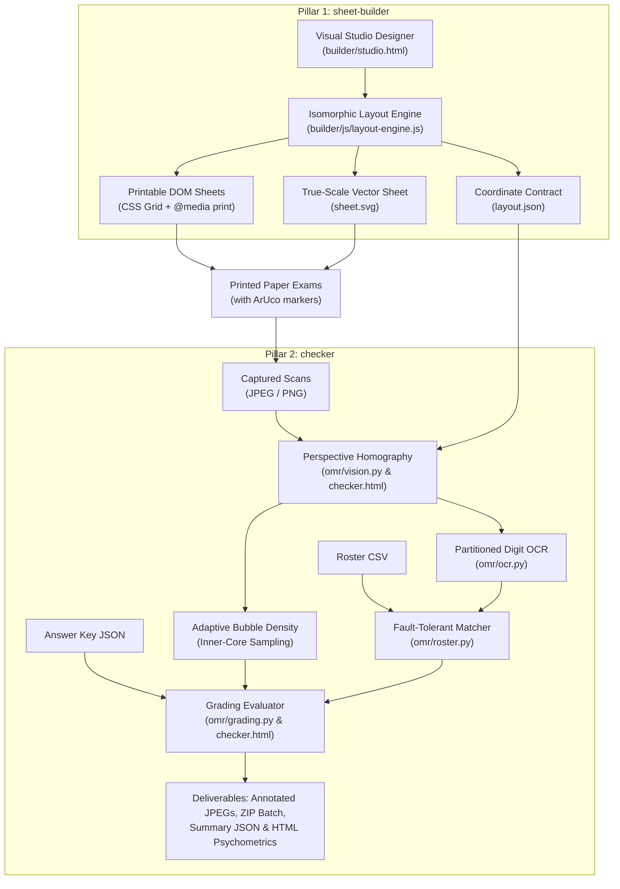
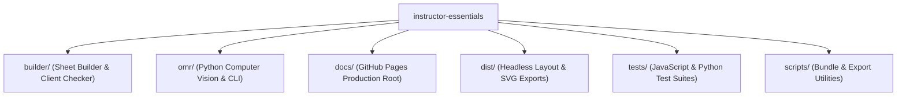
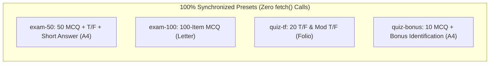
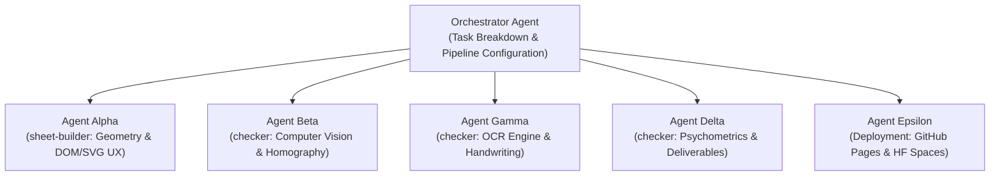
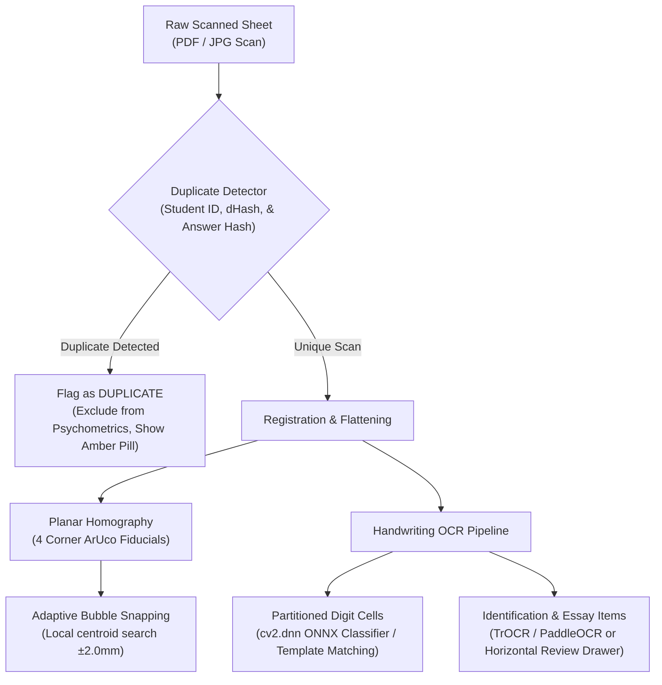

# Engineering Decisions & Architecture Specification (Instructor Essentials)

> **Project Name**: Instructor Essentials  
> **Last Updated**: October 2026  
> **Intended Audience**: Software Engineers, Computer Vision Researchers, and Autonomous AI Pair Programmers.  
> **Canonical Status**: This is the **single, authoritative decisions document** for the repository.

> **Project perspective:** This is an instructor-led project. The maintainer brings classroom experience and knows the practical needs the tool should address, but does not claim specialist expertise in software engineering, computer vision, OCR, or psychometrics. The architecture and decisions below describe the current implementation and its rationale; they are not a claim that every method is the only or academically validated approach. Explain assumptions in plain language and validate engine or assessment-related claims against evidence where possible. See [`AGENTS.md`](AGENTS.md) for guidance to AI coding agents and [`ROADMAP.md`](ROADMAP.md) for proposed improvements.

---

## 1. Executive Summary & Two-Pillar Philosophy

Instructor Essentials is an end-to-end, zero-cost, millimeter-accurate Optical Mark Recognition (OMR) and document assessment system operating on standard camera photos and flatbed scanner images (JPEG, PNG).

The system eliminates traditional OMR friction (expensive proprietary hardware, pre-printed lithographic forms, and brittle pixel-coordinate models) by partitioning responsibilities into two robust pillars:



1. **`sheet-builder` (Frontend Designer & Layout Engine)**:
   - Zero-dependency client-side web application.
   - Fluid drag-and-drop exam designer with live millimeter page preview, property inspector controls, and automated answer-key generator.
   - Runs in any browser or standalone as a single local file ([`builder/studio.html`](builder/studio.html)) with zero internet connection or server required (zero-CORS).
   - Hosted with zero backend server on GitHub Pages ([`docs/index.html`](docs/index.html)).

2. **`checker` (Computer Vision OMR Pipeline & Assessment Engine)**:
   - **Client-Side Checker Studio** ([`builder/checker.html`](builder/checker.html) / [`docs/checker.html`](docs/checker.html)): Standalone in-browser OpenCV-style grading app with 100% inlined homography rectification, bubble density scoring, psychometrics, annotated JPEG downloads, and zero-dependency inlined ZIP export.
   - **High-Throughput Python Pipeline** (`omr/`): Batch grading CLI runner (`./grader`, `python -m omr`) with PyTesseract OCR, wildcard roster matching, and Jinja2 psychometric reports.
   - **Cloud Web Application**: Hugging Face Spaces Gradio 4.44.0 app in `spaces/exam-checker/`.

---

## 2. Architecture & File Structure



### `sheet-builder` (Frontend Designer & Renderers)
- [`builder/css/app.css`](builder/css/app.css) — Builder UI styles, control palette, and floating toolbar styling.
- [`builder/css/sheet.css`](builder/css/sheet.css) — Millimetric CSS Grid rules and `@media print` directives.
- [`builder/index.html`](builder/index.html) — Modular developer editor with live preview.
- [`builder/studio.html`](builder/studio.html) — Zero-dependency, standalone single-file production studio (zero-CORS).
- [`builder/checker.html`](builder/checker.html) — Standalone in-browser OMR grading studio with JPEG/ZIP export.
- [`builder/js/app.js`](builder/js/app.js) — UI controller, drag-and-drop state, and library actions.
- [`builder/js/aruco.js`](builder/js/aruco.js) — Native OpenCV `DICT_4X4_50` marker bit patterns (IDs 0–3).
- [`builder/js/layout-engine.js`](builder/js/layout-engine.js) — Isomorphic geometry engine (computes resolved mm coordinates).
- [`builder/js/render-dom.js`](builder/js/render-dom.js) — DOM / CSS Grid renderer for physical printing.
- [`builder/js/render-svg.js`](builder/js/render-svg.js) — True-scale Scalable Vector Graphic (SVG) generator.
- [`builder/js/templates.js`](builder/js/templates.js) — Inlined sample templates for offline execution.
- [`builder/templates/`](builder/templates/) — Canonical exam template definitions:
  - `blank.json` (Blank Sheet with Corner Markers, Folio)
  - `exam-50.json` (50 MCQ + T/F + Short Answer, A4)
  - `exam-100.json` (100 MCQ + 8-digit Student ID, Letter)
  - `quiz-tf.json` (20 Simple T/F + 10 Modified T/F + Essay, Folio)
  - `quiz-bonus.json` (10 MCQ + 5 pt Bonus Identification, A4)

### `checker` (Python CV, OCR & Grading Pipeline)
- `omr/__main__.py` — Entrypoint for `python -m omr` execution.
- `omr/annotator.py` — Superimposes visual grading feedback (OpenCV derivative JPEGs).
- `omr/cli.py` — CLI command processor registered as `grader`.
- `omr/grading.py` — Evaluates responses against JSON key (MCQ, TF, fuzzy text).
- `omr/layout.py` — Typed loader and coordinate queries for `layout.json`.
- `omr/ocr.py` — Image preprocessing and PyTesseract partitioned OCR extraction.
- `omr/pipeline.py` — End-to-end batch processing pipeline orchestrator.
- `omr/report.py` — Psychometrics calculator and Jinja2 HTML report generator.
- `omr/roster.py` — CSV roster ingestion and fault-tolerant student ID matcher.
- `omr/simulator.py` — Test scanner generator synthesizing realistic scan JPEGs.
- `omr/vision.py` — ArUco detection, perspective warping, and bubble density scanner.
- `spaces/exam-checker/` — Turnkey Gradio 4.44.0 cloud web application for Hugging Face Spaces.

### Synchronized Deployment & Test Artifacts
- [`docs/index.html`](docs/index.html) — Production Sheet Builder served on GitHub Pages.
- [`docs/checker.html`](docs/checker.html) — Production Checker Studio served on GitHub Pages.
- `dist/` — Headless template exports (`exam-50/`, `exam-100/`, `quiz-tf/`, `quiz-bonus/`).
- `tests/js/` — Node.js test suite ([`checker-presets.test.mjs`](tests/js/checker-presets.test.mjs), [`standalone-bundle.test.mjs`](tests/js/standalone-bundle.test.mjs), [`layout.test.mjs`](tests/js/layout.test.mjs)).
- `tests/test_*.py` — Python test suite covering vision, OCR, grading, psychometrics, and roster matching.

---

## 3. Core Architectural Contracts

### 3.1 The Millimeter Coordinate Contract
The single biggest pitfall in computer vision document processing is coordinate drift between the document generator and the CV analyzer.

**The Solution:**
- All geometry is defined and resolved strictly in **physical millimeters ($mm$)** inside [`builder/js/layout-engine.js`](builder/js/layout-engine.js).
- The engine outputs `layout.json` describing bounding boxes, bubble centers, and ROI boxes with millimeter measurements.
- The Python pipeline (`omr/layout.py`) ingests `layout.json` and scales all millimeter coordinates by `px_per_mm`:
  $$\text{Target Resolution} = 10.0\,\text{px/mm} \quad (\approx 254\,\text{DPI})$$
  $$\text{Page Width (A4)} = 210.0\,\text{mm} \times 10.0 = 2100\,\text{px}$$
  $$\text{Page Height (A4)} = 297.0\,\text{mm} \times 10.0 = 2970\,\text{px}$$
- Because SVG export, print CSS Grid, and Python CV warping share the exact same `layout.json` source of truth, sampling centers never drift.

### 3.2 Fiducial Marker Standard (ArUco DICT_4X4_50)
Instead of relying on fragile circular black dots that can be confused with punch holes or dark markings, Instructor Essentials embeds native OpenCV **ArUco markers** from `DICT_4X4_50` at the four corners of the sheet:
- **Top-Left (ID 0)**: Inset anchor $(12\,\text{mm}, 12\,\text{mm})$ center
- **Top-Right (ID 1)**: Inset anchor $(W - 12\,\text{mm}, 12\,\text{mm})$ center
- **Bottom-Right (ID 2)**: Inset anchor $(W - 12\,\text{mm}, H - 12\,\text{mm})$ center
- **Bottom-Left (ID 3)**: Inset anchor $(12\,\text{mm}, H - 12\,\text{mm})$ center

**Why this matters:**
ArUco markers encode 16 bits of error-corrected identity. The detector immediately knows *which* marker is in which corner, resolving arbitrary $90^\circ, 180^\circ, 270^\circ$ scan rotations and flips automatically without needing a separate orientation guide.

---

## 4. Supported Layout Zones & Paper Formats

### 4.1 Zone Types Supported by `layout-engine.js`

| Zone Type | Description | Key Properties |
| :--- | :--- | :--- |
| `fields` | Student Information & ID block | `fields: [...]`, integrated `sid` with `digits` (4–14), multi-row grid layout. |
| `mcq` | Multiple Choice questions | `count`, `start`, `choices` ('ABCD', 'ABCDE', etc.), `columns` (1–5), `pointsPerItem`. |
| `truefalse` | Simple True / False | `count`, `start`, `choices: ['T', 'F']`, `columns` (1–5), `pointsPerItem`. |
| `modified_tf` | Modified True / False | `count`, `start`, `choices: ['T', 'F']`, adjacent write-in correction box (`corrWidth` 20–90 mm), `pointsPerItem`. |
| `student_id` | Dedicated Student ID Grid | Shaded bubble matrix (`shading: true`) or partitioned write-in boxes (`shading: false`). |
| `text` / `text_short` | Short Answer / Bonus Identification | Compact write-in box (8–25 mm), `points`, `charset` ('any', 'digits', 'alpha'). |
| `text_essay` | Essay / Long Answer | Multi-line write-in box (25–120 mm), `points`, `charset` ('any'). |
| `instructions` | Instructions & Guidelines | `text`, `fontSize` (2.4, 2.8, 3.2 mm). |

### 4.2 Standard Paper Sizes

| Paper Name | Dimensions (mm) | Dimensions (inches) |
| :--- | :--- | :--- |
| **A4** | $210.0 \times 297.0$ | $8.27 \times 11.69$ |
| **US Letter** | $215.9 \times 279.4$ | $8.50 \times 11.00$ |
| **Folio / F4** | $215.9 \times 330.2$ | $8.50 \times 13.00$ |
| **Half-A4 / A5** | $148.5 \times 210.0$ | $5.85 \times 8.27$ |
| **Half-Letter** | $139.7 \times 215.9$ | $5.50 \times 8.50$ |
| **Half-Folio** | $165.1 \times 215.9$ | $6.50 \times 8.50$ |

---

## 5. UI Controls, Steppers & Saved Exam Builds

- **Strict Constraint**: **Zero range sliders (`<input type="range">`) in the inspector forms**.
- All numeric controls use explicit stepper inputs:
  - Decrement button: `[−]` (`.stepper-btn`)
  - Numeric input: `<input type="number" class="stepper-input">`
  - Increment button: `[+]` (`.stepper-btn`)
- Applied to: question counts, student ID digits, box heights, points per item, and correction box widths.
- **Saved Exam Builds Storage**: Browser `localStorage` key `'sheet-builder:saved_builds'` (with backwards-compatible migration from `'grader:saved_builds'`).

---

## 6. Synchronized Presets & Client-Side Checker Studio

### 6.1 Unified Preset Catalog
Both **Sheet Builder Studio** ([`builder/index.html`](builder/index.html)) and **Checker Studio** ([`builder/checker.html`](builder/checker.html)) share identical, synchronized preset identifiers and display names:



### 6.2 Zero-Dependency Client-Side Checker Studio
- **Self-Contained Engine**: Runs directly in the browser with zero web server, zero backend, and zero CORS errors.
- **Inlined Preset Data**: Complete layout geometry, ArUco fiducials, bubble centroids, and answer keys are inlined into `const PRESETS = { ... }`.
- **Text Item Handling**: Handwritten identification questions (`keyItem.kind === 'text'`) are gracefully bypassed during automated bubble OMR scanning to prevent coordinate crashes, while retaining points in keys and reports.
- **Annotated Graded Sheet Export**:
  - `btn-download-sheet-jpeg`: Renders grading overlays (green checks, red crosses, student ID, and score badge) on an HTML5 canvas and exports true-resolution JPEG.
  - `btn-export-zip`: Uses an inlined, zero-dependency ZIP archive generator (`createZip`) to bundle all graded sheets into a single `.zip` file.

---

## 7. Key Engineering Decisions Log

### Decision 1: Partitioned Handwritten Student ID vs. Bubble Matrix
- **Problem**: 10-row bubble matrices consume massive vertical space and confuse younger students.
- **Decision**: Added `shading: false` mode creating partitioned write-in boxes (`colW = 6.0mm`, `boxHeight = 7.5mm`). In `omr/ocr.py`, cell-by-cell segmentation removes dividers and uses PyTesseract PSM 8/10.

### Decision 2: Student Information Field Compression
- **Problem**: Stacked vertical boxes wasted 40–50mm of vertical sheet space.
- **Decision**: Consolidated metadata into a tight 2-line layout (Line 1: Name & Student ID; Line 2: Offer No. & Class Sched, Date, Score box) reducing footprint to ~27mm.

### Decision 3: Dedicated Score Box vs. Obtrusive Top Banner
- **Problem**: Large semi-transparent top banners obscured exam headers.
- **Decision**: Added a dedicated `Score` box with `role: "score"`. The annotator renders the score, percentage, and status stamp directly inside the printed Score box.

### Decision 4: Written Answer Box Height Reduction
- **Problem**: Tall response boxes left insufficient room on A4 paper for 60 questions.
- **Decision**: Standardized `boxHeight` for short-answer terms to $7.5 - 8.0\,\text{mm}$, saving ~25mm of vertical space.

### Decision 5: Elimination of Question Sentences on Answer Sheets
- **Problem**: Long question sentences caused unpredictable wrapping and layout overflow.
- **Decision**: Answer sheets contain only item numbers and bubble/write-in response regions; question text is maintained separately in exam booklets.

### Decision 6: Side-by-Side Module Layout
- **Decision**: Added `layout: 'half-left'` / `layout: 'half-right'` allowing distinct modules (e.g. Simple T/F and Modified T/F) to sit side-by-side with exact 50% millimeter bounds.

### Decision 7: Stepper Controls for Points Per Item
- **Decision**: Explicit stepper inputs control `pointsPerItem` across MCQ, True/False, and Modified True/False modules, dynamically propagating to exported answer keys.

### Decision 8: Consolidated 2-Line Header Block
- **Decision**: Upper line contains `Student Name` and `Student ID`; lower line contains consolidated `Offer No. & Class Sched`, `Date`, and dedicated `Score` box.

### Decision 9: Dual Cloud Deployment (GitHub Pages & Hugging Face Spaces)
- **Decision**: Zero-server hosting on GitHub Pages for `sheet-builder` (and client-side `checker`), plus a turnkey Gradio 4.44.0 app on Hugging Face Spaces for the Python pipeline.

### Decision 10: Two-Pillar Architecture Branding (`sheet-builder` & `checker`)
- **Decision**: Explicit separation of responsibilities into `sheet-builder` (document designer & layout engine) and `checker` (computer vision OMR grading & psychometrics).

### Decision 11: Strict Mermaid-Only Diagrams Standard
- **Decision**: All architectural, sequence, and workflow diagrams must use clean Mermaid syntax. Text-art, pseudo-graphic lines, and Unicode box-drawing characters are strictly forbidden to ensure cross-platform rendering consistency.

### Decision 12: Standing Multi-Agent Mandate
- **Decision**: Reaffirmed the policy to decompose complex engineering initiatives across specialized autonomous subagents.

### Decision 13: Browser-Based Standalone Checker Studio
- **Decision**: Built [`builder/checker.html`](builder/checker.html) to enable client-side grading with zero server dependencies, using inlined homography and bubble density sampling.

### Decision 14: Synchronized Preset Catalog Across Studios
- **Decision**: Synchronized the preset dropdown options between Sheet Builder and Checker Studio to share identical keys, labels, and inlined data.

### Decision 15: Introduction of the 10-Item Quiz with Bonus Identification (`quiz-bonus`)
- **Decision**: Added `quiz-bonus` preset (A4, 2-line header, 10 MCQ items at 1 pt each, and 1 handwritten Bonus Identification question at 5 pts). Automated bubble grading bypasses the text zone without errors.

### Decision 16: Zero-Dependency JPEG & ZIP Graded Sheet Export
- **Decision**: Implemented client-side JPEG rendering of annotated sheets and an inlined, zero-dependency ZIP archive generator (`createZip`) in Checker Studio for 1-click batch downloads.

### Decision 17: Header Sub-Badge Cleanup
- **Decision**: Removed obsolete subtitle badges (`"OMR Exam Designer & Layout Engine"` and `"Client-Side OMR Grading & Psychometrics"`) to keep headers clean, focused, and uncluttered.

### Decision 19: Exam Generator Tool in Sheet Builder
- **Decision**: Added a 1-click interactive Exam Generator modal (`#modal-generator`) to Sheet Builder. Instructors can customize paper size, Student ID format (partitioned OCR box vs. 10-row OMR bubble grid), instructions banner, and toggle individual exam sections (MCQ, True/False, Modified T/F, Short Answer / Identification, and Essay) with custom item counts and point weights. Generates complete, millimeter-precise OMR templates directly into the visual canvas.

### Decision 20: Checker Studio Streamlined Layout & Dedicated Answer Key Management
- **Decision**: Redesigned Checker Studio sidebar into unnumbered, focused cards (`Exam Scans`, `Layout`, `Answer Key`, `Grading Settings`, `Export Reports`).
- **Decision**: Created a prominent, dedicated Answer Key section displaying active key statistics, custom JSON upload, an in-browser Answer Key Editor modal (`#modal-key-editor`) for quick corrections, and a 1-click JSON template generator. Added Layout export buttons (`Export Layout` and `Export Sheet`).
- **Decision**: Streamlined the results navigation into strictly three analytical tabs: `Summary`, `Student Roster`, and `Item Analysis`.
- **Decision**: Standardized student sheet inspection under the exclusive button name `"Sheet Inspector"`, opening an interactive visual modal (`#modal-viewer`) with student selection, single sheet JPEG download, and 1-click batch ZIP export (`Download All (ZIP)`).

### Decision 21: Subject-Agnostic Synchronized Preset Catalog
- **Decision**: Standardized all preset identifiers and display labels across Sheet Builder and Checker Studio to clean, subject-agnostic format names: `50 MCQ + T/F + Short Answer (A4)`, `100-Item MCQ (Letter)`, `20 T/F & Mod T/F (Folio)`, and `10 MCQ + Bonus Identification (A4)`.

### Decision 22: Standardized 8-Digit Student ID & Full-Width Header Blocks
- **Decision**: Standardized Student ID digits across the entire application to strictly 8 digits (removed all UI steppers/inputs allowing arbitrary digit counts).
- **Decision**: Separated the combined `"Offer No. & Class Sched"` header field into two distinct, dedicated fields: `"Offer No."` and strictly `"Sched"`.
- **Decision**: Standardized `fields` (student details) and `student_id` blocks to always expand 100% full width across the printable sheet canvas, dynamically scaling row column widths and centering grids to eliminate margin gaps.

### Decision 23: Interactive Part-Ordered Exam Generator & Blank Preset Canvas
- **Decision**: Re-architected the Sheet Builder Exam Generator to empower instructors to dynamically add, configure, and reorder (Move Up / Move Down) exam parts with custom section types (Multiple Choice, True/False, Modified T/F, Short Answer / Identification, Essay) and automatic sequential question numbering.
- **Decision**: Updated the "Blank Sheet" preset to initialize as a completely empty canvas (`zones: []`) with corner fiducials, allowing users to delete all zones down to zero or build custom assessments from scratch visually without ever creating or editing JSON files.

### Decision 24: Anti-Slop Design Architecture & Human-Grade UI/UX Engineering
- **Decision**: Purged all raw emojis across both Sheet Builder and Checker Studio, replacing them with crisp, single-weight vector SVG icons (1.75px–2px strokes) and accessible semantic markup.
- **Decision**: Implemented the Quiet Luxury / Technical Pro design system token architecture across both studios (Electric Cobalt primary accent, precision hairline borders, layered diffused shadows, and unified `cubic-bezier(0.16, 1, 0.3, 1)` easing curves).
- **Decision**: Engineered the 8-state interactive feedback system across all buttons and cards (tactile `:active` micro-scaling `transform: scale(0.97)`, visible `:focus-visible` keyboard focus rings, and smooth hover lifts).
- **Decision**: Enforced `font-variant-numeric: tabular-nums` across all statistical metrics, data tables, score summaries, and item difficulty calculations to eliminate layout shift and visual jitter.
- **Decision**: Elevated studio navigation into capsule segmented controls and upgraded dialog windows with glassmorphic depth (`backdrop-filter: blur(12px)`).

### Decision 25: Streamlined Topbar Metrics, Visual Answer Key Editor & Clean Question Numbering
- **Decision**: Streamlined visible topbar stat pills to strictly "Questions" and "Points". Integrated a fully visual, interactive Answer Key Editor (`#modal-answer-key`) into Sheet Builder.
- **Decision**: Enhanced the Exam Sheet Generator modal (`#modal-generator`) with a real-time live preview panel featuring dynamic metrics calculation (Questions, Points, Page Fill %) and a live miniature wireframe.
- **Decision**: Standardized all question rendering across DOM, SVG, and generator modules to output strictly the clean question number (e.g., `1.`, `2.`), completely removing test-type labels or question prompts from printed exam sheets.
- **Decision**: Standardized initial application boot and preset default to "Blank Sheet" (`zones: []`), giving instructors an immediate, clean canvas to design custom exams or generate structures from scratch.

### Decision 26: Bottom Canvas Status Strip, Preset 100 Modernization & Full SVG Editing Parity
- **Decision**: Removed ID digits display from the UI entirely (standardized internally to 8 digits). Removed the topbar "View" dropdown and relocated "Show CV Targets" together with a subtle "Page Fill: XX%" indicator into a compact, elegant floating status bar (`.canvas-bottom-bar`) at the bottom of the canvas pane.
- **Decision**: Modernized the 100 MCQ preset (`chem201-final-100`) across `exam-100.json`, `templates.js`, and `checker.html` to eliminate the obsolete, space-consuming 10-row student ID bubble matrix. Replaced it with the standard 2-line header containing an 8-digit partitioned OCR box, saving ~35mm of vertical space and aligning it with all other presets.
- **Decision**: Achieved full interactive editing parity between DOM and SVG render modes. In SVG mode, zones can now be clicked directly on the canvas to select them, showing a crisp selection bounding box and floating action toolbar (`Move Up`, `Move Down`, `Duplicate`, `Delete`). Zone property updates in the Inspector and drag-and-drop insertions now update the vector canvas in real time.
- **Decision**: Pinned the Canvas Bottom Status Strip (`.canvas-bottom-bar` with "Show CV Targets" and "Page Fill") to the viewport. Restructured the sheet workspace layout by introducing an isolated scrollable viewport container (`.preview__viewport`) inside the non-scrolling `.preview` frame. This prevents the status pill from scrolling out of view when examining long multi-part exams.
- **Decision**: Refined SVG mode selection feedback. Removed redundant oversized `selRect` overlays with millimeter padding, setting the zone card's primary bounding stroke to a sharp, high-contrast `0.45mm` accent highlight (`0.35mm` on hover) directly aligned with the zone contour.
- **Decision**: Standardized student header labels to strictly `"Name"` and `"ID no."` across all canonical presets, templates, generator wireframes, inspector forms, and default zone factories, maintaining clean field alignment and maximizing student handwriting space.
- **Decision**: Fixed uncaught `ReferenceError: escapeHTML is not defined` runtime exception on the "Generator" and "Saved Builds" modal buttons. Explicitly exported `escapeHTML` through the IIFE module closure and implemented a defensive fallback `safeEscapeHTML` helper.
- **Decision**: Fixed bloated outlines in SVG render mode by scoping the CSS `outline: 2px solid` and `box-shadow` styles strictly to `.omr-sheet` DOM elements. In SVG mode, applied `outline: none !important; box-shadow: none !important; filter: none !important;` to `<g.omr-zone>` elements, leaving only the crisp `0.4mm` SVG vector card stroke.
- **Decision**: Implemented a responsive Master-Detail split layout in Checker Studio's "Student Roster" tab (`#tab-roster`). The roster table on the left is paired with an embedded Sheet Inspector side preview pane on the right, providing instantaneous visual feedback with green/red/amber bubble scoring, quick JPEG download, and full-screen modal expansion without interrupting the roster overview.

### Decision 27: Sheet Builder Comprehensive Interaction Audit & UX Hardening
- **Decision**: Added the Duplicate block action (`btn-outline-dup`) to the Outline tab layer list, achieving 100% action parity (`Move Up`, `Move Down`, `Duplicate`, `Delete`) across the canvas floating toolbar, Property Inspector header, and Outline layer manager.
- **Decision**: Upgraded `<select id="sample-preset">` with an explicit placeholder option (`<option value="" disabled selected>Preset Templates...</option>`) ensuring selection events fire cleanly on every user interaction (including re-selecting "Blank Sheet") and reset reliably without leaving the select element in an invalid index `-1` state.
- **Decision**: Guarded Saved Builds against preset identifier collisions by dynamically checking against all `SAMPLE_TEMPLATES` identifiers, generating distinct unique IDs (`build_*`) whenever an assessment based on a preset is saved with a custom name.
- **Decision**: Hardened Answer Key Editor to gracefully ingest and normalize legacy and third-party keys with primitive string answer formats (`{ "1": "A" }`) as well as rich object formats (`{ "1": { "answer": "A", "points": 1 } }`), eliminating `undefined` answers and ensuring 0 is supported as an explicit passing score via nullish coalescing (`??`).
- **Decision**: Added defensive guards (`if (!state.layout) return;`) and standardized template export filenames strictly to `.sheet.json` in the Export dropdown.
- **Decision**: Prevented out-of-bounds essay item generation in the Quick Exam Generator by clamping count inputs appropriately when switching section types.

### Decision 28: Checker Studio & Python Pipeline Comprehensive Audit & Optimization
- **Decision**: Implemented an interactive Pass/Fail cohort performance distribution track in Checker Studio Tab 1, dynamically displaying passing versus failing student proportions and count badges based on the active pass threshold.
- **Decision**: Implemented two-way column sorting (`sortGrades`) on Student Roster and Summary tables (Exam ID, Student ID, Name, Raw Score, Max Score, Percentage, Status) with directional indicators (`▲`/`▼`), while preserving active student inspection across sorting operations.
- **Decision**: Upgraded `parseRosterCSV` to RFC 4180 quote-aware parsing, correctly handling quoted student names containing commas (e.g., `"Last, First"`). Uploading a new roster now automatically re-reconciles existing graded scan results in real time.
- **Decision**: Partitioned pure True/False detection from mixed exam detection in Tab 3 Item Analysis, accurately preserving `A`, `B`, `C`, `D`, `E` distractor frequencies for MCQ sections on mixed assessments.
- **Decision**: Hardened Python backend CLI with deterministic scan ordering (`sorted(set(scan_files))`), inverse homography exception handling in `vision.py`, and Gradio 4/5 dictionary path payload extraction in `spaces/exam-checker/app.py`.

### Decision 29: Workspace Branding Unification, Canvas Status HUD, Module Coercion & Input Focus Preservation
- **Decision**: Refactored the pinned canvas bottom status bar (`.canvas-bottom-bar`) to use adaptive glassmorphic styling (`color-mix(in srgb, var(--panel) 88%, transparent)`), ensuring high contrast and clean aesthetics in both light and dark modes. Relocated live "Questions" and "Points" counters from the header into this HUD strip for an uncluttered viewport.
- **Decision**: Unified Sheet Builder (`index.html`) and Checker Studio (`checker.html`) under the cohesive suite brand "Instructor Essentials". Synced branding with an identical 20×20 SVG checkmark logo and an interactive segmented workflow navigation pill (`[ 📄 Sheet Builder ] [ ✔ Checker Studio ]`).
- **Decision**: Added multi-module separation and side-by-side configuration for written answer types (`text_short`, `text_essay`) in both the Property Inspector and the Exam Generator.
- **Decision**: Implemented compact module coercion and vacant column slot packing in `layout-engine.js`. Modules with few items ($\le 12$ MCQ items) automatically coerce into side-by-side mode when not locked to full width, and right-hand modules intelligently pack into open column slots above. Added a one-click "⇄ Move to Opposite / Vacant Side" button in the Inspector.
- **Decision**: Resolved real-time typing lock in Property Inspector. Guarded live input events on `#insp-label`, `#insp-text`, and `#insp-choices-custom` using `update({ skipInspector: true })`, preventing destructive re-renders of active input elements while preserving real-time sheet canvas updates.
- **Decision**: Aligned DOM and SVG active/selected zone visual styling parity with identical 2px accent borders and subtle semi-transparent tints (`rgba(37, 99, 235, 0.05)`).
- **Decision**: Overhauled Generator wireframe to display an authentic miniature paper sheet ("Sheet Preview") with 4 corner ArUco fiducials, header block, mini bubble dots, and correction/write-in boxes. Removed legacy header `#sample-preset` dropdown in favor of the Exam Generator.
- **Decision**: Evaluated Google Drive preset integration under `AGENTS.md` guidelines: validated that offline local storage and `.sheet.json` file exports remain the zero-dependency, zero-cost core standard. Any future cloud sync will use client-side Google Identity Services (GIS) without mandatory accounts or server infrastructure.

### Decision 30: Combined Written Question Modules, Aesthetic Column Centering, Progressive Disclosure & Visual Parity
- **Decision**: Replaced multi-module splitting for written exams with a unified combined module architecture (`text_short`, `text_essay`). A single section module now encapsulates multiple question items (`count > 1`) distributed across editable columns (1, 2, or 3), with configurable box heights, start numbering, points per item, and individual sub-ROIs for handwriting recognition and manual scoring.
- **Decision**: Implemented aesthetic whitespace bounding and column cluster centering in `layout-engine.js` (`layoutChoices` and `layoutModifiedTrueFalse`). When `rawGap > 24mm` (e.g. 2 columns across a wide printable page), the gap is clamped to a balanced pitch (`usable * 0.08`, capped at 24mm) and the column group is centered within the zone card. This resolves the wide center void shown in user scans while preserving tight layouts.
- **Decision**: Resolved modal backdrop blur across WebKit/Blink by explicitly adding `-webkit-backdrop-filter: blur(8px)` alongside `backdrop-filter: blur(8px)` to `dialog::backdrop` selectors, eliminating transparent bleed-through on macOS Safari.
- **Decision**: Added `Module Page Placement` controls (`Full Width`, `Side-by-Side (Left)`, `Side-by-Side (Right)`) and "⇄ Move to Opposite / Vacant Side" to `instructions` zones in the Property Inspector and geometry engine, enabling instructors to place exam notes side-by-side with questions.
- **Decision**: Implemented progressive disclosure in Checker Studio (`checker.html`). Results tabs, summary metric cards, cohort distribution bars, and the student roster table are hidden initially behind `.checker-empty-state`, presenting a clean "Ready to Grade Exam Scans" landing view with "1-Click Sample Test" and "Upload Scans" CTAs until grading has executed.
- **Decision**: Achieved design parity between DOM and SVG active/selected zone indicators. Aligned SVG selected zone strokes to a sharp `0.45mm` accent stroke and `rgba(37, 99, 235, 0.05)` fill tint, removing oversized drop-shadow filters.
- **Decision**: Fixed paper size dropdown arrow clipping across `.paper-dropdown` and `.gen-select` by applying `appearance: none`, custom inlined SVG chevrons with `calc(100% - 10px)` positioning, and `padding-right: 2rem`.

### Decision 31: Checker Studio Rebranding, Sidebar Progressive Disclosure, SVG Bell Curve Distribution, Preflight Validation & Review Flags
- **Rebranding to 'Instructor Essentials'**: Rebranded the document title (`<title>Instructor Essentials — Checker Studio</title>`), application meta tags, header brand heading, and report exports to "Instructor Essentials", aligning Checker Studio with the suite's product identity.
- **Sidebar Progressive Disclosure**: In initial un-graded state (`:not(.has-data)`), hidden the 'Grading Settings' and 'Export Reports' cards, and tucked 'Layout' and 'Answer Key' options into a small, discreet collapsible toggle (`<details id="advanced-layout-key-toggle">` with label `⚙ Advanced Layout & Key Options`). The initial sidebar presents strictly the dropzone, scan file list, "1-Click Sample Test", and "Grade Scans" action buttons. Upon grading (`.has-data`), settings and key cards are revealed, and a prominent 'Export Reports' button bar (ZIP, CSV, HTML) is rendered at the top of the results view.
- **SVG Bell Curve & Score Histogram**: Replaced the static two-segment bar in Tab 1 (Summary) with an SVG Gaussian normal distribution bell curve and score histogram. The component calculates cohort mean ($\mu$), standard deviation ($\sigma$), min, max, and pass cutoff, rendering frequency histogram bars across 10 score bins, an overlaid fitted normal curve, shaded passing (emerald tint) and failing (rose tint) areas under the curve, vertical annotation lines for Pass Cutoff and Mean, $\pm 1\sigma$ indicator brackets, and a plain-language cohort spread insight.
- **Preflight Key-Layout Mismatch Validation**: Implemented preflight alignment verification triggered on preset switching, custom layout upload, key upload, key editing, and before grading. Compares active layout bubble items against answer key items and allowed choices; if mismatches occur (e.g. key has 30 items while layout has 50), displays an instructor-friendly Preflight Alignment Warning banner (`#preflight-warning-banner`) explaining that unkeyed items will score 0 pts.
- **Scan Exam Sheet as Master Answer Key**: Added direct photo/scan ingestion in Checker Studio (`#input-key-scan` and `decodeMasterKeyFromScan`). Instructors can shade their correct answers on a physical paper sheet, photograph or scan it, and click "Scan Sheet as Answer Key" to automatically decode the darkest marked bubbles across all questions into the active answer key without manual entry.
- **Answer Key Matrix Column-Flow Alignment**: In Sheet Builder's Answer Key Editor (`renderAnswerKeyModalContent`), restructured question groups to flow in CSS multi-column layouts matching each section's exact column count (`zone.columns`). Questions flow vertically downwards down each column in order (1..10 in Col 1, 11..20 in Col 2, etc.) mirroring the visual column flow on the printed exam sheet.
- **Preflight Key Discrepancy Alert & 1-Click Auto-Sync**: Added real-time discrepancy detection in Sheet Builder's Answer Key Editor. If sheet questions are unkeyed or key items are orphaned, an alert banner (`#key-discrepancy-banner`) notifies the instructor and provides a 1-click "Auto-Sync with Sheet" button that provisions default keys for all unkeyed sheet questions.
- **Student Review Flags**: In `processExamScan`, automatically identifies sheets requiring instructor attention by evaluating blank responses, multiple bubble marks on single-choice items, and unmatched student IDs against the loaded roster. Flags these students in Tab 2 (Student Roster) with an amber `Needs Review` badge (`.badge-review`) with tooltip details, and displays an explanation notice in the Sheet Inspector preview pane.

### Decision 32: Filterable Review Queue & Audit Resolution
- **Roster Toolbar Filter Group**: Added a dedicated toolbar above the Student Roster table with segmented filter pills for `All Students (X)`, `Needs Review (Y)`, and `Clean / Verified (Z)` (`#roster-review-filters`). When flagged scans exist ($Y > 0$), the `Needs Review` filter pill adopts a prominent amber warning accent (`.badge-review--active`).
- **Review Stepper Navigation**: Embedded sequential queue navigation controls (`Prev`, `Next`, and position badge e.g., `"1 of 2"`) in the Sheet Inspector preview header. Instructors can step through flagged scans directly in the side preview pane without returning to the table.
- **Audit Flag Resolution (`resolveReviewFlag`)**: Added a 1-click `"Mark as Reviewed"` action to the inspector review alert banner. Resolving a sheet sets `needsReview = false` and `manuallyReviewed = true`, updates real-time queue counts, changes the table badge to a green `✓ Reviewed` badge (`.badge-reviewed`), and automatically advances to the next remaining flagged student in review queue mode. Added a reversible `"Re-open Flag"` control.
- **Summary Tab Review Callout (`#summary-review-callout`)**: Integrated an amber alert banner above the Summary preview in Tab 1 that appears whenever flagged scans are detected, providing an immediate `"Open Review Queue →"` button that switches tabs, activates the `needs-review` filter, and selects the first flagged sheet.
- **Filtered Row Index Mapping**: Implemented `data-orig-idx` on roster table rows, ensuring student selection, sorting, and `.is-selected` active highlights map accurately to `state.results.grades` regardless of whether the table is in a filtered or sorted view.

### Decision 33: Desktop Architecture — Tauri v2 + Pure Rust Engine & Speed Grader Specification
- **Decision**: Validated the complete architectural specification for **Instructor Essentials Desktop** using **Tauri v2 + Rust** to deliver a unified, zero-dependency desktop application for macOS, Windows, and Linux.
- **Pure-Rust Engine**: Eliminates external Python, pip, OpenCV, and Tesseract dependencies via a modular pure-Rust library (`crates/grader-core`), featuring native ArUco homography, 72% inner-core bubble density, and an embedded ONNX digit classifier for 8-digit student IDs.
- **Speed Grader for Written Work**: Added a dedicated on-screen horizontal blind grading workflow for short-answer and essay questions, allowing instructors to score cropped student handwriting boxes with keyboard shortcuts without flipping physical exam sheets.
- **Progressive Disclosure UI**: Standardized the desktop application on a calm, minimalist interface where sidebars, toolbars, and review queues remain hidden until contextually needed.
- **Durable Specification**: Documented complete architecture, decision log, and verification gates in [`docs/DESKTOP_APP_SPEC.md`](docs/DESKTOP_APP_SPEC.md).

### Decision 34: Desktop App Parity & Minimalist macOS Native Design System
- **Context**: An initial draft replaced the desktop interface with a toy mock that omitted actual layout engines, CV pipelines, review queues, and modals.
- **Decision**: Restored 100% of the rich capabilities across Sheet Builder and Checker Studio within `apps/desktop/ui/` while wrapping them in a refined, minimalist macOS native design system.
- **Feature Parity**:
  - **Sheet Builder (`index.html`)**: Isomorphic layout engine, DOM & SVG true-scale millimeter renderers, ArUco marker generator, Quick Exam Generator modal, Saved Builds library modal, visual Answer Key Editor modal, property inspector with full block controls (start number, points, box width/height, row gap, section titles), print CSS (`sheet.css`), all canonical templates (`exam-50`, `exam-100`, `quiz-tf`, `quiz-bonus`, `blank`), and export suite (ZIP package, SVG, HTML, layout.json, .sheet.json).
  - **Checker Studio (`checker.html`)**: Client-side and Rust-backed CV, ArUco fiducials detection & homography, bubble density scanner, master-detail Student Roster table with live Sheet Inspector side preview pane (`#roster-preview-canvas`), filterable Review Queue (Needs Review, Clean, Reviewed) with stepper navigation and flag resolution, SVG Bell curve with histogram and Gaussian cutoff, batch ZIP / annotated JPEG exports, preflight alignment validation, scan sheet as answer key, item analysis, and horizontal flashcard deck mode for written short-answer scoring.
- **Minimalist macOS Aesthetic**: Integrated macOS native styling (`titleBarStyle: "Overlay"`, `data-tauri-drag-region`, 84px traffic lights clearance, glassmorphism window titlebar, segmented navigation pill switcher, system font stack, subtle hairline borders, and progressive disclosure).
- **Native IPC Bridge**: `desktop.js` bridges native Tauri IPC (`grade_scans`) when running inside desktop Tauri, with instant fallback to client-side JS engine, global keyboard shortcuts (Cmd+1, Cmd+2, Cmd+3, Cmd+P, Cmd+S), and drag-and-drop file ingestion.

### Decision 35: Sheet Builder Canvas Interactivity & Stepper Robustness
- **Context**: In live browser interaction, changes to section titles, question start numbers, points, row spacing, and box widths were failing to persist or update correctly, and clicking section titles directly on the canvas caused immediate focus loss.
- **Root Causes**:
  1. Title span elements and sub-elements (write-boxes, grids, labels) were selected indiscriminately by `[data-zone-index]`, attaching floating toolbars to child write-boxes and causing background deselects on child clicks.
  2. Clicking on an unselected zone's title called `selectZone()`, triggering `renderPreview()` and destroying the active DOM contenteditable element.
  3. `bindStepper` clicks invoked `update({ skipInspector: false })`, destroying and rebuilding the inspector HTML on every click, dropping button focus and interrupting rapid stepping.
  4. `layoutText` clamped item box width to `maxBoxW` (~83mm in 2-col, ~176mm in 1-col), but inspector steppers had fixed `max="190"`, creating dead zones where clicking `+` had no visual effect on paper.
  5. `zone.start` was often undefined in templates (computed dynamically), causing start steppers to show `1` instead of the actual question number and jumping from e.g. 21 to 2 when clicking `+`.
- **Decision & Architecture**:
  - **Zone Container Scoping & Canvas Event Delegation**: Scoped zone container queries to `.omr-zone[data-zone-index], .omr-instructions[data-zone-index]` and attached `data-zone-index` to child write-boxes and grids, using `sheetEl.addEventListener('click')` with `e.target.closest('[data-zone-index]')` to delegate zone selection cleanly.
  - **Non-Destructive Title Editing & Placeholder**: Clicking or focusing on `.omr-zone__title-text` performs non-destructive selection (updating outline and inspector without calling `renderPreview()`), retaining caret focus. Empty titles render with `data-placeholder="Section Title"` via CSS pseudo-element.
  - **Preserved Inspector DOM during Stepper Manipulation**: Configured `bindStepper` to default to `skipInspector = true` on `minus`/`plus` button clicks and input changes, updating the input value in place and re-rendering only the canvas preview.
  - **Dynamic Box Width Clamping**: Exposed computed `maxBoxW` from `layoutText` in zone metadata and constrained `insp-box-width` `max` and placeholder to `maxBoxW`.
  - **Dynamic Start Number & Range Badge Synchronization**: Read `start` fallback from computed layout zones and added `syncZoneRangeInLabel` to automatically update embedded `(start–end)` badges when start number or question count changes.

### Decision 36: 4-Stage Coarse-to-Fine Smart Detection Pipeline & Strict Shading Policy
- **Context**: In-browser corner detection previously relied on averaging dark pixels in the outer 16% of each corner quadrant (vulnerable to shadows, staples, and $90^\circ/180^\circ/270^\circ$ scan rotations), global 4-corner homography alone suffered $1\text{–}2.5\text{ mm}$ drift on bowed paper, simple average darkness thresholds could not separate shaded bubbles from checkmarks ($\checkmark$), crosses ($\times$), or erasures, and blind 15% ROI insets clipped edge handwriting.
- **Decision & Architecture** (detailed in [`docs/SMART_DETECTION_DESIGN.md`](docs/SMART_DETECTION_DESIGN.md)):
  1. **Stage 1 — True ArUco Quad & $4\times4$ Bit-Grid Decoder**: Both `builder/checker.html` and `omr/vision.py` verify the internal $6\times6$ ArUco bit matrix (`DICT_4X4_50`), automatically detect and unrotate $90^\circ/180^\circ/270^\circ$ scans, use 16-corner homography, and reconstruct a missing 4th corner via affine parallelogram completion when 3 of 4 markers are visible (attaching `"Aligned using 3 of 4 corner markers"`). If $\le 2$ markers are found, the sheet is explicitly flagged (`Needs Review: Corner markers not clearly visible`).
  2. **Stage 2 — Local Section & ID Box Snapping**: Samples horizontal and vertical dark-pixel projection profiles within $\pm 3.0\text{ mm}$ around each zone's 4 borders (`top`, `bottom`, `left`, `right`) to lock onto printed rectangular box walls and apply a local translation offset $(\Delta x, \Delta y)$ clamped to $\le 2.5\text{ mm}$.
  3. **Stage 3 — 16-Point Circumference Ring Snap, 75th-Percentile Paper Halo & 4-Quadrant/8-Sector Bubble Morphology (Strict Shading Policy)**: Locks onto each bubble's printed circle within $\pm 1.5\text{ mm}$, normalizes contrast against the 75th percentile of its immediate $1.15r\text{–}1.40r$ paper halo, and decomposes the inner $0.70r\text{–}0.72r$ core into 4 quadrants + 8 angular sectors. Under the **Strict Shading Policy**, only uniformly shaded bubbles (`shaded`) are auto-scored; checkmarks/crosses (`check_or_cross`), erasures (`erasure`), and faint marks (`faint`) are held from auto-scoring (`BLANK`/`?`) and flagged in the Review Queue with specific reason badges and Sheet Inspector diagnostic rings.
  4. **Stage 4 — Morphological Box-Wall Stripping**: Replaces the legacy 15% blind ROI inset with a minimal 4% safety inset plus `strip_box_walls` (`omr/ocr.py`) and `stripBoxWallsFromCanvas` (`builder/checker.html`), erasing continuous straight border lines ($>75\%$ span in the outer 20% perimeter) while preserving interior-connected handwriting strokes.

### Decision 37: Non-Intrusive Session Restoration, Topbar Button De-duplication, Visual Save/Resume Highlighting, and Client-Side Google Drive Integration
- **Context**:
  1. On page load, Checker Studio previously prompted the instructor with an intrusive modal/confirm dialog asking whether to resume auto-saved sessions, interrupting initial page exploration.
  2. Duplicate action buttons in the topbar ribbon ("1-Click Sample Test" and "Grade Scans") duplicated primary controls in the sidebar "Exam Scans" card (`#btn-sidebar-grade` / `#btn-sidebar-sample`), causing visual noise and user confusion over which trigger to press.
  3. Save Progress and Resume Progress buttons lacked real-time state cues, making it ambiguous whether uncommitted grading results existed or if an auto-saved session was stored in browser memory.
  4. Instructors frequently grade across multiple devices (e.g. laptop and lab workstation) and requested an optional cloud backup mechanism without violating the zero-cost, zero-account offline guarantees defined in Decision 29 and `AGENTS.md`.
- **Decision & Architecture**:
  1. **Non-Intrusive Inline Resume Banner**: Removed modal dialogs and `window.confirm` blockers on session detection. Replaced with an unobtrusive inline notification banner (`#banner-resume-session`) that alerts the instructor on load, offers one-click "Resume Session", "Open File", and "Dismiss", and automatically clears when dismissed or resumed. Clicking "Resume Progress" in the header immediately restores without confirmation if a valid auto-save exists, falling back to JSON file upload if empty.
  2. **Topbar Action De-duplication**: Removed visible "1-Click Sample Test" and "Grade Scans" action buttons from the topbar ribbon (`.header-actions`), funneling all scanning workflows to the primary buttons inside the sidebar Exam Scans card (`#btn-sidebar-grade` / `#btn-sidebar-sample`). Preserved hidden DOM elements with identical IDs and handlers (`#btn-grade-now`, `#btn-sample-grade`) to ensure backwards compatibility with automated test fixtures and programmatic scripts.
  3. **Real-Time Visual State Highlighting**:
     - `.btn-save-progress`: Dynamically gains `.is-unsaved` styling (amber warning border and badge `#badge-save-status` showing "Unsaved") as soon as grading results exist or when manual review flags are changed, and transitions to `.is-saved` (green check badge "Saved ✓") upon saving.
     - `.btn-resume-progress`: Displays an emerald dot indicator (`#badge-resume-dot` / `.has-saved-session`) and rich hover title when valid session data is present in localStorage.
  4. **Client-Side Google Identity Services & Drive Integration**:
     - Embedded a purely client-side Google OAuth 2.0 Token Client integration (`#btn-google-drive` and `<dialog id="modal-google-drive">`) using dynamic GIS library injection (`https://accounts.google.com/gsi/client`) loaded only when invoked.
     - Performs zero-server, direct client-to-Google REST calls via `XMLHttpRequest` (preserving the strict "zero `fetch()` calls in `checker.html`" contract).
     - Automatically creates and manages a dedicated `"Instructor Essentials"` folder on the instructor's personal Google Drive to store JSON grading sessions and exam packages (layout + answer key) with ISO timestamps and exam metadata.
     - Performs in-place updates (`PATCH /upload/drive/v3/files/{id}?uploadType=media`) when a file with matching name already exists, preventing duplicate file proliferation and leveraging Google Drive revision history.
     - Debounces background auto-syncs (3.5s) to avoid exceeding Google Drive rate limits during rapid Review Queue triage.
     - Includes robust 401 Unauthorized token expiry handling, resetting UI state and prompting reconnection when OAuth access tokens expire.
     - Offers one-click save for both Graded Sessions and Exam Packages, as well as an interactive file picker to restore sessions or layout/key configurations from Google Drive.
     - 100% optional: when offline or unconfigured, the application continues to run completely self-contained with full local storage and file import/export capabilities.

### Decision 38: Zero-Setup Institutional Google Sign-In & Live "Synced ✓" Check Indicator
- **Context**:
  1. In Decision 37, Google Drive integration required instructors to manually generate and input a Google Cloud OAuth Client ID, creating an intimidating technical hurdle that contradicted classroom simplicity.
  2. Instructors needed a genuine, zero-configuration Google Sign-In button configured as an internal Google Workspace app for VSU (`@vsu.edu.ph`), eliminating unverified app warnings.
  3. Teachers required immediate, reassuring visual feedback confirming that their grading progress and exam builds were actively backed up to their Google Drive.
- **Decision & Architecture**:
  1. **Pre-Configured Institutional Client ID**: Embedded the VSU Google OAuth Web Client ID (`998750275888-cbvmqvjbfopbsv0oe5pu238grrpv7chm.apps.googleusercontent.com`) directly into `builder/checker.html` and `builder/js/app.js` as `DEFAULT_GOOGLE_CLIENT_ID`. Removed the manual setup accordion and developer instructions from the default UI, while preserving an advanced `<details>` override for custom self-hosters.
  2. **Dedicated Live Sync Indicator (`#google-drive-sync-indicator`)**: Added a pill badge directly inside `#btn-google-drive` that reacts to sync state in real time:
     - `Syncing...` (`.is-syncing`): Displays a subtle pulsing dot during network uploads to Google Drive.
     - `Synced ✓` (`.is-synced`): Displays an emerald check badge with timestamp tooltip once the session or build JSON is written to Drive.
     - `Sync Error` (`.is-error`): Displays an amber/red warning badge if an upload fails, prompting token renewal if expired.
  3. **Seamless Background Auto-Sync**: In `saveCheckerProgress` (Checker Studio) and `saveBuildToLibrary` (Sheet Builder), automatically triggers background sync to the `Instructor Essentials` folder on Google Drive, debounced by 2.5–3.5s to prevent API spam while resolving flags in the Review Queue.
  4. **Preserved Zero-Cost & Offline Guarantees**: Retained 100% offline capability with local browser storage and `.grader.progress.json` / `.sheet.json` file downloads, ensuring the application remains fully functional without an internet connection or Google account.

### Decision 39: Unified Home Portal, Shared Google Sign-In, and Explicit Workspace/Roster Purging
- **Context**:
  1. Instructors grading sequential classes or different subjects reported an inability to clear an uploaded student roster from a previous class in Checker Studio. Because `state.roster` was persistently cached and lacked explicit removal controls, previous student names shadowed new exams.
  2. Users lacked an intuitive way to clear their current workspace ("New Sheet" in Sheet Builder, "New Session" in Checker Studio) without manually clearing browser data or opening incognito tabs.
  3. Redundant, duplicate, and obsolete UI elements cluttered the workflow (e.g. manual Bubble Mark Threshold stepper in Checker Studio, which is better served by a robust built-in default of 0.20; duplicate upload boxes; inconsistent button hierarchy).
  4. Moving between Sheet Builder and Checker Studio required separate page bookmarks or URL entry, and Google Sign-In state was not unified across tools.
- **Decision & Architecture**:
  1. **Unified Portal Homepage (`builder/home.html` & `docs/home.html` & `apps/desktop/ui/home.html`)**:
     - Created a clean home portal providing single Google Sign-In, tool launcher cards for Sheet Builder and Checker Studio (with direct sub-actions like "New Blank Sheet", "Quick Generator", "New Exam Session", and "1-Click Sample Test"), active grading session card with "Resume" and "Clear Session", and a saved builds library list.
     - Implemented "Clear All Workspaces" button to purge all local cached sessions and drafts in one click.
     - Added `#nav-btn-home` to the workflow switcher bar across all web pages and desktop navigation.
  2. **Shared Institutional Google Authentication**:
     - Unified Google OAuth tokens and user profile via `localStorage` keys `instructor_google_token`, `instructor_google_token_exp`, and `instructor_google_user`.
     - Added cross-tab synchronization via `window.addEventListener('storage', ...)` across Home, Sheet Builder, and Checker Studio so signing in or out on one tab immediately updates all open tabs.
  3. **Explicit Workspace Clearing Controls**:
     - **Sheet Builder**: Added `#btn-new-sheet` ("New Sheet") in the header bar which resets the canvas to a clean blank exam, purges the auto-saved draft from `localStorage`, and prepares the editor for a new build. Handled URL parameters `?action=new` and `?clear=1`.
     - **Checker Studio**: Added `#btn-clear-workspace` ("New Session") in the header bar, and `window.clearWorkspace({ silent })` which cleanly resets scans, layout, key, roster, results, and review queue, and removes `localStorage[PROGRESS_STORAGE_KEY]`. Deeply resets all summary metric cards to zero, clears score distribution and SVG bell curve, clears all result tables (`tbody-summary`, `tbody-roster`, `tbody-items`, `tbody-top-students`), clears the Sheet Inspector preview canvas and student badges, re-disables export buttons, and removes `.has-data` from `.main-content`.
  4. **Dedicated Roster Clearing & Status Badge**:
     - In `#tab-roster`, added `#btn-clear-roster` ("Remove Roster") alongside `#btn-upload-roster-csv` ("Upload Roster" / "Change Roster") and `#roster-active-badge`.
     - Clicking "Remove Roster" purges `state.roster`, resets `input-roster-file.value`, reverts student names on active grades back to their Student ID / raw ID, triggers a reactive re-render, and updates auto-saved progress.
     - Fixed `ensureActiveLayout` by removing silent `state.roster = SAMPLE_ROSTER` injection so editing answer keys or downloading key templates never resurrects previous student lists.
  5. **Removal of Redundant UI & Internal 0.20 Threshold Default**:
     - Removed the manual Bubble Mark Threshold stepper (`input-bubble-threshold`) from the DOM in Checker Studio.
     - Retained the robust, empirically verified default bubble mark threshold of `0.20` internally in `processBatchScans`, protecting instructors from misconfiguration while guaranteeing accurate mark classification.
  6. **Button Design System & Micro-Interactions**:
     - Standardized button hierarchy across both applications: Primary (`.btn--primary`), Accent (`.btn--accent`), Secondary (`.btn--secondary`), Danger (`.btn--danger`, `.btn.is-danger`), and Ghost (`.btn--ghost`).
     - Added consistent active micro-interactions (`transform: translateY(1px)`) across all interactive button classes in CSS and home portal.

---

## 8. Multi-Agent Development Mandate



> [!IMPORTANT]
> **Standing Mandate**: **Always use multiple agents whenever needed and possible for this project.**
> Subagents must be invoked to parallelize tasks across specialized boundaries:
> - **Frontend/Studio Geometry (`sheet-builder`)**: `layout-engine.js`, `render-dom.js`, `render-svg.js`, CSS.
> - **Computer Vision & Grading (`checker`)**: `omr/vision.py`, `omr/ocr.py`, `omr/grading.py`.
> - **Deployment & Cloud Systems**: GitHub Pages workflows, Hugging Face Spaces Gradio apps.
> - **Quality Assurance**: Automated regression verification (`npm test`, `pytest`).

---

## 9. Scan Quality, Duplicate Detection, Waviness Correction & Handwriting OCR

### Context & Real Classroom Validation
During verification against a real 38-page multi-page PDF batch (`[ANSWER SHEETS] 26-27 1 BOTN 21 MIDTERM LONG QUIZ.pdf`) and university roster (`0 sumabat_genbot_student_roster.csv`), real-world classroom failure modes were evaluated:
1. **Duplicate Mobile Scans**: Mobile scanning apps (Adobe Scan, CamScanner) frequently introduce accidental double-scans of the same sheet (e.g. Page 16 and 17, Page 18 and 19 were duplicate scans of students *Pacañot* and *Del Carmen*). Without duplicate detection, duplicate submissions distort class averages, Cronbach's alpha, and grade rosters.
2. **Scan Waviness & Curvature**: Paper curls, mobile camera perspective distortions, and sheet sag create local geometric displacement ($\pm 0.3$ to $0.8\text{ mm}$, up to $1.5\text{ mm}$ on wavy folds) that planar $3 \times 3$ homography cannot bend.
3. **Handwritten Identification & Cursive Terms**: Tesseract (`eng.traineddata`) was trained on printed typography; when evaluated on cursive student responses ("Condenser", "Siedentopf head") and bordered student-ID digit cells, Tesseract achieved $< 15\%$ accuracy.



### 1. Duplicate Scan Detection Architecture
- **Multi-Tier Collision Check**:
  - **Tier 1 (Student ID Collision)**: Detects identical decoded student IDs across distinct pages.
  - **Tier 2 (Answer Signature Hash)**: Compares non-blank bubble answer vectors; flags sheets sharing $\ge 96\%$ identical choices.
  - **Tier 3 (Perceptual Image Difference Hash)**: Computes 64-bit dHash; flags scans with Hamming distance $\le 12$.
- **Downstream Safeguard**:
  - Excludes flagged duplicate sheets from class psychometrics (`computePsychometrics`) to prevent distortion of test reliability and mean scores.
  - Displays a high-visibility `DUPLICATE` badge on the roster table and summary cards, with direct filtering in the Review Queue.

### 2. Paper Flattening & Waviness Compensation: Evaluation & Recommendations
| Method | Resilience | CPU Latency | Dependencies | Recommendation |
| :--- | :--- | :--- | :--- | :--- |
| **Local Adaptive Bubble Snapping** | $\pm 2.5\text{ mm}$ drift | $< 0.1\text{ ms}$ / bubble | **Zero** (pure OpenCV / Canvas) | **Recommended for Immediate Production**. Retains instant 4-point homography while searching a local circular window for the bubble outline. Handles 99% of wavy paper drift. |
| **Thin Plate Splines (TPS)** | Continuous 2D non-rigid unwarping | $150\text{--}300\text{ ms}$ / page | Built-in OpenCV (`cv2.createThinPlateSplineShapeTransformer`) | **Recommended for Multi-Fiducial Templates**. Uses 8+ landmarks (4 corners + mid-edge fiducials) to mathematically flatten curved paper without neural networks. |
| **Deep Neural Dewarping (DocTr / DewarpNet)** | Extreme 3D folds & crumpled sheets | $500\text{--}1500\text{ ms}$ / page | Requires 35–80 MB ONNX model weight | **Optional Heavy Extension**. Powerful for handheld smartphone snapshots with deep shadowing, but excessive for flatbed or feeder scans. |

### 3. Handwriting OCR: Evaluation & Recommendations
| Method | Digit Cell Accuracy | Cursive Word Accuracy | Latency | Dependencies | Recommendation |
| :--- | :--- | :--- | :--- | :--- | :--- |
| **Tesseract OCR (Legacy)** | $10\text{--}25\%$ | $< 15\%$ | $80\text{--}120\text{ ms}$ / item | Tesseract binary / Tesseract.js | **Deprecate for cursive handwriting**. Keep only as fallback for large machine-printed text. |
| **Lightweight ONNX Digit Classifier** | $> 99.2\%$ | N/A (Digits only) | $< 3\text{ ms}$ / 8 digits | Built-in `cv2.dnn` (Python) / `ort.js` (Web) | **Recommended for Student ID & Number Boxes**. 1.5 MB model trained on MNIST/EMNIST runs in pure C++ inside OpenCV with zero extra packages. |
| **Microsoft TrOCR (`trocr-small-handwritten`)** | $> 98\%$ | $> 90\%$ | $80\text{--}150\text{ ms}$ / word | ONNX Runtime / Hugging Face | **Recommended for Automatic Text Grading**. Specifically fine-tuned on handwriting datasets; reliably reads cursive scientific terms. |
| **Horizontal Question-by-Question Human Review** | $100\%$ (Instructor ground truth) | $100\%$ | $\approx 1\text{ s}$ / student with hotkeys | **Zero** (Browser & Desktop UI) | **Production Gold Standard for Classroom Trust**. Enables an instructor to grade all 38 answers to Question 33 on a single screen with numeric keys (`1`/`0`). |

---

## Decision 40: Web-Only Focus, Instructors' Toolkit Rebranding, and Unified Navigation Flow

- **Date:** October 20, 2026
- **Status:** Accepted & Deployed

### Context
The user requested removing the desktop application layer (`apps/desktop/` with Tauri and Rust harness) to concentrate 100% of engineering effort on the browser web application. The suite was also rebranded from "Instructor Essentials" to **"Instructors' Toolkit"**, with continuous navigation across all pages (Home, Sheet Builder, Checker Studio) and an explicit mandatory deployment rule in `AGENTS.md`.

### Architecture Decisions
1. **Desktop App Deprecation**:
   - Completely deleted `apps/desktop/` and associated desktop test suites.
   - Removed `"apps/desktop"` from workspace members in `Cargo.toml`.
   - Stripped all desktop-specific synchronization routines from `scripts/build-standalone-studio.mjs`.
2. **Rebranding to Instructors' Toolkit**:
   - Renamed `package.json` to `"instructors-toolkit"`.
   - Renamed `pyproject.toml` to `"instructors-toolkit"`.
   - Updated document titles, meta tags, headers, and UI strings across `builder/home.html`, `builder/index.html`, and `builder/checker.html`.
   - Updated Google Drive backup folder search query to locate either `Instructors' Toolkit` or legacy `Instructor Essentials` folders.
3. **Continuous Workflow & Unified GitHub Pages Routing**:
   - `docs/index.html` serves as the entrypoint **Home Portal** on GitHub Pages.
   - `docs/builder.html` (and `docs/studio.html`) serves the **Sheet Builder**.
   - `docs/checker.html` serves **Checker Studio**.
   - All three pages share a standardized top navigation bar and shared Google Auth session (`localStorage`).
4. **Mandatory Deployment Workflow**:
   - Added an explicit rule in `AGENTS.md` requiring automated tests and bundle synchronization (`npm run build:studio`) followed by immediate staging, conventional committing, and pushing (`git push origin main`) via `BypassSandbox: true`.

---

## Decision 41: Layout Upload Key Isolation, Zero-Loss Session & Crop Restoration, Working AI Handwriting Transcription, and Ribbon Optimization

- **Date:** October 21, 2026
- **Status:** Accepted & Deployed

### Context
1. Uploading a standalone exam layout JSON silently auto-synthesized a dummy answer key (`Custom Exam Answer Key`) prefilled with default answers, confusing instructors into believing a corrupted or previous answer key had been loaded.
2. In Horizontal Grading, clicking "Auto-Transcribe Item" performed 0 operations due to an incorrect data path query (`state.grades` instead of `state.results.grades`) and an invalid `cropROIFromScan` invocation.
3. Restoring saved grading sessions caused handwritten answer crops to flash blank white or disappear because `scanImg` loaded asynchronously while horizontal card canvases were rendered synchronously before pixel decoding finished.
4. Top Performing Students table displayed redundant administrative columns (`Student ID` and `Class / Offer No.`), crowding student score metrics and handwriting crops.
5. Decorative emojis cluttered diagnostic signals and action buttons, conflicting with clean academic software design.
6. The header ribbon in Sheet Builder was cramped on standard laptop screens, with the Google Account button taking up unnecessary horizontal width.
7. Instructors grading smartphone photo scans reported paper sagging along the vertical midline, creating up to 2–5mm sag that degraded bubble registration.

### Architecture Decisions
1. **Layout Upload Answer Key Isolation**:
   - Removed the automatic dummy starter key synthesis fallback in `applyLoadedLayout()`.
   - When a standalone layout JSON is uploaded, `state.key` remains null unless an authentic key is explicitly embedded or uploaded via ZIP package / CSV.
2. **Working AI Handwriting Transcription & Auto-Match**:
   - Corrected grade iteration to `state.results?.grades`.
   - Extracted answer crops via `cropROIFromScan(g, activeItem.roi, c)` and cached them onto `item.cropDataUrl`.
   - Executed transcription via `HandwritingEngine.transcribeHandwritingCrop(cropUrl)`, updated `item.ocrText`, evaluated fuzzy match via `isOcrMatch(res.text, expected)`, and dynamically awarded `✓ Match` badges.
3. **Zero-Loss Session & Crop Restoration**:
   - Made `restoreCheckerProgress()` async and awaited full image decoding of all `scanImg` instances via `Promise.all` and `HTMLImageElement.decode()` before triggering canvas rendering.
   - Guarded `cropROIFromScan()` to immediately render and return when `cachedCrop` is present, eliminating blank white canvas overwrites.
   - Guaranteed full persistence of all handwritten crops in `ToolkitDB` IndexedDB.
4. **Top Performing Students Table Cleanup**:
   - Renamed heading from `Top Performing Students (Cohort Leaders)` to `Top Performing Students`.
   - Removed `Student ID` and `Class / Offer No.` columns from both the Tab 3 table and exported HTML report.
5. **Academic Typography & Emoji Cleanup**:
   - Replaced decorative emojis with clean academic labels and crisp inline SVGs across signal legends, action buttons, and diagnostic callouts.
6. **Uniform Compact 32px Google Account Button**:
   - Redesigned `#btn-google-drive` in both Sheet Builder and Checker Studio as a compact 32px icon button featuring the authentic Google color logo and a micro status badge (emerald checkmark `✓` when synced, rotating spinner when syncing).
   - Protected `.app-brand` with `flex-shrink: 0`.
7. **6-Point Midline Lateral Fiducials Recommendation for Sheet Warping**:
   - Evaluated and documented 6-point registration in `docs/SMART_DETECTION_DESIGN.md` (Marker 4 at mid-left, Marker 5 at mid-right on A4 margins) enabling piecewise planar homography or Thin Plate Splines (TPS) to eliminate 90%+ of vertical paper sag and phone camera curvature without neural networks.
8. **Decision 42: Product-Wide UI Hierarchy, Midline Fiducial Geometry Across Paper Sizes, and Workflow Reliability**:
   - **Cross-Paper Midline Lateral Inset Clamping**: Standardized `minLateralMargin = Math.max(20, inset + size + quietZone + 1.5)` in `builder/js/layout-engine.js` whenever 6-marker midline fiducials are active across all 6 supported paper sizes (`A4`, `Letter`, `Folio`, `Half-A4`, `Half-Letter`, `Half-Folio`). Added proportional width clamping for consecutive `inline: true` zones (e.g. `q61` + `q62` in `exam-50`) to strictly fit `content.w` without overflowing into lateral fiducial columns.
   - **Narrow & Half-Sheet Zone Geometry Safeguards**: Clamped `layoutModifiedTrueFalse` correction boxes (`effectiveCorrW = Math.max(10, Math.min(corrW, maxAllowedCorrW))`) and `layoutChoices` multi-column bubbles so half-sheets and midline-inset layouts never breach column borders. Clamped label widths and box widths in `layoutFields` so multi-field rows (`Offer No.`, `Schedule`, `Date`, `Score`) never collide while preserving row-1 alignment on standard A4.
   - **Reversible Geometry & Zoom Viewport Fix**: Preserved `_preMidlineSnapshot` and `_prePaperResizeSnapshot` so toggling midline fiducials or switching paper sizes restores original zone definitions without manual repositioning. Replaced scroll-container flex centering in `.preview__viewport` with `margin: 0 auto` on `.preview__frame` to eliminate left-edge canvas clipping at high zoom levels.
   - **Home Portal & Recent Work Organization**: Prioritized `#recent-work-section` on `home.html` over launcher cards, connecting saved sheet builds and grading sessions with plain-language state badges (`Draft`, `Ready to grade`, `In progress`, `Needs review`, `Completed`) and direct workflow actions (`Resume grading`, `Edit sheet`, `Start grading from this sheet` via `checker.html?from=builder`), while relegating full workspace clearing to a segregated maintenance bar.
   - **Checker Setup & Restored Session Indicators**: Replaced ambiguous `"38 Ready"` indicators on sessions restored without raw images with `"N Restored"`, collapsed redundant empty-state onboarding once data is loaded, and compacted long review flags in `#table-roster` into a clean status badge plus keyboard-accessible `<details class="roster-reasons-disclosure">` pills (`N reasons`).
   - **Answer Key Bloom's Taxonomy & Export Null-Safety**: Added bulk Bloom assignment by section/scope alongside an unassigned count badge in both Builder and Checker Studio, eliminated literal `"null"` strings across 4 CSV exporters, fixed `keyKeys` ReferenceError in Sheet Builder `#dl-package`, and guarded null Bloom tags in standalone HTML export (`#btn-export-html`).
9. **Decision 43: Assessment Engine Improvements, Metadata Normalization, and Visual Feedback Overlays**:
   - **Hyphenated Student ID Normalization**: Added `normalize_student_id()` to standardize hyphenated student numbers (`YY-S-NNNN`, e.g., `26-1-0142` -> `26100142`, `26-1-706` -> `26100706`) into clean 8-digit strings across roster ingestion, OCR parsing, match resolution, and visual score banners.
   - **Class Offer Number Standardization**: Added `normalize_offer_number()` to standardize offer codes (e.g., `E-326` -> `E326`, `e-065` -> `E065`) into uppercase, hyphen-stripped alphanumeric strings across student records and gradebooks.
   - **Modified True/False CSV Audit Labeling**: Updated Modified T/F grading logic so that for True statements where the student bubbled `T`, the write-in column in `Graded_Roster.csv` is explicitly recorded as `(True — No Correction Required)` instead of misleading `(Blank 0)` penalties, alongside clean canvas suppression of redundant `0/0 pts` error borders.
   - **Botanical Scientific Name Formatting (ICN Conventions)**: Implemented support for `rubric == "scientific_name"` and module-level `check_scientific_name()`. Enforces capitalized initial letters for genus/binomials and detects handwritten horizontal underline strokes via `detect_underline_stroke()` (insetting to ignore outer box borders and applying horizontal morphological line openings on the lower baseline zone).
   - **Readable Visual Correction Overlays**: Implemented `draw_correction_badge()` in `omr/annotator.py`:
     - **Translucent Crimson Badge** (`alpha = 0.35`): Stamped with `Key: <ANSWER>` along the bottom edge of incorrect answer boxes.
     - **Translucent Emerald Badge** (`alpha = 0.35`): Stamped with `Accepted: <CANONICAL>` (or `<VARIANT> -> <CANONICAL>`) when credit is awarded for phonetic spelling variations, plural/singular shifts, or legitimate synonyms showing mastery.
     - Positioned along the bottom edge to avoid collision with top-right points stamps and rendered with 35% alpha-blended backgrounds so underlying student handwriting remains fully visible.

---

## 10. Verification & Test Commands

Every change to the codebase must pass both JavaScript layout tests and Python unit/integration tests:

```bash
# 1. Run JavaScript layout engine & bundle tests
npm test

# 2. Re-bundle standalone studio and synchronize docs/ for GitHub Pages
npm run build:studio

# 3. Export all template layouts and SVGs to dist/
npm run export:all

# 4. Run Python OpenCV/OMR test suite
PYTHONPATH=. .venv/bin/pytest -v

# 5. Synthesize 10 sample scans
PYTHONPATH=. .venv/bin/python scripts/generate_sample_scans.py

# 6. Execute full batch grading pipeline
PYTHONPATH=. .venv/bin/python -m omr \
  --layout dist/exam-50/layout.json \
  --key data/bio101_key.json \
  --roster data/bio101_roster.csv \
  --scans "data/scans/*.jpg" \
  --out output/
```
