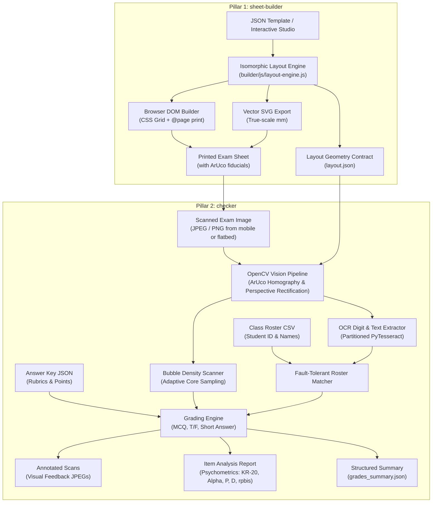
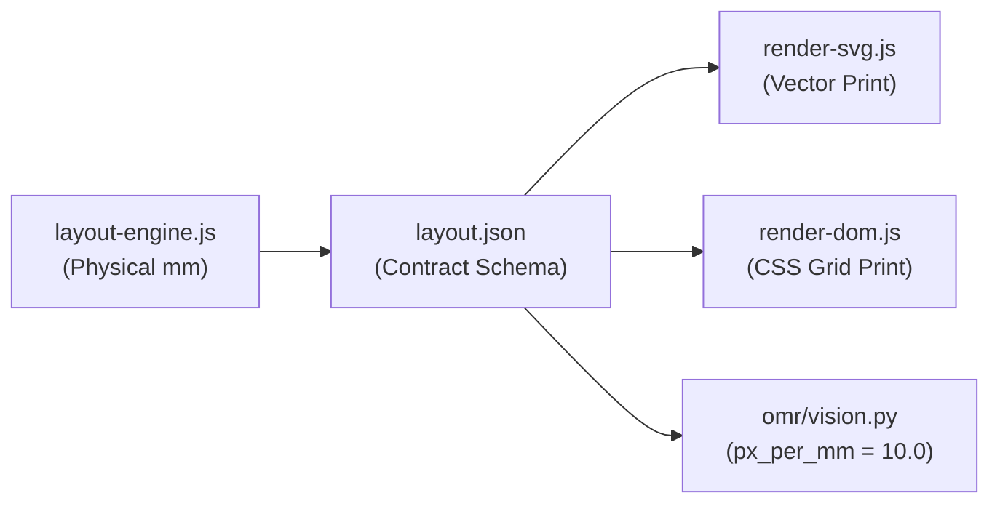

# Grader — Optical Mark Recognition (OMR) & Document Processing Pipeline

An end-to-end, millimeter-accurate Optical Mark Recognition (OMR) and document assessment system operating on standard camera photos and flatbed scanner images (JPEG, PNG).

Grader is architected into two clearly defined components:
1. **`sheet-builder`**: The browser-based visual exam sheet designer, layout engine, and zero-CORS standalone HTML editor.
2. **`checker`**: The computer vision OMR grading pipeline, OCR engine, psychometrics analyzer, CLI runner, and cloud web app (Hugging Face Spaces).

## Project Perspective

Grader is led by an instructor and shaped by practical classroom needs. The maintainer is not presenting themself as a software engineering, computer vision, OCR, or psychometrics expert. Technical methods and assessment interpretations in this project are implementation choices and areas for continued validation; they should not be read as expert-certified conclusions. The goal is to build a useful, free tool and make its assumptions and limitations understandable.

For AI coding agents and contributors, start with [`AGENTS.md`](AGENTS.md). It links to the [prioritized roadmap](ROADMAP.md), [engineering decisions and detailed architecture](DECISIONS.md), and this project overview. The current architecture overview lives in this README and the detailed specification is in `DECISIONS.md`.

---

## Architecture Overview



---

## System Components

### 1. `sheet-builder` (Visual Exam Sheet Studio & Layout Engine)
- **Zero-Dependency Architecture**: Runs in any modern browser without npm dependencies, bundling requirements, or local servers.
- **Standalone Mode (`builder/studio.html`)**: Complete single-file production bundle with inlined CSS, ArUco generators, and layout logic. Zero-CORS compatible under the `file://` protocol.
- **Isomorphic Layout Engine (`builder/js/layout-engine.js`)**: Single source of truth computing exact millimeter coordinates ($x, y, w, h$) for all bubbles, labels, and text boxes.
- **Dual Export Targets**: Generates true-scale SVG graphics and responsive DOM sheets styled with millimetric CSS Grid and `@media print` rules.
- **Cloud Hosting**: Deployed with zero backend to [GitHub Pages](docs/GITHUB_PAGES_SETUP.md).

### 2. `checker` (Computer Vision Grading Pipeline & Cloud Web App)
- **Perspective Warping (`omr/vision.py`)**: Uses 4 OpenCV ArUco markers (`DICT_4X4_50`, IDs 0–3) for subpixel homography estimation, automatically rectifying upside-down, rotated, or skewed scans.
- **Adaptive Bubble Density Sampling (`omr/vision.py`)**: Evaluates graphite fill density within an inner circular core ($72\%$ of bubble radius) to eliminate printed ring stroke interference.
- **Partitioned Cell OCR (`omr/ocr.py`)**: Suppresses boundary lines and runs Tesseract PSM 8/10 on segmented handwritten student ID cells and short-answer boxes.
- **Fault-Tolerant Roster Matching (`omr/roster.py`)**: Cascading 4-tier student ID resolution (exact $\rightarrow$ zero-normalized $\rightarrow$ wildcard inference $\rightarrow$ 1-digit Hamming recovery).
- **Psychometrics Analyzer (`omr/report.py`)**: Computes Classical Test Theory indices (Facility $P$, Kelly's Discrimination $D$, Point-Biserial $r_{pbis}$, Cronbach's $\alpha$) and compiles a standalone Jinja2 HTML report.
- **Multi-Interface Support**: Run locally via CLI (`python -m omr`) or deploy to [Hugging Face Spaces](docs/HUGGINGFACE_SPACES_SETUP.md) via Gradio 4.44.0.

---

## Project Structure

### `sheet-builder` Files
- `builder/css/app.css` — Studio UI styling, toolbar, inspector panels, and print resets.
- `builder/css/sheet.css` — Physical millimeter sheet styling and CSS Grid layout definitions.
- `builder/index.html` — Modular development editor for template preview and customization.
- `builder/studio.html` — Production standalone single-file visual designer (zero-CORS, offline).
- `builder/js/app.js` — Browser controller, library state management, and file exports.
- `builder/js/aruco.js` — Native OpenCV `DICT_4X4_50` marker bit patterns (IDs 0–3).
- `builder/js/layout-engine.js` — Core geometry engine calculating resolved millimeter coordinates.
- `builder/js/render-dom.js` — DOM / CSS Grid virtual node renderer for browser display and printing.
- `builder/js/render-svg.js` — True-scale Scalable Vector Graphic (SVG) generator.
- `builder/templates/` — Reference exam definitions (`exam-50.json`, `exam-100.json`, `quiz-tf.json`).

### `checker` Files
- `omr/__main__.py` — Entrypoint for Python package execution (`python -m omr`).
- `omr/annotator.py` — Visual grading overlay renderer creating marked-up JPEG feedback scans.
- `omr/cli.py` — Command-line interface with argument parsing and execution control.
- `omr/grading.py` — Evaluates student marks against `answer_key.json` (MCQ, T/F, fuzzy short-answer).
- `omr/layout.py` — Typed loader mapping `layout.json` millimeter coordinates to pixel sampling targets.
- `omr/ocr.py` — ROI border suppression, image preprocessing, and segmented Tesseract OCR.
- `omr/pipeline.py` — Batch processing orchestrator coordinating vision, OCR, roster, and grading.
- `omr/report.py` — Psychometrics calculation and standalone Jinja2 HTML report generator.
- `omr/roster.py` — Class roster CSV ingestion and fault-tolerant student ID resolution.
- `omr/simulator.py` — Test scan generator synthesizing realistic skew, perspective keystone, and noise.
- `omr/vision.py` — ArUco corner detection, homography perspective warping, and bubble density scanning.
- `spaces/exam-checker/` — Turnkey Gradio 4.44.0 cloud web application for Hugging Face Spaces.

### Data & Deliverables
- `data/` — Sample answer key (`bio101_key.json`), roster (`bio101_roster.csv`), and test scans (`scans/`).
- `dist/` — Headless template exports (`layout.json`, `sheet.svg`, `sheet.html`).
- `output/` — Grading deliverables (annotated JPEG scans, `grades_summary.json`, `item_analysis_report.html`).

---

## Quickstart

### 1. Installation

```bash
# Python environment for checker
python3 -m venv .venv
source .venv/bin/activate
pip install -r requirements.txt

# Node environment for sheet-builder dev tools & tests (optional)
npm install
```

### 2. Using `sheet-builder`

Launch the local development studio:
```bash
npm run dev
# Open http://localhost:3000 in your browser
```

Or open the standalone single-file studio directly in any browser:
```bash
open builder/studio.html
```

Or export template assets headlessly via Node:
```bash
npm run export:all
```
This generates `dist/<template>/` containing:
- `layout.json`: Canonical millimeter geometry consumed by the `checker` pipeline.
- `sheet.svg`: Scalable vector graphic for publishing.
- `sheet.html`: Standalone printable DOM sheet using CSS Grid and `@media print`.

### 3. Running `checker` via CLI

Grade a batch of scanned exams against an answer key and roster:
```bash
python -m omr \
  --layout dist/exam-50/layout.json \
  --key data/bio101_key.json \
  --roster data/bio101_roster.csv \
  --scans "data/scans/*.jpg" \
  --out output/
```

### 4. Running `checker` on Hugging Face Spaces

Deploy the turnkey web interface to Hugging Face Spaces for zero-install cloud grading:
- See the complete deployment guide in [`docs/HUGGINGFACE_SPACES_SETUP.md`](docs/HUGGINGFACE_SPACES_SETUP.md).
- Allows educators to upload scans, view real-time grading galleries, inspect item statistics, and download annotated scan packages in the cloud.

### 5. Running the Automated Test Suite

```bash
# Node test suite (layout-engine, standalone bundle, SVG/DOM rendering)
npm test

# Python test suite (OpenCV vision, homography, OCR, roster matching, psychometrics)
pytest -v
```

---

## Implementation Details



1. **Shared Coordinate Contract**:
   `sheet-builder`'s `layout-engine.js` computes exact bubble center coordinates `(cx, cy)` in millimeters. When exported to `layout.json`, the Python `checker` pipeline samples those exact coordinates multiplied by `px_per_mm = 10.0`. Physical print layout and computer vision sampling coordinates never drift out of sync.

2. **ArUco Perspective Transformation**:
   Four ArUco markers (`DICT_4X4_50`, IDs 0, 1, 2, 3) placed at the sheet corners provide orientation-invariant anchor points. The homography matrix $H$ is computed using subpixel corner estimation, correcting scans rotated at arbitrary angles, upside-down feeds, and mobile camera keystoning.

3. **Bubble Density Measurement**:
   Adaptive thresholding isolates pencil graphite fills. Pixel density is computed within an inner circular core ($72\%$ of bubble radius) to eliminate printed ring stroke interference, combined with contour alignment and differential margin detection.

4. **Fault-Tolerant Student ID Roster Matcher**:
   Decodes multi-column student ID matrices and matches against CSV rosters using a multi-tier fallback: Exact match $\rightarrow$ Leading-zero normalization $\rightarrow$ Wildcard inference (recovering blank/smudged columns) $\rightarrow$ Single-digit Hamming distance recovery.

5. **Handwriting OCR Extraction**:
   Preprocesses cropped regions of interest (ROI inset border suppression, bilateral filtering, and Otsu thresholding) before feeding to Tesseract OCR with character whitelist constraints.

6. **Visual Annotations & Psychometric Analysis**:
   Annotates scans with green halos for correct answers, red crosses with missed-key indicators for errors, and student score cards. Computes Facility Index ($P$), Discrimination Index ($D$), Point-Biserial Correlation ($r_{pbis}$), distractor frequencies, and Cronbach's Alpha ($\alpha$) in a Jinja2 HTML report.

---

## Cloud Deployment Guides

- **`sheet-builder` on GitHub Pages**: Detailed walkthrough in [`docs/GITHUB_PAGES_SETUP.md`](docs/GITHUB_PAGES_SETUP.md).
- **`checker` on Hugging Face Spaces**: Detailed walkthrough in [`docs/HUGGINGFACE_SPACES_SETUP.md`](docs/HUGGINGFACE_SPACES_SETUP.md).
