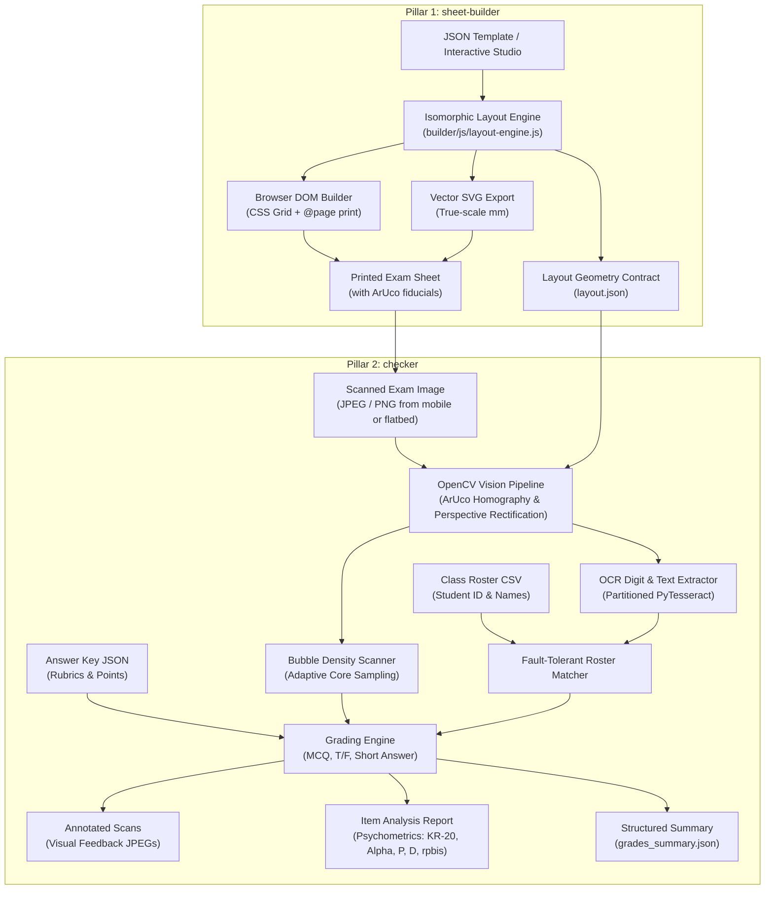

# Instructors' Toolkit — Optical Mark Recognition (OMR) & Assessment Suite

An end-to-end, millimeter-accurate Optical Mark Recognition (OMR) and document assessment system operating on standard camera photos and flatbed scanner images (JPEG, PNG).

Instructors' Toolkit is architected into two core pillars:
1. **`sheet-builder`**: The browser-based visual exam sheet designer, millimeter layout engine, and zero-CORS standalone HTML editor.
2. **`checker`**: The computer vision OMR grading pipeline, OCR engine, psychometrics analyzer, in-browser Checker Studio (`docs/checker.html`), local CLI runner, and optional cloud web app (Hugging Face Spaces).

---

## Project Perspective

Instructors' Toolkit is led by an instructor and shaped by practical classroom needs. The maintainer is not presenting themself as a software engineering, computer vision, OCR, or psychometrics expert. Technical methods and assessment interpretations in this project are implementation choices and areas for continued validation; they should not be read as expert-certified conclusions. The goal is to build a useful, free tool and make its assumptions and limitations understandable.

For AI coding agents and contributors, start with [`AGENTS.md`](AGENTS.md). It links to the [prioritized roadmap](ROADMAP.md), [engineering decisions and detailed architecture](DECISIONS.md), and this project overview. The current architecture overview lives in this README and the detailed specification is in `DECISIONS.md`.

---

## 🔒 Privacy, Security & Operating Modes

Instructors' Toolkit is designed to give instructors complete control over student data privacy and hosting costs:

| Mode | Where Code Runs | Where Data Goes | Network / Account Required | Best For |
| :--- | :--- | :--- | :--- | :--- |
| **1. Browser-Only (Offline / GitHub Pages)** | Client-side in browser (Canvas / JS) | **Never leaves device** (100% local memory & localStorage) | **None** (works offline, zero accounts) | Quick grading, FERPA compliance, zero-install setup |
| **2. Local Desktop (CLI / Local Gradio)** | Locally on user machine (Python / OpenCV) | **Never leaves computer** (local disk only) | **None** (zero cloud calls, zero accounts) | Batch grading high volume scans, automated scripts |
| **3. Cloud Web App (Hugging Face Spaces)** | Cloud container (Gradio / Linux) | Processed in cloud memory & deleted | Free Hugging Face account (recommend **Private** Space) | Shared departmental use without local Python setup |

---

## Architecture Overview



---

## System Components

### 1. `sheet-builder` (Visual Exam Sheet Studio & Layout Engine)
- **Zero-Dependency Architecture**: Runs in any modern browser without npm dependencies, build steps, or servers.
- **Standalone Single-File (`builder/studio.html`)**: Complete self-contained production bundle with inlined styles, ArUco vector generators, and layout logic. Zero-CORS compatible under the `file://` protocol.
- **Isomorphic Layout Engine (`builder/js/layout-engine.js`)**: Single source of truth computing exact millimeter coordinates ($x, y, w, h$) for all bubbles, labels, student ID grids, and text ROIs.
- **Dual Export Targets**: Generates true-scale SVG graphics and responsive DOM sheets styled with millimetric CSS Grid and `@media print` rules.
- **Hosted on GitHub Pages**: Deployed at `docs/index.html` (see [GitHub Pages Setup](docs/GITHUB_PAGES_SETUP.md)).

### 2. `checker` (OMR Computer Vision Grading Pipeline & Studio)
- **Client-Side Browser Studio (`docs/checker.html`)**: Complete zero-install in-browser grading interface hosted on GitHub Pages. Features client-side ArUco rectification, bubble fill detection, student roster matching, live sheet inspector, roster review queue, horizontal (blind) grading, and psychometric dashboards.
- **Perspective Warping (`omr/vision.py`)**: Uses 4 OpenCV ArUco markers (`DICT_4X4_50`, IDs 0–3) for subpixel homography estimation, automatically rectifying upside-down, rotated, or skewed scans.
- **Adaptive Bubble Density Sampling (`omr/vision.py`)**: Evaluates graphite fill density within an inner circular core ($72\%$ of bubble radius) to eliminate printed ring stroke interference.
- **Partitioned Cell OCR (`omr/ocr.py`)**: Suppresses boundary lines and runs Tesseract PSM 8/10 on segmented handwritten student ID cells and short-answer boxes.
- **Fault-Tolerant Roster Matching (`omr/roster.py`)**: Cascading 4-tier student ID resolution (exact $\rightarrow$ zero-normalized $\rightarrow$ wildcard inference $\rightarrow$ 1-digit Hamming recovery).
- **Psychometrics Suite (`omr/report.py`)**: Computes Classical Test Theory indices (Facility $P$, Kelly's Discrimination $D$, Point-Biserial $r_{pbis}$, Cronbach's $\alpha$) and compiles standalone Jinja2 HTML reports.
- **Multi-Interface Support**: Run via top-level CLI wrappers (`./instructor-essentials`, `./checker`, `./checker-ui`), Python module (`python -m omr`), browser (`docs/checker.html`), or cloud web app ([Hugging Face Spaces](docs/HUGGINGFACE_SPACES_SETUP.md)).

---

## Reference Exam Templates

Instructors' Toolkit includes 5 canonical exam templates covering standard classroom formats:

| Template | Path | Paper Size | Capacity & Format | Features |
| :--- | :--- | :--- | :--- | :--- |
| **Blank Canvas** | `builder/templates/blank.json` | A4 / Letter / Folio | Customizable | Minimal starter template for custom designs |
| **Exam 50** | `builder/templates/exam-50.json` | A4 (210 × 297 mm) | 50 MCQ + 10 T/F + 2 Short Answer | 8-digit Student ID grid, 2-line header, points per item |
| **Exam 100** | `builder/templates/exam-100.json` | Letter (215.9 × 279.4 mm) | 100 MCQ (4 columns × 25) | High-density layout, 8-digit Student ID grid |
| **Quiz True/False** | `builder/templates/quiz-tf.json` | Folio (215.9 × 330.2 mm) | 30 T/F + 12 Short Answer | Dual-choice T/F layout, correction hints, handwriting boxes |
| **Quiz Bonus** | `builder/templates/quiz-bonus.json` | A4 (210 × 297 mm) | 10 MCQ + 1 Bonus Challenge | Partitioned digits, challenge question, compact quiz format |

---

## Project Structure

```text
instructor-essentials/
├── builder/                  # Sheet Builder web application & templates
│   ├── css/                  # App styling and print millimeter grid CSS
│   ├── js/                   # Layout engine, ArUco generator, DOM/SVG renderers
│   ├── templates/            # Canonical exam template JSON definitions
│   ├── index.html            # Modular development studio
│   ├── studio.html           # Standalone single-file Sheet Builder (zero-CORS)
│   └── checker.html          # Standalone single-file Checker Studio (zero-CORS)
├── docs/                     # GitHub Pages deployment directory
│   ├── index.html            # Hosted Sheet Builder (= builder/studio.html)
│   ├── checker.html          # Hosted Checker Studio (= builder/checker.html)
│   ├── .nojekyll             # Disables Jekyll processing
│   ├── deploy-pages.yml.example # Template GitHub Actions deployment workflow
│   ├── GITHUB_PAGES_SETUP.md # Deployment guide for GitHub Pages
│   └── HUGGINGFACE_SPACES_SETUP.md # Deployment guide for Hugging Face Spaces
├── omr/                      # Core Python computer vision & OMR engine
│   ├── annotator.py          # Visual feedback JPEG overlay generator
│   ├── cli.py                # Command-line interface logic
│   ├── grading.py            # Scoring rules (MCQ, T/F, regex, fuzzy short-answer)
│   ├── layout.py             # Layout geometry loader and coordinate mapper
│   ├── ocr.py                # Segmented Tesseract OCR for handwriting
│   ├── pipeline.py           # Batch processing orchestrator
│   ├── report.py             # Psychometrics and standalone HTML report generator
│   ├── roster.py             # CSV class roster ingestion and fuzzy matcher
│   ├── simulator.py          # Synthetic scan generator for automated tests
│   └── vision.py             # OpenCV ArUco homography, warping, and bubble scanner
├── spaces/exam-checker/      # Turnkey Gradio 4.44.0 app for Hugging Face Spaces
├── data/                     # Sample answer keys, rosters, and scan fixtures
├── dist/                     # Headless compiled assets (layout.json, sheet.svg)
├── output/                   # Default destination for grading deliverables
├── scripts/                  # Build and development scripts
├── tests/                    # Python unit tests and Node test suites
├── instructor-essentials     # Top-level executable CLI wrapper
├── checker                   # Top-level grading CLI wrapper
├── checker-ui                # Top-level local Gradio web UI launcher
├── grader                    # Compatibility alias wrapper
├── LICENSE                   # MIT License
├── package.json              # Node dependencies, build scripts, and test config
└── pyproject.toml            # Python packaging and pytest configuration
```

---

## Quickstart

### 1. Prerequisites & Installation

```bash
# Clone the repository
git clone https://github.com/<username>/instructor-essentials.git
cd instructor-essentials

# Setup Python environment for computer vision & grading
python3 -m venv .venv
source .venv/bin/activate
pip install -r requirements.txt

# Setup Node.js (v18+) for Sheet Builder development & tests
npm install
```

### 2. Using `sheet-builder` (Designing Exam Sheets)

- **Option A: Run local dev server**:
  ```bash
  npm run dev
  # Open http://localhost:5173 in your browser
  ```
- **Option B: Open standalone studio offline**:
  ```bash
  open builder/studio.html
  ```
- **Option C: Use live on GitHub Pages**:
  Visit `https://<username>.github.io/<repository>/` (see [GitHub Pages Setup](docs/GITHUB_PAGES_SETUP.md)).
- **Option D: Export all headless layouts via Node**:
  ```bash
  npm run export:all
  ```
  Generates `dist/<template>/` containing `layout.json`, `sheet.svg`, and `sheet.html`.

### 3. Using `checker` (Grading Scanned Exams)

- **Option A: In-Browser Checker Studio (Zero Install)**:
  Open `builder/checker.html` locally or visit `https://<username>.github.io/<repository>/checker.html`.
- **Option B: Top-Level CLI Wrapper**:
  ```bash
  ./instructor-essentials \
    --layout dist/exam-50/layout.json \
    --key data/bio101_key.json \
    --roster data/bio101_roster.csv \
    --scans "data/scans/*.jpg" \
    --out output/
  ```
- **Option C: Launch Local Gradio Web Interface**:
  ```bash
  ./checker-ui
  # Opens interactive Gradio app on http://localhost:7860
  ```
- **Option D: Python Module Execution**:
  ```bash
  python -m omr \
    --layout dist/exam-50/layout.json \
    --key data/bio101_key.json \
    --roster data/bio101_roster.csv \
    --scans "data/scans/*.jpg" \
    --out output/
  ```
- **Option E: Deploy to Hugging Face Spaces**:
  See [`docs/HUGGINGFACE_SPACES_SETUP.md`](docs/HUGGINGFACE_SPACES_SETUP.md).

---

## Rebuilding & Automated Verification

To rebuild standalone bundles and verify both test suites:

```bash
# Rebuild standalone HTML apps and sync docs/ for GitHub Pages
npm run build:studio

# Run Node test suite (64 tests: layout engine, standalone bundle, DOM/SVG, checker studio)
npm test

# Run Python test suite (18 tests: OpenCV homography, OCR, roster matching, psychometrics)
pytest -v
```

---

## Cloud Deployment Guides

- **GitHub Pages (Sheet Builder & Checker Studio)**: Detailed setup in [`docs/GITHUB_PAGES_SETUP.md`](docs/GITHUB_PAGES_SETUP.md).
- **Hugging Face Spaces (Turnkey Gradio App)**: Detailed setup in [`docs/HUGGINGFACE_SPACES_SETUP.md`](docs/HUGGINGFACE_SPACES_SETUP.md).

---

## License

This project is licensed under the [MIT License](LICENSE). Core features are free and usable without required accounts, subscriptions, or paid APIs.
