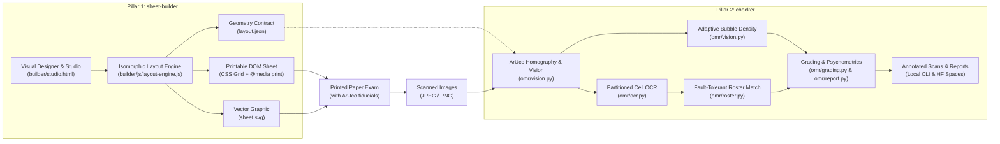
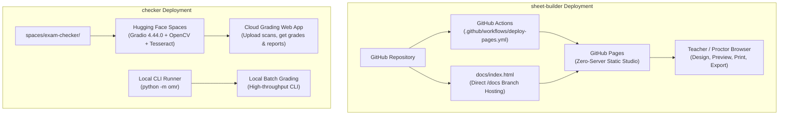
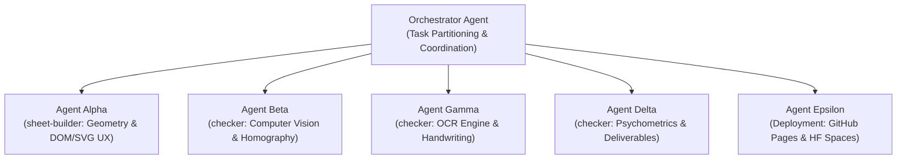

# Grader — Comprehensive Architecture, Technical Decisions & Handoff Guide

> **Audience**: AI assistants, software engineers, and future maintainers continuing development of **Grader**.
> **Last Updated**: October 2026

---

## 1. Executive Summary & Two-Pillar Philosophy

**Grader** is an end-to-end, zero-cost, millimeter-accurate Optical Mark Recognition (OMR) and document assessment system. The architecture is cleanly partitioned into two core pillars:



1. **`sheet-builder` (Frontend Designer & Layout Engine)**:
   - Zero-dependency client-side web application.
   - Fluid drag-and-drop exam designer with live millimeter page preview, property inspector controls, and automated answer-key generator.
   - Runs in any browser or standalone as a single local file (`builder/studio.html`) with zero internet connection or server required (zero-CORS).
   - Hosted with zero backend server on GitHub Pages.
2. **`checker` (Computer Vision OMR Pipeline & Assessment Engine)**:
   - High-throughput Python pipeline using OpenCV, ArUco fiducials, and PyTesseract.
   - Automatically un-skews mobile phone scans or flatbed PDF scans, grades MCQ bubbles and handwritten text, matches student rosters with fault-tolerant wildcard recovery, and produces rich psychometric item analysis reports (KR-20, Cronbach's $\alpha$, Point-Biserial $r_{pbis}$, Item Difficulty $P$).
   - Available via CLI runner (`python -m omr` / `./grader`) and turnkey cloud deployment on Hugging Face Spaces (Gradio 4.44.0).

---

## 2. Core Architectural Decisions

### 2.1 Why Zero-Dependency Vanilla ES Modules?
- **Decision**: No React, Vue, Webpack, or Tailwind in `sheet-builder`. Pure standard ES Modules and CSS variables.
- **Rationale**:
  - The studio must run when double-clicked directly in Finder/Explorer (`file://` protocol) without `npm install` or local web servers.
  - Teachers and schools frequently have locked-down computers where installing Node.js or running local servers is prohibited.
  - Zero vulnerability surface, zero maintenance debt, instant startup.

### 2.2 Dual-Mode Architecture: `index.html` vs `studio.html`
- **`builder/index.html`**: Modular development mode loading `js/app.js`, `css/sheet.css`, `css/app.css` via `<script type="module">`.
- **`builder/studio.html`**: Production standalone bundle generated by `scripts/build-standalone-studio.mjs`.
  - All CSS is inlined into `<style>` tags.
  - All JS modules (`aruco.js`, `layout-engine.js`, `render-dom.js`, `render-svg.js`, `templates.js`, `app.js`) are bundled into isolated **IIFE closures** (`const LayoutEngine = (function() { ... })()`).
  - Scoped IIFE wrapping guarantees complete encapsulation and eliminates global identifier collisions (e.g. `$` helpers).
  - `window.__SHEET_CSS__` is inlined so `getSheetCss()` never triggers a browser CORS `fetch()` error when running under `file://`.

### 2.3 Single Source of Truth for Geometry: `layout-engine.js`
- **Decision**: Bubble centroids and ROI boxes are **never** measured from browser DOM coordinates.
- **Rationale**: Browser DOM layout engines vary between platforms and zoom levels. Instead, `layout-engine.js` mathematically computes all $x, y, w, h$ coordinates in physical millimeters based on paper dimensions and margins.
- The exact same layout JSON contract (`LAYOUT_SCHEMA = 'omr-layout/1'`) drives:
  1. Virtual DOM rendering (`render-dom.js`)
  2. Printable SVG rendering (`render-svg.js`)
  3. Python OpenCV warping and centroid sampling (`omr/vision.py`)

### 2.4 Fiducial Alignment & Perspective Warping
- **Decision**: 4 OpenCV ArUco markers (`DICT_4X4_50`, IDs 0, 1, 2, 3) placed at sheet corners:
  - ID 0: Top-Left (TL)
  - ID 1: Top-Right (TR)
  - ID 2: Bottom-Right (BR)
  - ID 3: Bottom-Left (BL)
- **Rationale**: Unlike simple black squares or crosshairs, ArUco markers have distinct binary IDs. Even if a teacher feeds the exam upside-down, rotated 90°, or mirrored, OpenCV automatically detects orientation, rotates the image right-side up, and computes the exact homography matrix.

---

## 3. Supported Component Types & Features

| Zone Type | Description | Key Properties |
| :--- | :--- | :--- |
| `fields` | Student Information & ID block | `columns` (1–4), `fields: [...]`, integrated `sid` with `digits` (4–14). Suppresses header banner if `label: ""` |
| `mcq` | Multiple Choice questions | `count`, `start`, `choices` ('ABCD', 'ABCDE', etc.), `columns` (1–5), `pointsPerItem` (1–50) |
| `truefalse` | Simple True / False | `count`, `start`, `choices: ['T', 'F']`, `columns` (1–5), `pointsPerItem` (1–50) |
| `modified_tf` | Modified True / False | `count`, `start`, `choices: ['T', 'F']`, adjacent write-in correction box (`corrWidth` 20–90 mm), `columns` (1–3), `pointsPerItem` (1–50) |
| `text_short` | Short Answer Question | Compact write-in box (8–25 mm), `points` (1–50), `charset` ('any', 'digits', 'alpha') |
| `text_essay` | Essay / Long Answer | Multi-line write-in box (25–120 mm), `points` (1–50), `charset` ('any') |
| `instructions` | Instructions & Guidelines | `text`, `fontSize` (2.4, 2.8, 3.2 mm) |

---

## 4. Paper Format Specifications

All sizes are mathematically normalized in `builder/js/layout-engine.js`:

| Paper Name | Dimensions (mm) | Dimensions (inches) |
| :--- | :--- | :--- |
| **A4** | $210.0 \times 297.0$ | $8.27 \times 11.69$ |
| **US Letter** | $215.9 \times 279.4$ | $8.50 \times 11.00$ |
| **Folio / F4** | $215.9 \times 330.2$ | $8.50 \times 13.00$ |
| **Half-A4 / A5** | $148.5 \times 210.0$ | $5.85 \times 8.27$ |
| **Half-Letter** | $139.7 \times 215.9$ | $5.50 \times 8.50$ |
| **Half-Folio** | $165.1 \times 215.9$ | $6.50 \times 8.50$ |

---

## 5. UI Controls & Steppers

- **Strict Constraint**: **Zero range sliders (`<input type="range">`) in the inspector forms**.
- All numeric controls use explicit stepper inputs:
  - Decrement button: `[−]` (`.stepper-btn`)
  - Numeric input: `<input type="number" class="stepper-input">`
  - Increment button: `[+]` (`.stepper-btn`)
- Applied to:
  - Questions count & Start question number
  - Student ID digits counter ($4\text{--}14$)
  - Short / Essay box height ($8\text{--}120\,\text{mm}$)
  - Question points ($1\text{--}50\,\text{pts}$)
  - Modified True/False correction box width ($20\text{--}90\,\text{mm}$)

---

## 6. Saved Exam Builds Feature

- **Storage**: Browser `localStorage` key `'grader:saved_builds'`.
- **Saved Build Object Schema**:
  ```json
  {
    "id": "exam-build-unique-id",
    "name": "Biology Midterm Folio",
    "savedAt": "2026-10-12T16:00:00.000Z",
    "paper": "Folio",
    "questions": 50,
    "template": { "paper": "Folio", "zones": [] }
  }
  ```
- **UI Actions**:
  - **Save Build**: Persists current canvas state to library.
  - **Saved Builds Modal** (`#modal-library`): Displays cards with title, paper badge, item count, and formatted date.
  - **Load**: Restores build into editor and re-renders canvas.
  - **Export `.grader.json`**: Downloads standalone build file.
  - **Import Build File**: File picker loads any external `.grader.json` or `.json` template into storage.
  - **Delete**: Removes entry with confirmation.

---

## 7. Python Grading Pipeline (`checker`)

The `checker` engine in `omr/` executes the grading pipeline:
- `omr/vision.py`: ArUco corner homography, perspective warp, bubble density thresholding.
- `omr/ocr.py`: `process_partitioned_digits` parses digit boxes cell-by-cell without boundary bleed.
- `omr/roster.py`: Matches extracted Student ID against CSV roster. Supports exact match, single-digit typo recovery, and wildcard inference.
- `omr/grading.py`: Evaluates student choices against `answer_key.json` and tallies total points.
- `omr/annotator.py`: Generates derivative annotated JPEGs with green checks (correct) and red crosses (incorrect).
- `omr/report.py`: Produces standalone HTML report with psychometrics (Item Difficulty Index, Point-Biserial Correlation, Cronbach's Alpha).

---

## 8. CLI Commands & Quick Reference

```bash
# Run standalone zero-dependency local server (port 3000)
npm run dev

# Run automated JavaScript tests (Layout, Standalone bundle, DOM/SVG)
npm test

# Build the 100% standalone single-file HTML studio
npm run build:studio

# Run headless layout & SVG export on templates
npm run export:all

# Run Python OpenCV/OMR test suite
PYTHONPATH=. .venv/bin/pytest -v

# Run Python grading pipeline CLI (checker)
./grader --layout dist/exam-50/layout.json --key data/bio101_key.json --roster data/bio101_roster.csv --scans "data/scans/*.jpg"
```

---

## 9. Cloud Deployment Architecture



1. **GitHub Pages (`sheet-builder`)**:
   - Hosted with zero backend server directly via GitHub Pages.
   - **Automated Workflow**: [`.github/workflows/deploy-pages.yml`](../.github/workflows/deploy-pages.yml) builds `studio.html` and deploys to Pages on push to `main`.
   - **1-Click Branch Option**: [`docs/index.html`](index.html) is automatically synchronized by `npm run build:studio` so users can point GitHub Pages to `/docs` on `main`.
   - Complete guide in [`docs/GITHUB_PAGES_SETUP.md`](GITHUB_PAGES_SETUP.md).

2. **Hugging Face Spaces (`checker`)**:
   - Turnkey Gradio 4.44.0 app located in [`spaces/exam-checker/`](../spaces/exam-checker/).
   - Provides free cloud-hosted batch grading with drag-and-drop scan upload, live psychometric item analysis reports, and annotated scans download.
   - Complete guide in [`docs/HUGGINGFACE_SPACES_SETUP.md`](HUGGINGFACE_SPACES_SETUP.md).

---

## 10. Multi-Agent Development Mandate



> [!IMPORTANT]
> **Permanent Multi-Agent Policy for Grader**:
> **Always use multiple agents whenever needed and possible for this project.**
> Subagents must be invoked to parallelize tasks across specialized boundaries:
> - **Frontend/Studio Geometry (`sheet-builder`)**: `layout-engine.js`, `render-dom.js`, `render-svg.js`, CSS.
> - **Computer Vision & Grading (`checker`)**: `omr/vision.py`, `omr/ocr.py`, `omr/grading.py`.
> - **Deployment & Cloud Systems**: GitHub Pages actions, Hugging Face Spaces Gradio apps.
> - **Quality Assurance**: Automated regression verification (`npm test`, `pytest`).

---

## 11. Additional Design Decisions Log

### Decision 10: Two-Pillar Architecture Branding (`sheet-builder` & `checker`)
- **Context**: The project spans two distinct execution contexts: client-side browser layout generation and computer vision grading.
- **Decision**: Formally brand the system into two explicit pillars:
  - `sheet-builder`: The browser-based visual exam sheet designer, layout engine, and zero-CORS standalone HTML editor.
  - `checker`: The computer vision OMR grading pipeline, OCR engine, psychometrics analyzer, CLI runner, and cloud web app (Hugging Face Spaces).
- **Impact**: All documentation, architecture diagrams, CLI manuals, and deployment guides clearly attribute responsibilities to either `sheet-builder` or `checker`.

### Decision 11: Strict Mermaid-Only Diagrams Standard
- **Context**: Text-art and legacy ASCII/Unicode box-drawing characters (such as box corners, vertical dividers, horizontal connectors, arrows, and directory tree symbols) frequently break, wrap unpredictably, or fail to render across different fonts, devices, and markdown viewers.
- **Decision**: Mandate valid Mermaid syntax (```mermaid code blocks) for all architectural, workflow, sequence, deployment, and dataflow diagrams.
- **Formatting Rules**:
  - Node labels containing special characters, parentheses, or colons must be quoted: e.g. `node["Label (Details)"]`.
  - Prohibit all text-art and Unicode box-drawing characters in documentation diagrams.
  - Ensure compatibility with GitHub Flavored Markdown and standard Mermaid renderers.

### Decision 12: Side-by-Side Module Layout & Points Steppers
- **Side-by-Side Module Placement**: Modules in the drag-and-drop studio can be placed side-by-side using `layout: 'half-left'` / `layout: 'half-right'`. The layout engine mathematically assigns exact 50% millimeter width track boundaries, preserving inner module columns.
- **Points per Item Stepper**: Every gradable module has a dedicated stepper ($1..50\text{ pts}$) controlling `pointsPerItem`. The value propagates to layout coordinate outputs, live header total points stats, and pre-filled answer key downloads.
- **2-Line Student Information Header**:
  - **Line 1 (Upper)**: Student Name & Student ID (with cell-by-cell partitioned digit write-in boxes).
  - **Line 2 (Lower)**: Offer No. & Class Schedule (single consolidated field), Date, and dedicated Score box.
