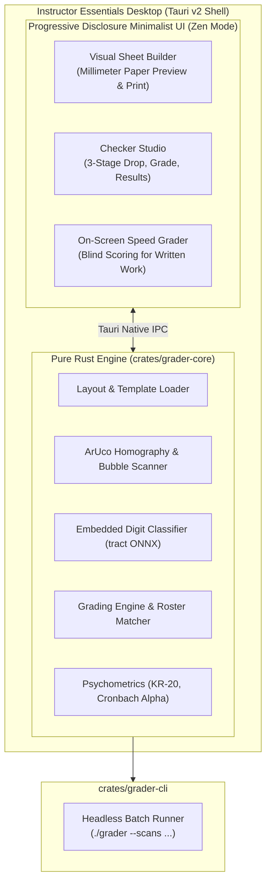

# Instructor Essentials Desktop — Architecture & Design Specification

> **Status**: Validated Design  
> **Last Updated**: October 2026  
> **Authors**: Maintainer & Antigravity  
> **Target Platform**: macOS (`.dmg`), Windows (`.msi` / `.exe`), Linux (`.deb` / AppImage)

---

## 1. Executive Summary

**Instructor Essentials Desktop** unifies the exam creation and grading lifecycle into a single, clean, standalone desktop application powered by **Tauri v2** and **Rust**.

It eliminates the historical friction of Python, `pip`, `.venv`, system OpenCV, and Tesseract dependencies for non-technical classroom instructors, while preserving 100% of the validated millimeter CSS Grid layout engine, canonical exam templates, and psychometric standards already built in the project.



---

## 2. Understanding Summary & User Constraints

* **What is being built**: A cross-platform desktop application bundling:
  1. A visual **Sheet Builder** for designing, customizing, and printing millimeter-accurate exam sheets.
  2. A high-throughput, pure-Rust **Checker Engine** for scanning, grading, review flagging, and psychometrics.
  3. An on-screen **Speed Grader** for rapid, bias-free scoring of handwritten short answers and essays.
  4. A headless **CLI executable** sharing the identical Rust core for batch automation.
* **Who it is for**: Teachers and instructors who need to create exams and grade batches of 30 to 1,000 scans quickly on their own laptops without IT administrator rights, terminal commands, or cloud subscriptions.
* **Key constraints**:
  * **Zero external C/C++ dependencies**: Pure Rust image processing (`image`, `imageproc`, `nalgebra`) without linking C++ OpenCV or Tesseract.
  * **Free, local-first & FERPA-compliant**: 100% offline, zero network requests, zero accounts, zero cloud telemetry.
  * **Lightweight distribution**: Tauri v2 leverages the OS webview (WKWebView on macOS, WebView2 on Windows), keeping installer sizes tiny (~10–15 MB) and RAM usage minimal (<80 MB).
  * **100% Contract Compatibility**: Seamlessly reads existing `layout.json` definitions, canonical templates (`exam-50`, `exam-100`, `quiz-tf`, `quiz-bonus`), answer keys, and roster CSVs.

---

## 3. Decision Log

| ID | Decision | Alternatives Considered | Rationale |
| :--- | :--- | :--- | :--- |
| **D1** | **Target Language: Rust** | Python, Go, C++, TypeScript | Single static binary distribution, zero runtime dependencies, memory safety, and 20x faster image processing throughput. |
| **D2** | **Zero C/C++ CV Dependencies** | Linking C++ OpenCV / Tesseract | Avoids massive build matrix complexity and runtime linking failures on user computers; pure Rust yields truly portable executables. |
| **D3** | **Embedded Digit OCR** | Tesseract system CLI, OMR-only | A tiny embedded ONNX model (<100KB) running on a pure-Rust runtime (`tract`) reads 8-digit handwritten student IDs without any external setup. |
| **D4** | **Form Factor: Tauri v2 Desktop** | Standalone CLI only, Native Rust GUI | Reuses the proven millimeter web layout engine and visual designer while gaining native file dialogs, direct disk exports, and OS-native printing. |
| **D5** | **Modular Cargo Workspace** | Monolithic single crate | Decouples pure vision/scoring math (`crates/grader-core`) from GUI (`apps/desktop`) and CLI (`crates/grader-cli`), speeding up tests and enabling headless batch automation. |
| **D6** | **On-Screen Speed Grader (Blind Grading)** | Physical paper score bubbles, Automated OCR guessing | Provides rapid, bias-free horizontal scoring directly on screen; eliminates flipping physical exam papers while keeping the teacher in complete control of subjective points. |
| **D7** | **100% Preservation of Existing UI & Geometry Contracts** | Rewriting frontend in a new framework | Preserves months of validated CSS Grid print formatting, millimeter scaling, and visual components, minimizing effort and risk. |
| **D8** | **Progressive Disclosure & Contextual Tooling** | All tools visible on static toolbars/panels | Prevents visual overload for instructors, creates a calm 'Quiet Luxury' interface, and guides the user naturally through their task step by step. |
| **D9** | **Deterministic Benchmarking & Transparent Flags** | Guessing uncertain marks, silent skips | Classroom grading demands trust; ambiguous marks and distorted warps must be surfaced for 1-click teacher review rather than silently guessed. |

---

## 4. Workspace Architecture

The repository will adopt a standard Cargo virtual workspace:

```text
instructor-essentials/
├── Cargo.toml                  # Virtual workspace configuration
├── crates/
│   ├── grader-core/            # Pure Rust engine (no GUI, no Tauri)
│   │   ├── Cargo.toml
│   │   └── src/
│   │       ├── layout.rs       # Ingests and validates layout.json geometry
│   │       ├── vision.rs       # Pure-Rust ArUco detection, homography & bubble scanner
│   │       ├── digit_ocr.rs    # Embedded ONNX digit model & tract inference
│   │       ├── roster.rs       # CSV ingestion & 4-tier student ID matcher
│   │       ├── grading.rs      # MCQ, True/False, and point evaluator
│   │       ├── psycho.rs       # Psychometrics (KR-20, Alpha, P, D, rpbis)
│   │       └── report.rs       # Annotated scan JPEG & CSV/JSON deliverables
│   └── grader-cli/             # Headless batch grading CLI
│       ├── Cargo.toml
│       └── src/main.rs         # Clap-based CLI (runs ./grader --scans ...)
└── apps/
    └── desktop/                # Tauri v2 Desktop App
        ├── Cargo.toml
        ├── tauri.conf.json     # Window, menu, and bundle configuration
        ├── src-tauri/
        │   └── src/
        │       ├── main.rs     # App bootstrapper
        │       └── commands.rs # Native IPC handlers (grade_batch, open_folder, etc.)
        └── ui/                 # Preserved & refined Sheet Builder + Checker Studio UI
```

---

## 5. Core Subsystem Specifications

### 5.1 Pure Rust Vision Pipeline (`grader-core/src/vision.rs`)
1. **Marker Detection**: Implements OpenCV `DICT_4X4_50` quad detection natively in pure Rust. Locates the 4 corner anchors (IDs 0–3) embedded at $(12\,\text{mm}, 12\,\text{mm})$ insets.
2. **Homography Estimation**: Computes projective transformation matrix using `nalgebra`, rectifying phone camera tilt, perspective distortion, and rotation ($90^\circ, 180^\circ, 270^\circ$).
3. **Perspective Warp**: Resamples image to canonical $10.0\,\text{px/mm}$ ($\approx 254\,\text{DPI}$) using bilinear interpolation.
4. **Adaptive Density Sampling**: Evaluates graphite fill density within an inner circular core ($72\%$ of bubble radius) to eliminate printed ring stroke interference.

### 5.2 Embedded Digit OCR (`grader-core/src/digit_ocr.rs`)
* Extracts partitioned 8-digit write-in boxes ($6.0 \times 7.5\,\text{mm}$).
* Preprocesses digits (cell boundary line suppression, centering, and $28 \times 28$ grayscale normalization).
* Runs inference via `tract-onnx` using a compiled-in model (<100KB via `include_bytes!`).
* Yields top candidate digits with confidence scores; falls back to review queue if ambiguous.

### 5.3 On-Screen Speed Grader (`apps/desktop/ui/`)
* **Trigger**: Activates automatically whenever the active layout includes short-answer (`text_short`) or essay (`text_essay`) items.
* **Blind Grading**: Hides student names and IDs to prevent grading bias.
* **Batch Question Flow**: Queues question crops horizontally across the entire student roster (grades Question 51 for all students sequentially before moving to Question 52).
* **Keyboard Flow**: Number keys (`0`, `1`, `2`, `3`) or numeric stepper award points and auto-advance immediately to the next student.
* **Score Fusion**: Automatically merges subjective written scores into the master gradebook and recalculates exam totals in real time.

### 5.4 Progressive Disclosure UI Pattern
* **Stage 1 (Calm)**: Clean, spacious canvas or single file dropzone. Advanced settings, inspector panels, and sidebars remain hidden.
* **Stage 2 (Contextual Action)**: Clicking a zone in Sheet Builder slides open the property inspector; dropping scans into Checker reveals the primary **[ Grade Scans ]** button.
* **Stage 3 (Results & Review)**: Post-grading exposes the Summary metrics, Roster Table, and Export Bar. The Review Queue and Speed Grader tabs appear *only* if flagged items or written questions exist.

---

## 6. Verification & Parity Strategy

To ensure zero regression risk, the migration follows a strict side-by-side verification protocol:
1. **Fixture Parity**: The existing 18 test scans in `data/scans/` and fixtures in `tests/` serve as the golden benchmark.
2. **Differential Test Runner**: A test script runs both the Python pipeline (`omr/`) and the Rust CLI (`grader-cli`) on identical scans.
3. **Acceptance Gate**: Rust grading outputs (scores, detected bubbles, matched IDs, KR-20 metrics) must match Python results 100% before the Rust engine is promoted to primary.
4. **Web Version Continuity**: GitHub Pages (`docs/index.html` and `docs/checker.html`) remains active as the zero-install web fallback.
