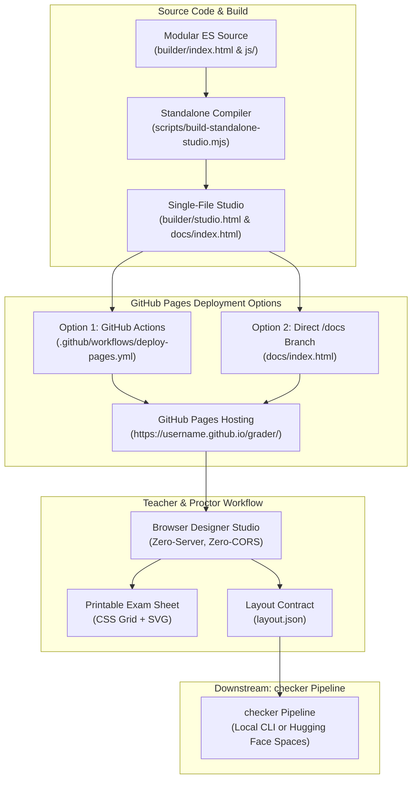

# Deploying `sheet-builder` to GitHub Pages

`sheet-builder` is the browser-based visual exam sheet designer, layout engine, and zero-CORS standalone HTML editor of the **Grader** system.

Because `sheet-builder` compiles into a self-contained bundle with inlined CSS, JS, and vector ArUco fiducial generators (`builder/studio.html`), it requires **zero backend server**, **zero database**, and can be hosted for free on GitHub Pages in seconds.

---

## Deployment & Workflow Architecture



---

## Deployment Methods

Choose either **Option 1 (GitHub Actions)** or **Option 2 (Branch `/docs` folder)** depending on your preferred workflow.

---

### Option 1: Automated Deployment via GitHub Actions (Recommended)

Grader includes a GitHub Actions workflow in [`.github/workflows/deploy-pages.yml`](../.github/workflows/deploy-pages.yml) that automatically compiles and deploys `sheet-builder` on every push to the `main` branch.

#### Setup Steps:
1. Open your repository on GitHub.
2. Navigate to **Settings** > **Pages** (under the "Code and automation" section).
3. Under **Build and deployment** > **Source**, select:
   ```text
   GitHub Actions
   ```
4. Push a commit to the `main` branch, or trigger the workflow manually:
   - Go to the **Actions** tab in your repository.
   - Click **Deploy Grader Studio to GitHub Pages** in the left sidebar.
   - Click **Run workflow** > select branch `main` > **Run workflow**.
5. Once completed, your live site URL will be displayed at the top of the **Settings > Pages** page:
   ```text
   https://<username>.github.io/<repository>/
   ```

---

### Option 2: 1-Click Deployment from `/docs` Folder

If you prefer deploying directly from a branch folder without configuring GitHub Actions:

Grader automatically maintains a standalone, self-contained build at [`docs/index.html`](index.html).

#### Setup Steps:
1. Open your repository on GitHub.
2. Navigate to **Settings** > **Pages**.
3. Under **Build and deployment** > **Source**, select:
   ```text
   Deploy from a branch
   ```
4. Set the branch and folder:
   - Branch: `main` (or your default branch)
   - Folder: `/docs`
5. Click **Save**.
6. GitHub Pages will deploy the `/docs` directory within 1–2 minutes. Access your studio at:
   ```text
   https://<username>.github.io/<repository>/
   ```

---

## Local Verification & Building

To rebuild the standalone `sheet-builder` studio locally before pushing:

```bash
# Rebuild builder/studio.html and docs/index.html
npm run build:studio

# Run bundle test suite
npm test
```

You can test the generated studio simply by opening `docs/index.html` or `builder/studio.html` directly in your browser (`file:///` protocol) — no web server is required.

---

## Features Available on GitHub Pages

When accessed through GitHub Pages, `sheet-builder` provides complete functionality:
- Interactive layout designer (columns, questions, student ID grid, text response ROIs, scoring scales).
- Live real-time visual preview of exam sheets with fiducial ArUco alignment markers.
- Built-in templates: `exam-50`, `exam-100`, and `quiz-tf`.
- Side-by-side module placement with automatic width partitioning.
- Points-per-item stepper controls that synchronize directly with total score counters.
- 1-click export of:
  - Printable Exam Sheet HTML & SVG
  - Machine-readable `layout.json` (consumed by the Python `checker` grading pipeline)
  - Pre-filled `answer_key.json`
