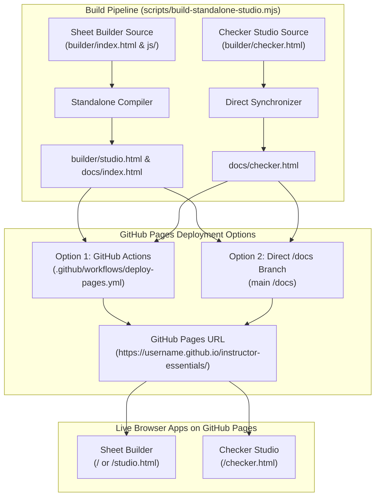

# Deploying Instructor Essentials to GitHub Pages

GitHub Pages hosts the zero-dependency, client-side web application suite of **Instructor Essentials**:

1. **`sheet-builder` (`index.html` / `studio.html`)**: The visual exam sheet designer, millimeter layout engine, and template generator.
2. **`checker` (`checker.html`)**: The complete in-browser Optical Mark Recognition (OMR) grading studio, student roster matcher, interactive sheet inspector, psychometrics dashboard with Bloom's taxonomy analysis, and offline session manager.

Because both applications compile into 100% standalone single-file HTML bundles with zero external dependencies, **zero backend server**, and **zero cloud tracking**, they can be hosted for free on GitHub Pages and run entirely within the instructor's web browser.

---

## 🔒 Privacy & Offline Security Guarantees

- **100% Client-Side Processing**: All image processing, bubble detection, OCR, and psychometric computations execute locally on your device via HTML5 Canvas and JavaScript.
- **Zero Cloud Uploads**: Student photos, roster names, student IDs, and test scores are never transmitted across the network.
- **Standalone `file://` Protocol Support**: Both applications can be downloaded and opened directly in any browser (by double-clicking `studio.html` or `checker.html`) completely offline without an internet connection.

---

## Deployment & Workflow Architecture



---

## Deployment Methods

Choose either **Option 1 (GitHub Actions)** or **Option 2 (Branch `/docs` folder)** depending on your preferred workflow.

---

### Option 1: Automated Deployment via GitHub Actions (Recommended)

Instructor Essentials provides a ready-to-use GitHub Actions workflow template in [`docs/deploy-pages.yml.example`](deploy-pages.yml.example). Copy this file to `.github/workflows/deploy-pages.yml` in your repository to automatically compile and stage both `sheet-builder` and `checker` on every push to the `main` branch.

#### Setup Steps:
1. Open your repository on GitHub.
2. Navigate to **Settings** > **Pages** (under the "Code and automation" section).
3. Under **Build and deployment** > **Source**, select:
   ```text
   GitHub Actions
   ```
4. Push a commit to the `main` branch, or trigger the workflow manually:
   - Go to the **Actions** tab in your repository.
   - Click **Deploy Instructor Essentials to GitHub Pages** in the left sidebar.
   - Click **Run workflow** > select branch `main` > **Run workflow**.
5. Once completed, your live site URLs will be active:
   - **Sheet Builder**: `https://<username>.github.io/<repository>/` (or `/studio.html`)
   - **Checker Studio**: `https://<username>.github.io/<repository>/checker.html`

---

### Option 2: 1-Click Deployment from `/docs` Folder

If you prefer deploying directly from a branch folder without GitHub Actions:

Instructor Essentials automatically maintains synchronized, self-contained standalone builds in the [`docs/`](.) folder:
- [`docs/index.html`](index.html) — Sheet Builder
- [`docs/checker.html`](checker.html) — Checker Studio
- [`docs/.nojekyll`](.nojekyll) — Disables Jekyll processing

#### Setup Steps:
1. Open your repository on GitHub.
2. Navigate to **Settings** > **Pages**.
3. Under **Build and deployment** > **Source**, select:
   ```text
   Deploy from a branch
   ```
4. Set the branch and folder:
   - Branch: `main` (or your default branch)
   - Folder: `/docs`
5. Click **Save**.
6. GitHub Pages will deploy the `/docs` directory within 1–2 minutes. Access your applications at:
   - `https://<username>.github.io/<repository>/` (Sheet Builder)
   - `https://<username>.github.io/<repository>/checker.html` (Checker Studio)

---

## Local Verification & Building

To rebuild both standalone web applications locally:

```bash
# Rebuild builder/studio.html, docs/index.html, and sync docs/checker.html
npm run build:studio

# Run all test suites (JS & Python)
npm test
pytest -v
```

You can test either app locally simply by opening `docs/index.html` or `docs/checker.html` directly in your browser (`file:///` protocol) — no web server is required.

---

## Features Available on GitHub Pages

### Sheet Builder (`index.html` / `studio.html`)
- Interactive layout designer (columns, questions, student ID bubble grid, handwritten text ROIs, scoring scales).
- Live real-time visual preview of exam sheets with true-scale ArUco alignment markers.
- 5 built-in presets:
  - `blank.json` — Minimal starting canvas for custom assessments
  - `exam-50.json` — 50 MCQ + T/F + Short Answer on A4
  - `exam-100.json` — 100 MCQ on US Letter
  - `quiz-tf.json` — 30 True/False + 12 Short Answer items on Folio
  - `quiz-bonus.json` — 10 MCQ with bonus point challenge
- Side-by-side module placement with automatic width partitioning.
- Points-per-item stepper controls that synchronize directly with total score counters.
- 1-click export of:
  - Printable Exam Sheet HTML & SVG (CSS Grid + `@media print` true-scale mm)
  - Layout Geometry Contract (`layout.json`) consumed by Python & browser checkers
  - Pre-filled Answer Key (`answer_key.json`)
  - Complete Exam Package ZIP containing all assets

### Checker Studio (`checker.html`)
- In-browser computer vision OMR pipeline with 4-corner ArUco rectification.
- Adaptive bubble density scoring and handwritten digit OCR extraction.
- Fuzzy roster matching against CSV student rosters with interactive mismatch resolution.
- Live Sheet Inspector with visual green/red overlay inspection.
- Roster review queue with stepper navigation and manual verification flags.
- Horizontal (item-by-item) blind rapid grading with keyboard shortcuts (`A`, `U`, `P`, `R`).
- Full psychometrics dashboard:
  - Classical Test Theory indices (Mean, Std Dev, Median, Facility $P$, Discrimination $r_{\text{pbis}}$)
  - Cronbach's Alpha ($\alpha$ / KR-20) internal consistency reliability
  - Bloom's Revised Taxonomy cognitive distribution analysis
  - Interactive Bell Curve histogram with score cutoffs
- Multi-format exports:
  - Graded summary CSV with safe cell quoting
  - Standalone Jinja2-style HTML psychometrics report
  - Annotated scan images ZIP
  - Local auto-save session recovery (`localStorage`)
