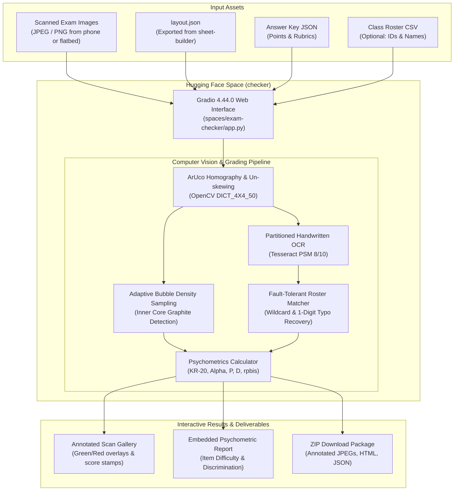
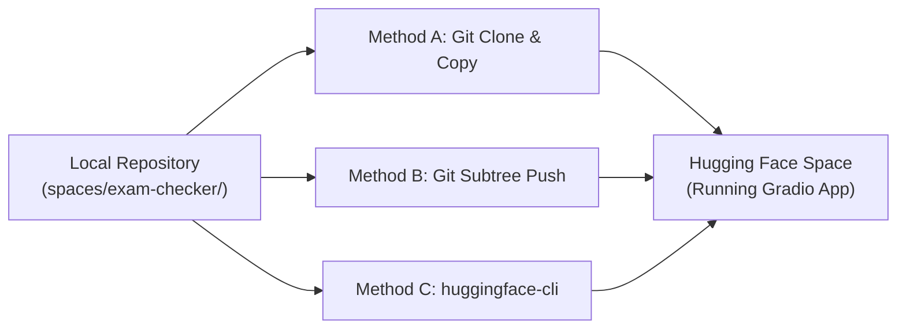

# Deploying Instructor Essentials Checker to Hugging Face Spaces

The directory [`spaces/exam-checker/`](../spaces/exam-checker/) contains a complete, ready-to-deploy cloud web application for the **`checker`** component of Instructor Essentials, powered by **Gradio 4.44.0**.

It provides educators, professors, and exam proctors with a zero-install interactive web application to upload scanned exam sheets, evaluate them against custom answer keys and class rosters, inspect live psychometric item analysis reports, and download visually marked exam scans directly in the cloud.

---

## Cloud Processing Architecture



---

## Prerequisites
- A [Hugging Face](https://huggingface.co) account.
- A Hugging Face User Access Token (with `write` permission) if using Git CLI or the Hugging Face Hub CLI.

---

## Step 1: Create a New Space on Hugging Face

1. Go to [huggingface.co/new-space](https://huggingface.co/new-space).
2. Configure your Space:
   - **Space name**: `grader-exam-checker` (or your preferred name)
   - **License**: `mit`
   - **Select the Space SDK**: **Gradio**
   - **Gradio template**: Blank
   - **Space hardware**: `CPU basic` (2 vCPU · 16 GB RAM — Free tier)
   - **Visibility**: **Private** (strongly recommended when handling student records, FERPA-regulated rosters, or real classroom scans) or Public
3. Click **Create Space**.

---

## Step 2: Push `spaces/exam-checker` to Your Space

Choose whichever deployment method fits your workflow:



### Method A: Git Clone & Copy (Recommended)

Clone your newly created Hugging Face Space, copy the contents of `spaces/exam-checker/` into it, and push:

```bash
# 1. Clone your HF Space repository
git clone https://huggingface.co/spaces/<your-username>/grader-exam-checker hf-space

# 2. Copy the exam-checker files into the HF Space directory
cp -r spaces/exam-checker/* hf-space/

# 3. Commit and push to Hugging Face
cd hf-space
git add .
git commit -m "Deploy Grader Exam Checker"
git push
```

### Method B: Git Subtree Push (Single Command)

If you have Git credentials configured for Hugging Face:

```bash
# Add Hugging Face Space as a remote
git remote add hf-space https://huggingface.co/spaces/<your-username>/grader-exam-checker

# Push the spaces/exam-checker directory directly to main
git subtree push --prefix spaces/exam-checker hf-space main
```

### Method C: Hugging Face Hub Python CLI

Using `huggingface_hub`:

```bash
# Install CLI and authenticate
pip install huggingface_hub
huggingface-cli login

# Upload directory directly to your Space
huggingface-cli upload <your-username>/grader-exam-checker spaces/exam-checker . --repo-type space
```

---

## Step 3: Automated Build & Launch

Once pushed, Hugging Face automatically handles the build process:
1. **Container Setup**: Reads [`packages.txt`](../spaces/exam-checker/packages.txt) to install Debian system dependencies (`tesseract-ocr`).
2. **Python Dependencies**: Reads [`requirements.txt`](../spaces/exam-checker/requirements.txt) to install Gradio, OpenCV Headless, NumPy, PyTesseract, Jinja2, SciPy, and Pandas.
3. **App Launch**: Reads the YAML metadata in [`README.md`](../spaces/exam-checker/README.md) and launches `app.py`.

Within 1–2 minutes, your Space status will turn green (**Running**), and the interactive `checker` UI will be live!

---

## Step 4: Using the Deployed Exam Checker

### 1. Test with the Built-in Sample
- Click **"⚡ Pre-fill Inputs with Sample Files"** or directly click **"🔍 Grade Scanned Exams with Checker"**.
- The Space automatically evaluates the included 10 sample scans from the 50-item BIO 101 Midterm examination.
- Within 2–3 seconds, you will see:
  - **Cohort Overview Cards:** Total exams, class mean score, pass rate, and Cronbach's $\alpha$ test reliability.
  - **Student Roster & Scores:** Individual student names, scores, percentages, and pass/fail statuses.
  - **Annotated Visual Gallery:** Scanned exam sheets marked up with green outlines for correct answers and red markers for incorrect selections.
  - **Interactive Item Analysis Report:** An embedded interactive report detailing item difficulty index ($P$), point-biserial discrimination ($r_{\text{pbis}}$), and distractor distributions.
  - **Download Buttons:** 1-click downloads for the full ZIP archive of annotated sheets, the standalone HTML report, and summary JSON.

### 2. Grade Custom Exams
1. In `sheet-builder` ([GitHub Pages Setup](GITHUB_PAGES_SETUP.md)), design your sheet and export `layout.json`.
2. Prepare an answer key JSON file (e.g. `{"title": "Exam 1", "items": {"1": {"kind": "mcq", "answer": "B", "points": 1.0}}}`).
3. Optional: Prepare a student roster CSV with `Student ID` and `Full Name` columns.
4. Scan your filled exam sheets (JPEG or PNG) using any document scanner or phone camera.
5. Upload these files to your Hugging Face Space and click **"🔍 Grade Scanned Exams with Checker"**.

---

## Optional: Continuous Deployment via GitHub Actions

You can automatically sync updates to your Hugging Face Space whenever you push to GitHub:

1. In your Hugging Face account settings, create an access token with **Write** role at [huggingface.co/settings/tokens](https://huggingface.co/settings/tokens).
2. In your GitHub repository, go to **Settings** > **Secrets and variables** > **Actions** and add a secret:
   - Name: `HF_TOKEN`
   - Value: `<your-huggingface-token>`
3. Create `.github/workflows/sync-to-hf.yml`:

```yaml
name: Sync to Hugging Face Spaces

on:
  push:
    branches: [main]
    paths:
      - 'spaces/exam-checker/**'
  workflow_dispatch:

jobs:
  sync-to-hub:
    runs-on: ubuntu-latest
    steps:
      - uses: actions/checkout@v4
        with:
          fetch-depth: 0
      - name: Push to HF Space
        env:
          HF_TOKEN: ${{ secrets.HF_TOKEN }}
        run: |
          git subtree split --prefix=spaces/exam-checker -b hf-space-branch
          git push https://<your-username>:$HF_TOKEN@huggingface.co/spaces/<your-username>/grader-exam-checker hf-space-branch:main --force
```
