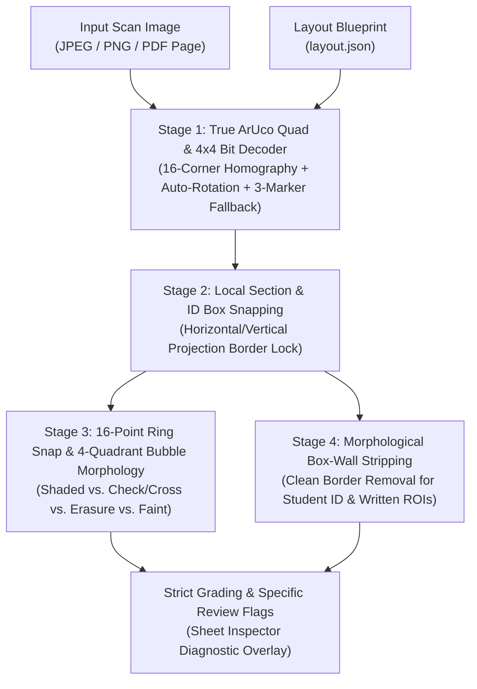

# Smarter Fiducial, Box, and Circle Detection — Architecture & Design Specification

> **Status:** Validated Design (Ready for Implementation)  
> **Scope:** Browser Checker Studio ([`builder/checker.html`](../builder/checker.html), [`docs/checker.html`](checker.html)) & Python OMR Engine ([`omr/vision.py`](../omr/vision.py), [`omr/ocr.py`](../omr/ocr.py))  
> **Updated:** October 2026

---

## 1. Understanding Summary

- **What is being built:** A 4-stage "Coarse-to-Fine" computer vision detection pipeline across both the Browser Checker Studio and the Python OMR Engine that detects ArUco corner markers, section/ID rectangular boxes, and option circles using geometric verification and spatial morphology.
- **Why it exists:**
  - The browser studio previously located corners by averaging dark pixels in the outer 16% of each image quadrant, which could be thrown off by desk edges, shadows, staples, or rotated scans.
  - Global 4-corner perspective warping alone cannot fully compensate for middle-of-the-page paper curl or slight printer scaling ("Fit to Page").
  - Simple average-darkness bubble thresholds cannot distinguish properly shaded bubbles from checkmarks ($\checkmark$), crosses ($\times$), or erased smudges.
  - Blindly cropping 15% off the edges of Student ID and short-answer boxes clips handwritten strokes that touch the box border or leaves residual border lines that confuse OCR.
- **Classroom Grading Rule (Strict Shading Policy):** Only properly shaded bubbles are automatically awarded points. Non-standard marks (checkmarks $\checkmark$, crosses $\times$, erasure smudges, or faint borderline marks) are **not** silently credited or silently discarded—they are flagged as `Needs Review` with an explicit, human-readable reason so the instructor stays in control.
- **Who it is for:** Instructors grading scanned or photographed exam sheets (flatbed scans, multi-page PDFs, or mobile camera photos) offline in the browser or locally via Python.
- **Key Constraints:**
  - 100% free, offline-capable, and zero-CORS compatible (single-file bundle in [`builder/checker.html`](../builder/checker.html) with no paid APIs or mandatory servers).
  - Keeps **ArUco corner fiducials + `layout.json`** as the primary coordinate contract so item numbering and multi-column layouts never rely on blind guessing.
- **Explicit Non-Goals:**
  - Not removing ArUco markers or attempting template-free layout guessing on arbitrary third-party forms.
  - Not silently auto-crediting checkmarks, crosses, or erasures without instructor review.

---

## 2. Non-Functional Assumptions

1. **Performance:** Batch grading in the browser remains under ~100–200 ms per scan on a standard laptop without blocking the UI thread.
2. **Scale:** Supports typical classroom batches of 20 to 200 scans per session (JPEG, PNG, or multi-page PDF).
3. **Privacy & Security:** All image processing and grading execute 100% locally in browser memory or on the local disk; no student data leaves the device.
4. **Reliability & Fallback:** Automatically recovers $90^\circ/180^\circ/270^\circ$ scan rotations and reconstructs a 4th corner marker if 1 marker is obscured (e.g., by a staple or thumb). If $\le 2$ markers are found or geometry is severely distorted, the scan is explicitly flagged for review rather than graded with misaligned coordinates.
5. **Maintainability:** Implemented in clean, dependency-free JavaScript (`builder/checker.html`) and OpenCV/NumPy (`omr/vision.py`, `omr/ocr.py`), verified by `npm test` and `pytest`.

---

## 3. Final Design: 4-Stage Coarse-to-Fine Pipeline

### Stage 1: True ArUco Square & $4\times4$ Bit-Grid Decoder
- **Candidate Detection:** In each corner search region (and full-page orientation check when needed), locate dark connected quadrilateral contours with aspect ratio and area matching expected fiducial markers.
- **Bit-Grid Verification (`DICT_4X4_50`):** Sample the internal $6\times6$ grid ($1$-bit black border + $4\times4$ internal data bits) against the canonical bit patterns for Marker IDs `0, 1, 2, 3`.
- **Orientation & 16-Corner Homography:**
  - Identify if the sheet is rotated ($0^\circ, 90^\circ, 180^\circ, 270^\circ$) from marker ID positions and bit orientations, rotating automatically.
  - Fit the perspective homography matrix using all **16 marker corners** (or 4 verified subpixel marker centroids + corner vectors in JS).
- **3-Marker Parallelogram Recovery:** If 3 of 4 markers are verified and 1 is obscured, estimate the missing 4th marker via affine parallelogram completion ($\text{TL} + \text{BR} = \text{TR} + \text{BL}$) and record a review note (`"Aligned using 3 of 4 corner markers"`). If $\le 2$ markers are found, flag the sheet (`Needs Review: Corner markers not clearly visible`).

### Stage 2: Local Section Box & Student ID Grid Snapping
- **Problem Solved:** Compensates for $1\text{–}2.5\text{ mm}$ middle-of-the-page drift caused by bowed paper or slight print scaling.
- **Mechanism:**
  - For each rectangular zone or group cluster (`mcq`, `truefalse`, `student_id`, `text_short`), inspect a small $\pm 3.0\text{ mm}$ search band around the expected zone bounding box (`x, y, w, h`) or bubble column headers.
  - Compute horizontal and vertical dark-pixel projection profiles to detect the printed rectangular border lines (or aligned bubble column/row axes) and apply a local translation offset $(\Delta x, \Delta y)$ clamped to a safe maximum ($\le 2.5\text{ mm}$) before sampling individual items.

### Stage 3: Ring-Locked, 4-Quadrant Bubble Morphology
For each option bubble (`A–E`, `T/F`, or `sid` bubble):
1. **16-Point Circumference Ring Snap:** Search within $\pm 1.5\text{ mm}$ of the locally adjusted center by sampling 16 points along the expected printed circle radius $r$ to lock onto the physical printed ring `(optSx, optSy)`.
2. **Local Paper Halo Normalization:** Measure background luminance in the immediate white paper annulus ($1.15r \text{ to } 1.40r$) surrounding that specific bubble to immunize against uneven desk shadows.
3. **4-Quadrant & Center-Crosshair Decomposition:** Inside the inner core ($0.70r$), compute:
   - **Core Fill Density ($D$):** Contrast-normalized fill ratio across the inner core.
   - **Quadrant Densities ($Q_{TL}, Q_{TR}, Q_{BL}, Q_{BR}$):** Fill density in each of the 4 quarters of the circle.
   - **Uniformity / Balance Ratio ($U$):** Number of quadrants exceeding active fill threshold and ratio of median-to-peak quadrant density, plus center-stroke concentration.
4. **Classification & Strict Classroom Grading:**
   - **`shaded` (Auto-Scored):** $D \ge \text{bubbleThreshold}$ **and** balanced coverage across at least 3 of 4 quadrants ($U$ meets uniformity threshold).
   - **`check_or_cross` (Flagged, Not Auto-Scored):** Localized high-contrast dark stroke crossing the center/ring with lopsided quadrant distribution (e.g., 1–2 quadrants or thin diagonal crosshairs dark while outer quadrants remain hollow). Resolved as `BLANK`/`?` for auto-scoring and flagged: `Needs Review: Non-standard mark (Check/Cross) on Q#`.
   - **`erasure` (Flagged, Not Silently Guessed):** Two bubbles in the same question row show elevated density where one is clearly shaded ($D_1 \ge \text{threshold}$) and a second bubble has a uniform grey smudge ($0.14 \le D_2 < D_1$, or two marks present with erasure profile). Flagged: `Needs Review: Possible erasure on Q#`.
   - **`faint` (Flagged):** Highest bubble in an otherwise blank row has moderate density ($0.13 \le D < \text{threshold}$) and stands out above row peers ($\Delta \ge 0.08$). Flagged: `Needs Review: Faint mark on Q#`.

### Stage 4: Morphological Box-Wall Stripping for OCR (`omr/ocr.py` & `checker.html`)
- **Problem Solved:** Prevents clipping student handwriting at the edges of Student ID digit cells and short-answer boxes while eliminating printed box borders that look like `1`, `7`, or `I`.
- **Mechanism:**
  - Instead of an aggressive 15% blind inset crop, use a minimal 3–5% safety inset and scan the outer 20% perimeter of each cell/box for continuous straight horizontal or vertical dark runs spanning $>75\%$ of the cell width or height.
  - Replace detected straight border lines with background white (`255`) while keeping any connected handwriting strokes that cross into the interior intact.

---

## 4. Decision Log

| # | Decision | Alternatives Considered | Rationale |
| :--- | :--- | :--- | :--- |
| 1 | **4-Stage Coarse-to-Fine Native CV Pipeline** | Bundling 9 MB OpenCV.js WASM; Tiny CNN/ONNX neural network | Preserves fast (`<100 ms`/scan), lightweight (~550 KB), 100% offline (`file://`) execution in `checker.html` and full transparency in `omr/vision.py`. |
| 2 | **Strict Shading Policy with Explicit Review Flags** | Silently accepting $\checkmark/\times$; silently treating $\checkmark/\times$ as blank with no flag | Upholds classroom instructions to shade bubbles completely while ensuring instructors are alerted to every checkmark, cross, faint mark, or erasure in the Review Queue. |
| 3 | **Local Section Box & Row Projection Snapping** | Global 4-corner homography only | Corrects $1\text{–}2.5\text{ mm}$ middle-of-the-page drift from bowed paper or printer scaling before sampling bubbles. |
| 4 | **Perimeter Line Morphology for Box Cropping** | Blind 15% border inset cropping | Removes printed box borders without slicing off the edges of student handwritten digits. |

---

## 5. Architectural Recommendation: Addressing Sheet Warping via Multi-Fiducial Registration

### 5.1 Physical Problem Analysis
In standard classroom usage, exam sheets frequently exhibit physical distortion that violates the planar assumption of a single global $3 \times 3$ homography matrix $H$:
1. **Vertical Paper Sag & Barrel Distortion**: Phone cameras held at slight angles or thin paper ($70\text{--}80\text{ gsm}$) curling across desks exhibit cylindrical 1D curvature, leading to $2\text{--}5\text{ mm}$ displacement along the vertical midline ($y \approx 50\%$).
2. **Printer Feed Skew**: Mechanical roller drag on budget classroom printers can stretch or compress paper non-linearly along the sheet length.
3. **Small Bubble Margin**: Standard $2.1\text{ mm}$ bubbles require registration accuracy within $\pm 0.8\text{ mm}$ to ensure sampling circles stay firmly inside the printed rings. A $2.5\text{ mm}$ sag causes outer quadrant clipping and false positive/negative shade reads.

### 5.2 Recommended Multi-Fiducial Strategies
To eliminate warping without requiring neural network dewarping models (e.g., DewarpNet/DocTr which add 50+ MB weights), the following incremental hardware-layout additions are recommended:

1. **Midline Lateral Fiducials (6-Point Registration — Primary Recommendation)**:
   - Place two additional ArUco fiducials along the left and right page margins at $50\%$ page height:
     - **Marker 4 (Mid-Left)**: $x = 12\text{ mm}, y = 148.5\text{ mm}$ (A4).
     - **Marker 5 (Mid-Right)**: $x = 198\text{ mm}, y = 148.5\text{ mm}$ (A4).
   - **Piecewise Homography**:
     - Upper half rectified using markers $[0, 1, 5, 4]$.
     - Lower half rectified using markers $[4, 5, 2, 3]$.
   - **Benefit**: Reduces midline vertical distortion by over $90\%$, operating in pure 2D matrix arithmetic with $< 5\text{ ms}$ compute overhead.

2. **Column Header Anchor Crosses**:
   - For 2-column or 3-column exams, print $4\text{ mm}$ registration crosshairs above and below each question column.
   - Allows local affine calibration per column, compensating for asymmetric paper curl across wide portrait pages.

3. **Margin Timing Tracks (Scantron-style Sync)**:
   - A vertical column of alternating $3\text{ mm}$ tick marks along the margin providing independent row-by-row $Y$-synchronization for every individual question.
